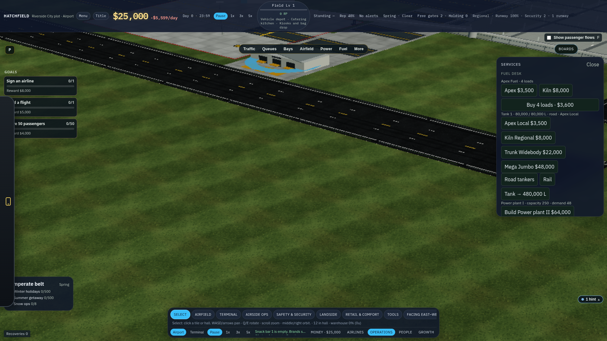
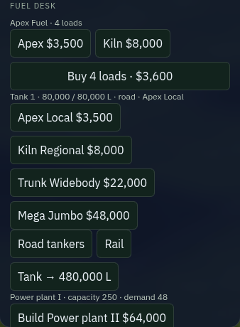
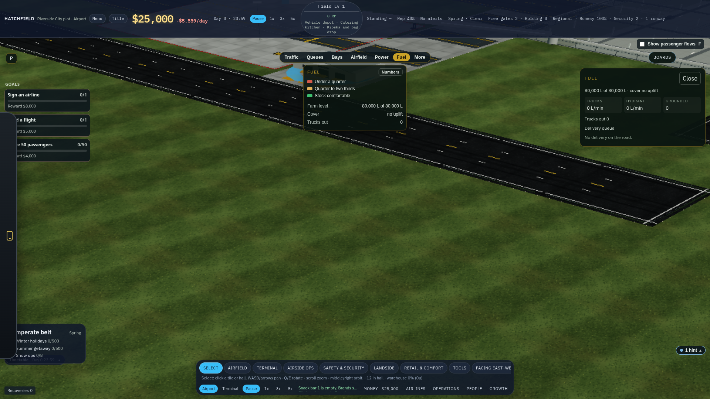
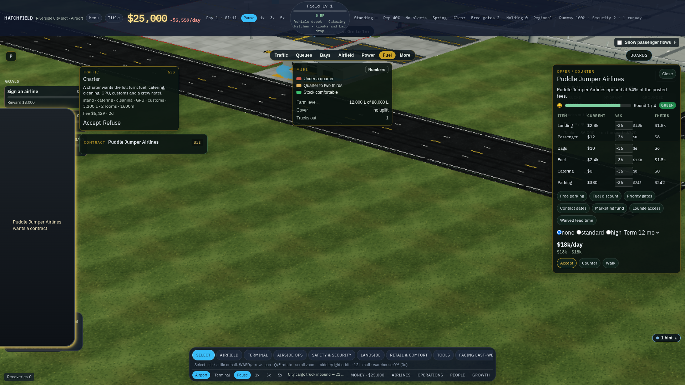
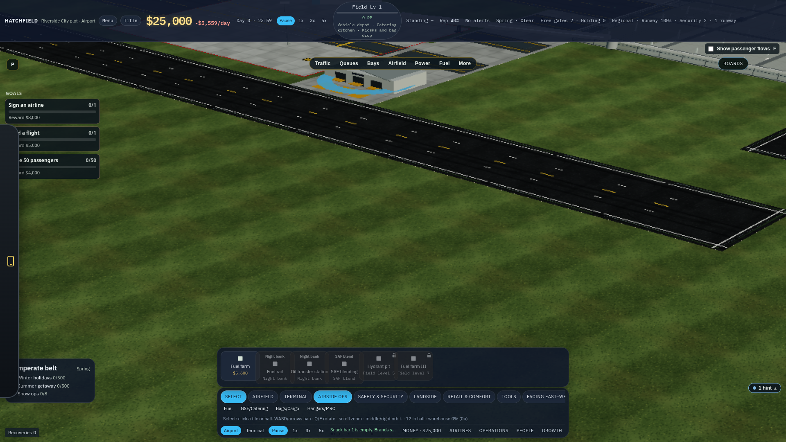
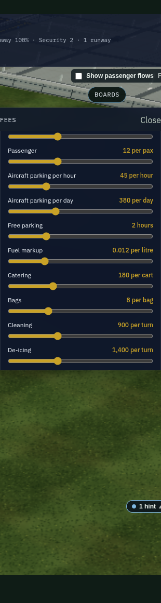
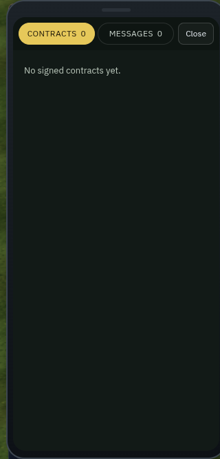
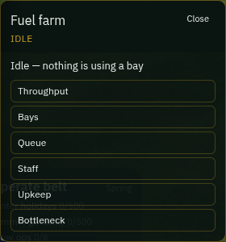

# Fuel contracts

A fuel contract should be a truck you can watch, a price you agreed to, and a wing that does not leave until the hose is done. This note audits the desk as it was on 15 Oct 2026, checks it against how airports actually buy jet fuel, and sets the progression from a single road tanker to a pipeline.

Phase 1 is in the game. The starter no longer signs a term or fills the tank. A spot card orders one Apex road tanker into `tankLitres`. A signed term auto-orders at its price, bills the untaken band at midnight, and sets the brand the wing bill reads. The fuel rack, the services desk, the phone, and the farm card show supplier, price, and band. Stamp badges for the fuel rail and the oil station now say Fuel rail, the line, and the station. A hydrant pit is stamped on a stand: that stand draws by hydrant only when it has a pit and a dispenser, and the stand card says hydrant or bowser. Each supplier has a standing meter. It moves that supplier's differential, and the spot card shows the index before you accept. The logistics farm purchase price is quarantined at $0 so it cannot debit the bank. A pipeline is a painted line and a receipt manifold: flow uses the rail connection rule, the open manifold takes $0.008/L off the term, and a quality hold stops the batch for 6 game hours with a spot-truck card. The listed Jet-A cash spike is retired. Rail takes $0.004/L off the term while the spur is connected. The barge berth and the into-plane split are still ahead. Numbers below are the 15 Oct audit, plus the proposed column the build is following.

Shots are a passenger starter kit, sandbox off, paused, desktop 1920×1080. The tanker frame is the same field after the tank was drawn down to 12,000 L and the clock ran 18 half-second ticks, so the lead time was still open.

## 1. What the game does today

### Where it appears

**Operations → Services → Fuel desk.** This is the only place a player can sign a supplier or buy fuel. The starter kit has already signed both copies of the cheap contract, filled the tank to the cap, and parked four bowser loads. The buttons for the bigger contracts are on the same row. Power, bags, and the vehicle shop sit underneath the same heading.

The panel text on that shot:

> Apex Fuel · 4 loads. Apex $3,500. Kiln $8,000. Buy 4 loads · $3,600. Tank 1 · 80,000 / 80,000 L · road · Apex Local. Apex Local $3,500. Kiln Regional $8,000. Trunk Widebody $22,000. Mega Jumbo $48,000. Road tankers. Rail. Tank → 480,000 L.

**Fuel info view.** The Fuel pill, then the numbers button, opens the farm panel. It shows litres, days of cover, truck draw, hydrant draw, grounded departures, and a delivery queue. It does not show the supplier, the unit price, or a way to sign. Clicking the farm tile on the map opens this same panel.

Full tank, nothing ordered, cover reads "no uplift":

After the draw-down, the queue is the one honest line in the whole system. One road tanker, 36,000 L, on the road, bill $720:

**Airside Ops → Fuel.** The build tray sells the farm and locks the rest. On a fresh field the badges read: Fuel farm $5,600. Fuel rail, Night bank. Oil transfer station, Night bank. SAF blend, SAF blending. Hydrant pit, Field level 5. Fuel farm III, Field level 7.

**Money → Fees.** The slider is labeled "Fuel markup, 0.012 per litre." That label is not what the wing is billed. See pricing below.

**The phone does not know about fuel.** Contracts, on a field that has already signed Apex Local, says "No signed contracts yet." The phone's contract cards are airline letters. A fuel-dry alert is kept off the phone on purpose.

**The farm's building card** says Idle, then a row of collapsed figures (throughput, bays, queue, staff, upkeep, bottleneck). No litres, no supplier, no price.

### How an offer works

Nothing is offered. The starter kit writes `fuelBrand = apex` and `contractId = apex_local` and pours four legacy loads into the tank (80,000 L, which is the whole tier-1 tank). After that the player hunts the services panel and presses a button.

There are two sign paths, and they only half agree:

| Button | What it spends | What it sets |
| --- | ---: | --- |
| Apex $3,500 | `FUEL.apex.sign` | `fuelBrand = apex`, and `contractId = apex_local` if the current id is empty or already one of the two small ones |
| Kiln $8,000 | `FUEL.kiln.sign` | `fuelBrand = kiln`, and `contractId = kiln_regional` on the same rule |
| Apex Local $3,500 | scale `sign` | `contractId = apex_local` and `fuelBrand = apex` |
| Kiln Regional $8,000 | scale `sign` | `contractId = kiln_regional` and `fuelBrand = kiln` |
| Trunk Widebody $22,000 | scale `sign` | `contractId` only. `fuelBrand` stays whatever it was |
| Mega Jumbo $48,000 | scale `sign` | `contractId` only |

A widebody or jumbo signature does not make the wing bill possible. The bowser still requires `fuelBrand` (`sim.ts` fuel-truck completion). Signing Trunk while you have never pressed Apex leaves the airline requirement "fuel contract" met only if a brand was already set, and leaves the pump table on the old brand.

Gates live in `canSignContract`: field level, then a research node. Apex Local is level 1. Kiln Regional is level 2. Trunk needs level 4 and `widebody_ops`. Mega needs level 5 and `heavy_pack`. A disabled button does not say why. The news line only fires if the click gets through.

Rail is a second button on the same desk. It refuses until `rail_fuel` is researched, with the news "Research Fuel rail first. The trains still need a line and a station." The build tray, meanwhile, badges Fuel rail and the oil station as **Night bank**, which is an ancestor in the tree, not the reason the player needs. The advisor hints in `railHints` already say the right thing (research, paint the line to the map edge, put the oil station on that line beside the farm). The stamp badge does not.

Road supply is the default. Once a contract id is set, `tickFuel` orders by itself. There is no accept, no decline, and no expiry. If the tank has room and the cash is there, the litres arrive. If the cash is short, a news line fires on about 2% of ticks: "Fuel delivery is waiting on cash."

### How it is priced

Three prices exist. Two of them move cash. One is a leftover on the logistics farm and must not be wired back onto the bank.

**1. Legacy brand (`catalog.ts` `FUEL`).** Apex sign $3,500, wholesale 900, pump 2,400. Kiln sign $8,000, wholesale 1,400, pump 4,200. "Buy 4 loads" spends `wholesale × 4` ($3,600 on Apex) and adds 4 × 20,000 L instantly. No truck. The wing is then billed the **pump as a flat fee**, passed through `listed(..., 'fuelMarkupPerLitre')`. At the default markup of 0.012 that scale factor is 1, so the airline pays $2,400 per bowser visit. The slider is drawn as "per litre" and it multiplies a flat number. One visit also draws one 20,000 L load off the tank, whether the aeroplane is a 737 or an A380.

**2. Scale contract (`scale/data.ts` `FUEL_CONTRACTS`).** This is what `tickFuel` and the fuel-view queue actually bill.

| Contract | Sign | $/L | Tanker | Lead | Rail L/h | Upkeep/day | Gate |
| --- | ---: | ---: | ---: | ---: | ---: | ---: | --- |
| Apex Local | $3,500 | 0.020 | 36,000 L | 90 min | 40,000 | $80 | Level 1 |
| Kiln Regional | $8,000 | 0.017 | 72,000 L | 80 min | 70,000 | $140 | Level 2 |
| Trunk Widebody | $22,000 | 0.015 | 160,000 L | 70 min | 140,000 | $320 | Level 4, widebody ops |
| Mega Jumbo | $48,000 | 0.012 | 420,000 L | 60 min | 280,000 | $640 | Level 5, heavy metal |

Apex's 36,000 L at $0.020 is the $720 on the tanker shot. The same 80,000 L bought with the loads button costs $3,600, which is $0.045/L, and skips the road. The player is offered both, with no hint which one is the bargain.

Lead time is game minutes. A day is 1,440 game minutes (180 sim-seconds). Ninety minutes is about eleven real seconds at 1×, which is the right length for a truck you can follow. It is not a calendar wait.

Rail litres flow only when supply is set to rail **and** the research, the painted line, and the oil station all connect. Hydrant research does not fill the tank. It moves the draw tally from "trucks" to "hydrant" on the fuel view. The pits on the build tray are a different object.

**3. Logistics farm config, not on the bank.** `logistics/defaults.ts` and `logisticsBridge.ts` still carry `purchasePricePerLitre: 0.7` and `throughputFeePerLitre: 0.012`, with a 36,000 L tanker and a 90 minute lead. The apron books fuel through `charge(..., 'fuel_purchase')` on the scale contract and on Buy 4 loads. The $0.70 figure does not hit cash. Leave it unwired.

Other cash around fuel:

| Item | Amount | Where |
| --- | ---: | --- |
| Fuel farm stamp | $5,600 | Airside → Fuel |
| Tank tier 1 | 80,000 L, upkeep $180/day, cost $0 | Starter |
| Tank tier 2 | 480,000 L, $52,000, upkeep $640/day | Level 4, `tank_farm_ii` (30 points) |
| Tank tier 3 | 1,600,000 L, $140,000, upkeep $1,500/day | Level 5, `tank_farm_iii` (46 points) |
| Hydrant research upkeep | $420/day | While `hydrant_fuel` is owned (36 points, level 4) |
| Fuel rail tile | $1,400, upkeep $35/day | Level 5, after `rail_fuel` (44 points) |
| Oil transfer station | $64,000, upkeep $480/day | Same gate |
| Hydrant pit stamp | $40,000, upkeep $480/day | Tray says Field level 5 |
| Fuel farm III stamp | $120,000, upkeep $1,800/day | Tray says Field level 7 |
| Listed-airport spike | $3,500–$6,000 | `tickAnalyst`, when loads ≤ 1. News: "Jet-A spike hits the tape." No supplier, no litres |

Contract upkeep is inside `pillarUpkeep` and lands in the daily bill. The fuel desk does not show it.

Size gates the advisor already knows (`SIZE_TIERS`): a small turn wants 16,000 L by road, a widebody 120,000 L by road, a jumbo 190,000 L **by rail** and through a hydrant. Mega's 420,000 L "tanker" is what you get if supply stays on road. That is not a truck.

### Gaps

- Two signatures for one supplier, and the one that sets the wing price is the flat pump.
- The phone, the fuel view, and the farm card cannot sign, compare, or even name the deal. The services panel can, and it is also the power plant and the bag shop.
- Buy 4 loads is an instant top-up. The tanker you can see is optional.
- A full starter tank means the first hour has no truck and the cover line says "no uplift."
- Disabled contracts and the Fuel rail badge do not say the fix. Night bank is the wrong noun.
- Jumbo road tankers are a single queue row of 420,000 L. The curb should show a convoy, or the game should refuse road supply at that tier. The advisor already refuses it. The button does not.
- Hydrant is a research flag that relabels the draw. The pit stamp is locked on another track and does not have to exist for the flag to count.
- The into-plane fee is flat, so a heavy and a hopper pay the same, and the slider lies about the unit.
- Price swings exist only as a listed-airport dice roll with no card and no alternate supplier.
- No term volume, no shortfall, no supplier you can offend, no outage you can answer.

## 2. How airports get the fuel

ICAO's jet-fuel manual splits the trip in two. **Primary** transport is bulk fuel from a refinery to a terminal, usually a multi-product pipeline or a ship. **Secondary** transport is the dedicated last leg onto the airport: a grade-dedicated pipeline, a road tanker, or a rail tank car. Some airports take the primary leg straight to the fence. Quality rules (JIG, EI/JIG 1530, API) exist because that last leg has to stay jet fuel and not the diesel batch that was in the pipe before it. The player does not need the chemistry. The player needs to see which leg they built.

Sources: ICAO *Manual on Civil Aviation Jet Fuel Supply* (Doc 9977), §4.4, via the SKYbrary copy. Menzies Aviation Fuels brochure (2024) describes the same receiving set: pipe, rail, road, and sea, then storage and a hydrant, then into-plane. Skytanking's into-plane page is the wing end: a tank truck or a hydrant dispenser, refuellers up to about 85 m³.

### Road tankers

The small and mid-size airport. A US highway tanker is on the order of 8,000–11,500 gallons, about 30,000–44,000 L. Apex Local's 36,000 L is one of those. The truck leaves a terminal rack, sits in traffic, waits at the airport gate, and unloads at the farm coupler. The bottleneck is the truck, the gate, and the one unloading bay. Hatchfield already puts that truck on the public road (`tankerVehPerMin`) and already queues it in the fuel view. That picture is the right early game.

### Rail tank cars

A tank car is on the order of 90,000–110,000 L. A handful of cars replaces a parade of road tankers and takes the pressure off the curb. You need a spur and an unloading rack next to the farm. Kiln's 70,000 L/h is a small rack. Mega's 280,000 L/h is a serious one. The capex is the spur and the station. The unit cost falls because you stopped paying a driver for every 36,000 L.

### Barges and ships

Coastal and river airports take a parcel by water and then a short pipe or a truck bridge to the farm. Boston's tanks sit on the harbor the ships already use. A barge is the same idea as a rail spur: one berth, a large parcel, a long lead, a low unit cost. It should be a plot variant of the rail contract, on a field that has a water edge. An inland starter should not be asked to build a port.

### Pipeline to the farm

Large hubs take jet fuel by pipeline from a refinery or a marketing terminal and keep a smaller farm on the airport as a buffer. Flow is continuous until a batch is held, a valve is shut, or the supplier allocates the product somewhere else. Capex is the line and the receipt manifold. There is no truck to count. The outage has to be a gauge the player can walk up to.

### Hydrant and bowser

From the farm to the wing there are two machines.

A **bowser** fills at the farm and drives to the stand. It is limited by its own tank, the drive, and the farm's fill bay. A busy bank with one bay is a queue of yellow trucks you can see, and the second aeroplane waits.

A **hydrant** is a buried pipe from the farm to a pit in the stand. The vehicle at the wing is a dispenser: hoses and a meter, little or no tank. Skytanking and Menzies both describe that cart. Pump rates in the project's own ops notes are about 1,000 L/min for a truck and about 2,500–4,000 L/min for a hydrant. A widebody wants two pits. A jumbo wants the hydrant. The advisor already says so. The missing picture is the pit the player forgot to stamp, and the bowser still crawling out to that stand.

### Who sells it, and who pumps it

These are different companies, and the airport is often a third party.

The **supplier** (a fuel marketer or a trader) owns the product until it is in the farm or through the meter. The **into-plane provider** (Menzies, Skytanking, Swissport, an airline consortium, an FBO) owns the bowsers and the dispensers and hooks the wing. The **airport** often owns or leases the farm and the hydrant and charges a throughput fee, also called a flowage fee, for every litre that passes.

Oakland's south-field consortium put the capital into the tank farm and the hydrant, and those airlines do not pay the flowage fee. Everyone else's into-plane handler does. Columbus's 2025 schedule is the shape of the fee: a few cents per gallon to land the fuel in the farm, and a flowage fee on top, lower once the volume is large. The ICAO price stack used at the 2011 alternative-fuels workshop is the one to copy: a floating index, a fixed differential for getting the product to that airport, taxes, then into-plane. An FBO guide (AC-U-KWIK) says the same thing in contract order: term, index plus differential, transport, flowage. The differential is where a good customer gets a better number, and it moves with how the fuel arrived. A pipeline airport pays a smaller differential than a trucked one.

Game dollars are not those cents. Jet fuel at a real rack is on the order of a few dollars a gallon. The sim's $0.02/L is a game price, and it has to stay a game price. What we copy is the shape: spot is dearer, a term buys a differential, the pipe is cheaper per litre because the concrete was expensive, and the wing fee is separate from the product.

## 3. Early, mid, late

The bottleneck stays visible. Each tier removes one queue and adds a bill the player chose.

### Early — spot trucks, a small farm, bowsers

The starter kit places the farm and two bowsers. It does not sign a term and it does not fill the tank to the cap. The first fuel is a phone card.

> Apex rack. 36,000 L at $0.030/L. $1,080. On your road in 90 minutes.

Accept, and the tanker that already exists in the fuel chain starts rolling. The player can follow it through the guard post to the coupler. Decline or ignore it, and the departure that needed those litres sits grounded, with its flight number on the fuel view. That is the whole early lesson: one truck, one bill, one aeroplane waiting.

The farm holds 80,000 L, about two small uplifts or one tanker plus a reserve. Into-plane is the player's own bowsers. A far farm means a long drive and a late pushback. A second departure queues at the single farm bay. Both are already the right pictures.

There is no Buy 4 loads button.

### Mid — a term, a bigger farm, pits

A supplier offers a term once the field can hold it. The card names the band, the price, the shortfall, and the length.

> Kiln Regional. 200,000 L a day at $0.017/L for 90 days. Untaken litres bill $0.008/L at midnight. Sign / Not now.

Signed, the road tankers keep coming on their own, at the term price, until the tank is full. The fuel view grows a band meter: drawn today, promised today, shortfall if the day ended now. A thin schedule still pays. The fix on that line is "fly more, or drop back to spot."

Tank II (480,000 L) is the mid-game farm. Hydrant pits become a stamp the player puts on a stand, after the hydrant research. A stand with a pit and a dispenser fuels from the farm with no bowser. A stand without a pit still calls a bowser, and the player can see which stands are the slow ones. Research alone no longer flips every stand to hydrant.

An into-plane contractor is optional here. They bring dispensers, they take a cut of the wing fee, and the player stops buying every truck. If their roster is short, the stand card says so: "Into-plane short. Add a dispenser, or send your own bowser."

### Late — rail and pipeline, paid for in concrete

Research unlocks the tool. The player still has to lay it out.

**Rail.** Paint fuel rail from the map edge to an oil transfer station beside the farm. Until the three pieces meet, supply stays on trucks and the curb stays busy. When they meet, rail litres flow at the contract's rate and the road tanker count drops. A break in the line, or a station that is not on the line, dries the manifold. The advisor hints for this already exist. The late game uses them.

**Pipeline.** Same shape, second tool: a pipe to the map edge and a receipt manifold at the farm. Flow is continuous and the unit cost is the lowest. An outage is a batch held at the manifold, with a card.

> Pipeline batch held. Quality check. Flow resumes in 6 hours, or buy one spot truck now.

The player can see the pipe, the stopped manifold, and the one truck they called instead. A listed-airport dice roll that subtracts $3,500 does not come back.

**Supplier standing.** Each supplier has a standing meter on the contract. Taking your band, paying on time, and not cancelling mid-term raise it. Breaking a term or ignoring a shortage they warned you about drops it. Standing moves the differential by a tenth of a cent in game money, and it decides who calls you first when the rack is short. This is a fuel-supplier meter. It does not write the airline diplomacy track.

**Price swings.** The index moves. A term keeps its differential, so the bill moves a little. A spot card shows the new price before you accept. The swing is a number on the card, not a surprise debit.

**Barge.** Only on a plot with a water edge. A berth stamp, a parcel the size of a rail day, a long lead. Same contract math as rail. Inland fields never see it.

SAF blending stays a grade on the farm you already built. It is not a new way to get fuel to the gate, and it is out of this pass.

## 4. Where the player meets a contract

### Phone cards

Spot loads and new term offers arrive as phone cards, the way an airline letter does. One card, one decision, a deadline. The deadline is long enough to read and short enough that a grounded flight is still sitting there if you swipe it away.

The risk of a phone-only market is the one the fuel-dry alert already avoids: the phone is for interrupts, and a player who is laying pavement will miss a card. So a missed spot card fails in the world (that departure stays grounded) and the same offer sits on the rack until the deadline. The phone is the tap on the glass. The rack is the list.

### The rack

A list on the fuel info view, not a new full-screen market. Open offers, the signed term, and the spot price right now. Compare two suppliers without leaving the field. Accept and decline do the same thing the phone buttons do.

The risk of a rack-only market is that a good deal never interrupts, and a new player never learns the farm needs a supplier. The first spot card still rings the phone. Later offers can wait on the rack if the tank has cover.

### Fuel info view

This is the home of the signed deal. Stock, cover, the queue you already have, plus the supplier name, the unit price, today's band, and the next bill. Grounded flight numbers stay. A fix sits under each bad line: call a spot truck, paint the rail, stamp a pit, drop the term.

### Farm panel and the building card

Clicking the farm already opens the fuel view. Keep that. The building card gets one line so the click is not an empty Idle: litres, the contract name, and the cover. Bays and upkeep stay behind their rows. Signing and upgrading live on the fuel view, not in a second copy on the services desk.

The services desk keeps a single button, "Open the fuel rack," and stops selling Apex twice.

### Tradeoffs

| Method | What you pay | What you see when it goes wrong | What you do |
| --- | --- | --- | --- |
| Spot road tanker | Highest $/L, no monthly promise | One truck missing, one departure grounded, the curb a bit quieter | Accept the next card, or sign a term |
| Term, still by road | Lower $/L, a daily band, a shortfall if you under-fly | Band meter short of the promise, a midnight line with the supplier's name | Add flying, or drop to spot before the day ends |
| Into-plane contractor | Less truck capex, they keep a cut of the wing fee | Their dispenser queued, stand card names the shortage | Buy another dispenser, or send your bowser |
| Your own bowsers | Truck capex and a driver | A queue at the farm bay, a long drive if the farm is far | Add a bowser, move the farm, or stamp pits |
| Hydrant pits | Pit and dispenser capex, weekly upkeep | A stand you skipped still calls a bowser | Stamp the pit on that stand |
| Rail spur | Spur and oil station, then the cheapest road-free litres | An empty manifold, trucks back on the curb | Finish the line to the map edge, or put the station on the line |
| Pipeline | The line and the manifold, lowest $/L | A held batch, flow at zero, cover falling | Wait the card out, or buy one spot truck |
| Barge berth | A berth, on a water plot only | The berth empty past the parcel's lead | Call spot until the next parcel, or switch the term |

Cancelling a term mid-way drops that supplier's standing and they will not offer the old differential again this season. Spot is always there, at the spot price, from whoever still likes you.

## 5. Tunables

Today's figures are what the code charges. Proposed figures are the design target. They belong in `src/fuel/` config when a ticket builds them, not in `sim.ts`. The into-plane split changes what airlines pay, so that one number waits for a 90-day bot run before it replaces the flat $2,400.

### Product, per litre

| | Today | Proposed | Note |
| --- | ---: | ---: | --- |
| Spot road | none (Buy 4 loads is $0.045/L, instant) | $0.030 | 36,000 L, lead 90 game minutes, one truck on the road |
| Apex term | $0.020 | $0.020 | Becomes a term. Band 80,000 L/day |
| Kiln term | $0.017 | $0.017 | Band 200,000 L/day. Level 2 |
| Trunk term | $0.015 | $0.015 | Band 600,000 L/day. Level 4, widebody ops |
| Mega term | $0.012 | $0.012 | Band 1,600,000 L/day. Level 5, heavy metal. Rail or pipeline only |
| Rail differential | same $/L as the road term | −$0.004 off the term | Only while the spur is actually flowing |
| Pipeline differential | none | −$0.008 off the term | Only while the manifold is open |
| Term shortfall | none | 40% of the term $/L | Untaken band litres, posted at day end |
| Standing step | none | $0.001 per 20 standing | Applied to the differential. Floor −$0.004, cap +$0.006 |
| Index swing | $3,500–$6,000 cash hit if listed and loads ≤ 1 | ±10% on the spot price, shown on the card | Term differential does not swing |
| Logistics ghost price | $0.70/L, not on the bank | delete | Do not connect it |

### Wing fee

| | Today | Proposed |
| --- | --- | --- |
| Apex pump | $2,400 flat per bowser visit | Retire with the legacy brand |
| Kiln pump | $4,200 flat | Retire |
| Markup slider | $0.012 default, labeled per litre, multiplies the flat pump. Range $0–$0.05 | Into-plane per litre. Start at $0.12 so a 20,000 L visit still bills about $2,400. Range $0.04–$0.20. Confirm on the bots before it ships |
| Contractor cut | none | 25% of the into-plane fee, while their dispensers do the turn |

### Iron

These stay as they are unless a ticket says otherwise. They already match the progression.

| Piece | Cost | Upkeep/day | Capacity or rate | Gate |
| --- | ---: | ---: | --- | --- |
| Fuel farm | $5,600 | tank upkeep | — | Level 1 |
| Tank I | $0 | $180 | 80,000 L | Starter |
| Tank II | $52,000 | $640 | 480,000 L | Level 4, tank farm II, 30 points |
| Tank III | $140,000 | $1,500 | 1,600,000 L | Level 5, tank farm III, 46 points |
| Hydrant research | 36 points | $420 | relabels the draw today | Level 4, after widebody ops |
| Hydrant pit | $40,000 | $480 | one stand | Tray: Field level 5. Proposed: also requires the research, and the stand must have the pit |
| Dispenser rate | — | — | proposed 2,500 L/min | Bowser stays on the slower truck rate |
| Fuel rail tile | $1,400 | $35 | — | Level 5, Fuel rail, 44 points |
| Oil transfer station | $64,000 | $480 | enables rail flow | Same |
| Pipeline tile | none | proposed $40 | — | After rail research, one node later |
| Receipt manifold | none | proposed $520 | enables pipeline flow | Beside the farm, on the pipe |
| Apex sign / upkeep | $3,500 / $80 | | | Level 1 |
| Kiln sign / upkeep | $8,000 / $140 | | | Level 2 |
| Trunk sign / upkeep | $22,000 / $320 | | | Level 4 |
| Mega sign / upkeep | $48,000 / $640 | | | Level 5 |
| Quality hold | none | | proposed 2× the mode's lead | Card offers one spot truck |
| Barge parcel | none | | proposed one rail-day of litres, lead 6 game hours | Water-edge plots only |

Sign fees stay. They are the cost of opening an account. Spot has no sign fee.

## 6. Build tickets

Each ticket is one module. Tunables go in config. Do not touch airline diplomacy. Do not retune inbound lateness or diverts. The into-plane dollar change is the last ticket and it does not land without a bot run.

1. **One contract.** `fuelBrand` and `contractId` become one record. Trunk and Mega set the supplier the wing bill reads. The services desk shows each supplier once, with level, research, $/L, tanker size, and the reason a button is locked.
2. **Fuel view tells the truth.** Supplier, unit price, and the next bill join the queue. The farm building card gains one line: litres, contract, cover. Services keeps a button that opens this view.
3. **Spot card.** Remove Buy 4 loads. A phone card orders the road tanker the fuel chain already draws. Ignoring it grounds the departure the card named. The same card is listed on the rack until the deadline.
4. **Term band.** Daily litres, shortfall at midnight with the supplier's name and the fix, overage billed at spot. Rack lists open terms beside the spot price.
5. **Stamp badges.** Fuel rail and the oil station name Fuel rail research, the line, and the station. They stop saying Night bank.
6. **Hydrant pits that count.** A stand fuels by hydrant only if it has a pit and a dispenser. Otherwise a bowser goes, and the stand card says which.
7. **Pipeline.** A paintable line and a manifold, same connection rule as rail. Outage card with a clock and a spot-truck button. Retire the listed-airport Jet-A cash spike.
8. **Supplier standing and the index.** A meter per supplier, a differential step, spot cards that show the swung price before accept. No airline-diplomacy writes.
9. **Quarantine the $0.70.** Delete or comment the logistics farm purchase price so a later bridge cannot post it to the bank. The scale contract remains the product price.
10. **Into-plane per litre.** Replace the flat pump with litres times the into-plane fee, default chosen so a 20,000 L visit matches today's $2,400. Run the 90-day Careful, Greedy, and Chaotic bots before merging. If fuel income collapses, the default is wrong and the flat fee stays until the table is fixed.
11. **Barge berth.** After rail is in. Water-edge plots only. Same math as a rail parcel.

Tickets 1 through 5 are the audit. Tickets 6 through 8 are the late game. Ticket 10 is the one that can break the economy, so it waits.
