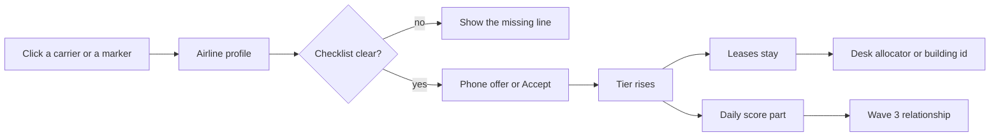

# Hub progression

Changes for review, Oct 15 09:30.

Status: sections marked **Review** are design only. No code in this note. Trever, Oct 2026. Hub gameplay stops here until this write-up is accepted. Higher-tier carriers stay stricter and pay the larger `HUB_OFFER_FEE`. The unique benefit is still the one archetype perk in §4. This review does not add a second perk list.

Hub progression is a per-airline ladder on top of the relationship score and the diplomacy bands. It does not replace them. Dedicating a desk, a lane, a gate, a lounge, a hangar bay, a fuel hook, or a turnaround vehicle is a relationship lever: it raises the score, and some carriers will not sign or climb until that piece of the airport is theirs. A tier above Station is never applied by the sim. The airline offers it. The player accepts.

## Already on main

These shipped after the first draft (`894858d`). This note does not ask for them again.

| What | Commit | Where it lives |
| --- | --- | --- |
| Checklist data | `84db44f` | `src/hubprogress/`. `hubChecklist`, `LEASE_NEED`, `ALLOCATOR_WAIT`. |
| Checklist on the Airlines desk | `20e829d` | `HubSection` under the relations meter, and the Hubs sheet (`HubProgress`, `manageTab === 'hubs'` in `src/ui/Hud.tsx`). Both sit outside the phone. |
| Phone offers | `5c85795`, `38a6a70` | Focus, Base, Hub, and Primary. `src/phone/readGame.ts` sets `acceptDisabled` unless `list.eligible && list.next === tier`. `src/phone/feed.ts` renders Accept (`accept-hub`) and Decline (`decline-hub`). |
| Dedicate stays off | `20e829d` | Desk, lounge, gate, and hangar buttons are `disabled`. The desk button title is `ALLOCATOR_WAIT` ("Waiting on the desk allocator"). |

Desk and lane counts stay at zero. `src/checkin/allocate.ts` brands a desk for an open window (`DedicatedLock`, `allocate`). That is window paint. It is not the hub lease table. Hub progression still has one assignment table: the allocator lease API (`leasesFor`, `requestLease`, `releaseLease`), when that export exists. Vehicles, gates, lounges, hangar bays, and fuel hooks are rows in that same table. The hub module does not keep a second one.

## Open questions for Trever

1. Is a gap of 4 game days per airline, and a field cap of 3 nudge texts a day, the right rate limit?
2. Vehicle hard gates, as proposed in §1: a budget Base wants one dedicated tug; a flag Hub wants a tug, a belt loader, and a hi-lift; a cargo Hub wants one dedicated bowser or hydrant dispenser. Regional, charter, and heli get score credit only. Confirm or cut.
3. The backlash ladder in §3 (−4 / −8 / −15, with the chances in that table) is the trade-off below Primary. Allies stay spared, matching `requestHub`. Confirm the chances before any roll is coded.
4. A dedicated vehicle is an existing fleet unit, painted from roster `primary` / `secondary`, taken out of the common pool, and still billed `DEFAULT_VEHICLE_SPECS[type].upkeepPerDay` on a quiet day. Confirm that dedicating does not add a second upkeep line.
5. Decline silences nudges for that warmth step only. The next step may still text. Later does not silence anything. Confirm.
6. The Airlines home is the existing Letters desk and Hubs sheet, outside the phone. The assign screen is a second side panel. Confirm that, rather than a new shell.

The playable names are the 45-carrier roster in `src/airlines/roster.ts` (`docs/AIRLINES.md`). Fees and facility asks still copy a catalog template through `ROSTER_TEMPLATE` in `src/game/rosterAirlines.ts`.

## What already exists

Keep these. Hub tiers read them. They do not get a second copy.

| Ladder | Where | What it is |
| --- | --- | --- |
| Relationship score, −100..100 | `src/wave3/config.ts` `CONTRACT_TIERS` | Published, Preferred, Trusted, Priority, Flagship. Score parts are contracts, on-time turns, delays, cancellations, kept days, stand capacity, lounges, gates, missed asks, fines (`RELATION_PART_LABELS`). Trusted (score 45) is what sends today's hub plaque letter. |
| Diplomacy bands | `src/diplomacy` | Hostile, Cold, Neutral, Warm, Partner. `isBase` and `isHub` live here. `hubBlockers` in `src/diplomacy/actions.ts`: signed, Partner, tier 3 or higher, not Minor, already a Base, at least 2 daily departures, maintenance level 2, and nobody else holding `hubAirlineId`. Rivals take −15, and only on that hub grant. The ladder in §3 is the proposal for Base and Hub. Do not edit this folder for the first phases. |
| Hub plaque letter | `Game.offerRelationHub`, `HUB_FEE_MIN` / `HUB_FEE_MAX` in `src/game/catalog.ts` | One letter at Trusted: denser slots and a brand lounge for a cash fee. Cargo and military personas skip it. This letter becomes the Hub-tier phone card, not a parallel offer. |
| Service points | `src/servicepoints/points.ts` | A check-in desk or security lane is open when it is included, automatic, or staffed. Nothing on `StaffPoint` names an airline. |
| Premium kit | `src/premium/data.ts` | Premium check-in, fast-track lanes, VIP room. Field levels 3 / 4 / 6 / 8. Shared staff pool. A dedication can point at one of these. It does not invent a second fast-track building. |

Lounges and gates already add a capped daily score (`SCORE_PER_LOUNGE`, `SCORE_PER_GATE`). A dedication is a new part on that same daily review, not a new currency.

## 1. Dedicated infrastructure

A dedication is a lease. The building stays the player's. The airline gets a name on it and a promise about who it serves.

| Kind | What "dedicated" means | Common-use alternative |
| --- | --- | --- |
| Check-in desk | The desk allocator serves that airline's passengers first, or only them. | A common desk any signed carrier can use. |
| Security lane | A fast-track or preferred lane for that airline's tickets. Reuse a premium lane when one is built. | The shared lanes. |
| Lounge | A hall lounge room branded for that airline. Co-funded: the airline pays half the room's upkeep while the lease holds. | An unbranded lounge that still counts for the existing lounge score. |
| Gate or pier | A stand, or a run of stands on one pier, reserved for that airline's turns. | Tower-assigned stands, as today. |
| Hangar bay | A bay in a hangar reserved for that airline's overnight or line MX. | The shared hangar queue. |
| Fuel hook | A contract slice: litres or a truck window reserved before other carriers. | The published fuel contract. |
| Turnaround vehicles | A tug, belt loader, hi-lift catering truck, or fuel bowser / hydrant dispenser painted in that airline's livery. It rolls only on that carrier's turns. | The common GSE pool from the depot grant and the catalog. |

Three lease modes, same on every kind:

- **Common.** No airline. No relationship credit.
- **Preferred.** That airline goes first when it has a passenger, a turn, or a truck due. Others may use the slack. Half credit.
- **Dedicated.** Only that airline. Full credit. An idle dedicated desk still costs its staff and upkeep. An idle dedicated vehicle still costs its daily upkeep. Nothing is free.

### Turnaround vehicles — Review

A dedicated vehicle is a unit the player already fields. It is not a new mesh and not a free truck. The common pool is the GSE fleet: `DEPOT_GRANT` in `src/scale/data.ts` is added once for each depot tile (`tilesOf(tiles, 'depot')` in `src/game/path.ts`, applied in `src/scale/logic.ts`), and further units are purchases from `VEHICLE_CATALOG` in `src/logistics/defaults.ts`. Dedicating one takes it out of that pool.

Four roles, mapped onto types the fleet already has. A jumbo turn uses the heavy type, the same rule as `vehicleCanServe` in `src/scale/logic.ts`.

| Role on the lease | Narrow and wide | Jumbo |
| --- | --- | --- |
| Tug | `pushback_tug` | `heavy_tug` |
| Belt loader | `belt_loader` | `uld_loader` or `main_deck_loader` |
| Hi-lift catering | `catering_truck` | `highlift_catering` |
| Fuel bowser / dispenser | `fuel_truck` | `heavy_fuel_truck` or `hydrant_dispenser` |

Paint comes from the roster. `RosterAirline.primary` and `secondary` live in `src/airlines/roster.ts` (the five base carriers in `BASE`, the other forty from `public/art/refs/airlines/palettes.json`). Preferred is a stripe in `primary`. Dedicated is a `primary` body with a `secondary` stripe. Accent stays off the truck. No new colour table.

Who it serves. A dedicated unit rolls only when the turn's airline is the lease holder. `CartYard` in `src/carts/engine.ts` paths bag carts and catering trucks between named sockets (`CART_TUNING` in `src/carts/config.ts` grants carts per depot). A dedicated hi-lift or belt loader is skipped on `kitchen_to_door` and `sort_to_loader` unless that stand is the lease holder's. Tugs and fuel trucks follow the same rule in the GSE dispatcher. A preferred unit goes first for that airline and may take another carrier's turn when it is slack. A common unit stays in the pool.

Upkeep while idle. The bill is the one already on the spec: `DEFAULT_VEHICLE_SPECS[type].upkeepPerDay` (`pushback_tug` 90, `belt_loader` 50, `catering_truck` 120, `highlift_catering` 200, `fuel_truck` 180, `hydrant_dispenser` 140). A quiet day does not waive it. Dedicating does not add a second line on top of that bill.

Score. One vehicle is one lease on the same daily review as a desk. Credit is `SCORE_PER_LEASE` (preferred 0.04, dedicated 0.08), inside the same `LEASE_SCORE_CAP` of 1.6. Four dedicated trucks are 0.32. They do not get a private cap.

Hard gates, proposed, not in `LEASE_NEED` yet. A line that is not a gate can still be dedicated for the small daily credit.

| Archetype | Tier | Vehicle hard gate |
| --- | --- | --- |
| Budget | Base | 1 dedicated tug. The turn promise needs their own pushback. |
| Flag | Hub | 1 tug, 1 belt loader, 1 hi-lift catering. Handling that does not wait behind other carriers. |
| Cargo | Hub | 1 dedicated fuel bowser or hydrant dispenser. The night bank fuels first. |
| Regional, charter, heli | None | Score credit only. Heli keeps the pad and the fuel hook. No painted truck is required. |

A dedicated bowser or hydrant dispenser may satisfy the existing fuel-hook line. It does not add a second fuel ask. A flag at Primary still needs the Hub vehicle set, plus the pier and the fuel hook. Stricter ask, same perk, larger `HUB_OFFER_FEE`.

### How it moves the relationship

Once a day, on the same pass as lounges and gates, each live lease adds to the score. The cap stops a player from wallpapering the hall with empty desks.

A hard gate is separate from the score. Brisa can be Preferred on punctuality alone and still be refused a Base because no desk is dedicated. Gulf Pearl can be Trusted and still be refused Primary hub because the pier is common-use. The checklist on the profile is the hard gate. The score part is the slow pressure.

Dedicating something the airline did not ask for still pays the small daily credit. It does not skip a checklist line. Taking a lease back drops the credit on the next review and, if that line was a gate for the current tier, opens a 30-day warning before the tier falls. Weather and excused misses do not strip a lease.

### What some airlines require before they sign or climb

The sign letter and each tier offer name the leases they need. If the airport cannot spare them, the letter says so and does not pretend the player can accept.

| Moment | Typical hard gate | Who |
| --- | --- | --- |
| First contract | A fuel farm and a stand their airframe can use. Already true of the catalog asks. | Everyone |
| Focus city | One preferred desk, or a kiosk tagged for them. | Budget, regional |
| Base | Dedicated desks or a dedicated pad, plus somewhere to park overnight. A budget carrier also wants one dedicated tug. | Budget, flag, cargo, heli |
| Hub | A branded lounge or a night hangar, plus a connection or sort window. A flag also wants the tug, belt loader, and hi-lift. A cargo carrier also wants a dedicated bowser or dispenser. | Flag, cargo |
| Primary hub | An exclusive pier or ramp, and the diplomacy `hubBlockers` list. | One airline |

### Desk allocator

Another agent is building the desk allocator now. This design does not specify queues, hiring, or walk timing. Those stay in `src/servicepoints`.

Today `StaffPoint` is `{ id, kind, included, automatic }` and `openPointIds` only answers "is someone on the post?". Hub progression needs one more answer: "whose passengers is this post for?"

Proposed lease, owned by the allocator, read by hub progression. One array. Desks, lanes, gates, lounges, hangar bays, fuel hooks, and turnaround vehicles are rows in it.

```ts
type LeaseMode = 'common' | 'preferred' | 'dedicated'

type LeaseKind =
  | 'checkin_desk'
  | 'security_lane'
  | 'gate'
  | 'lounge'
  | 'hangar_bay'
  | 'fuel_hook'
  | 'turnaround_vehicle'

interface PointLease {
  pointId: string
  kind: LeaseKind
  airlineId: string | null
  mode: LeaseMode
}
```

A vehicle `pointId` is minted by the allocator when a fleet unit is dedicated (`veh:pushback_tug:3`). The fleet today is a count per `VehicleType`, not a list of named trucks. The hub module does not invent those ids.

Hub progression will call, once the allocator exports them:

- `leasesFor(airlineId)` for the checklist. Every kind.
- `requestLease(pointId, airlineId, mode)` from the profile and from the assign screen. Refuse when the point is unstaffed, already dedicated to someone else, or not built. For a vehicle, also refuse when no spare unit of that type is in the pool, or when `vehicleCanServe` says it cannot work that airframe.
- `releaseLease(pointId)` from the same control. A released vehicle returns to the common count.

Until those functions exist, desk, lane, and vehicle lines on the checklist read **Waiting on the desk allocator** and do not pass. Do not invent a second assignment table in the hub module. `src/checkin/allocate.ts` may later read dedicated desk rows from this table. It does not become a second writer. Gates, lounges, hangar bays, and fuel hooks are rows here too, because those buildings already have ids. They wait on the same three functions.

A premium check-in or fast-track lane is a legal `pointId` if the allocator agrees to tag it. The premium upkeep in `PREMIUM_ITEMS` still applies.

## 2. Real-world grounding

These are the patterns the tiers copy. They are not licences to use the real brands in game. Our carriers stay the roster names.

### Emirates at Dubai (DXB), Terminal 3

Emirates runs Terminal 3 as its own house: dedicated check-in, its own gates sized for the A380, first and business lounges, and a connection product that is the point of the airport. Ground handling and catering sit with the airline's own companies. A passenger connecting there is not visiting Dubai. The airport's job is a short, reliable connection and a pier that does not mix the fleet with everyone else.

Demands we copy: widebody gates on one pier, a branded lounge, a connection window, dedicated desks, and fuel and handling that do not wait behind other carriers. Reward we copy: transfer passengers and a flagship type (our A380-class airframe) only while Primary hub holds.

### British Airways at London Heathrow Terminal 5

T5 was built for BA. Check-in, security, lounges, and the T5A/B/C piers are the airline's. Connections use a flight-connections centre rather than sending people back to landside. The airport still owns the building. BA's deal is exclusive use and a clock it can bank.

Demands: an exclusive pier, fast-track, lounges, and an on-time rate high enough to hold the bank. Reward: guaranteed rotations and a transfer stream. Rivals on the same tier feel the exclusive pier, which is the diplomacy −15.

### Delta at Atlanta (ATL)

ATL is a fortress hub. Most passengers are connecting. Gates run to whole concourses, lounges repeat down the pier, and the bank is the product. A focus city elsewhere in the network is the same airline with a few based aircraft and no claim to be the hub.

Demands: gate count, connection time, on-time rate, lounge seats. Reward: volume. The score and the fees go up because the bank is large, not because each passenger pays a luxury fare. This is why Primary hub is one slot. Two fortress hubs at a small field is not this pattern.

### Lufthansa at Frankfurt (FRA) and Munich (MUC)

FRA is the primary hub: a terminal district, a separate first-class terminal, lounges, and a Star Alliance pier. MUC Terminal 2 is the second hub, shared with partners, still a connection bank, not a station. One airline can hold two hubs. Only one of them is primary.

Demands: alliance-shaped pier, lounges, two banks with different clocks. Reward: the primary site gets the exclusive type and the rival hit. The second site stays at Hub and does not take `hubAirlineId`. Our fields are one airport, so the "second hub" is a second airline at Hub while one holds Primary. The dual-hub lesson is that Hub and Primary are different tiers, not two names for the same flag.

### Ryanair bases

A base is not a hub. Aircraft and crew overnight. The turn is short. The airline wants its own desks or a wall of kiosks, a predictable fee, and stands it can push off without a jetway. It does not want a lounge, and it leaves when the fee moves the wrong way. The 2025 Aena dispute is the story: fee pressure, then a base closes and seats disappear. Diplomacy already models that as a capacity cut before exit.

Demands: dedicated or preferred desks, a 25-minute turn standard, overnight stands, a fee promise. No lounge line. No transfer-passenger reward. Reward: guaranteed early rotations and a marketing bump on those routes only.

### FedEx at Memphis (MEM) and UPS at Louisville (SDF)

A cargo hub is a night sort. Aircraft arrive in a bank, freight crosses the ramp, aircraft leave before morning. Memphis and Worldport are ramps, fuel, and a sort building. They are not check-in halls. Passenger lounges and security lanes are the wrong lever. The right ones are night slots, a dedicated ramp, a hangar that can hold a heavy freighter, and a fuel hook large enough for the bank.

Demands: hangar bay, fuel arrangement, night slots, a ramp that is not shared with a passenger bank at the same hour. Reward: guaranteed night rotations and a revenue share on freight, not on tickets.

### Helicopter operators

A heli operation is a pad, a small desk or none, Jet A, and a hangar bay the size of the aircraft. Medevac wants the pad kept clear and a fast release. A transfer or sightseeing operator wants the pad next to the terminal, not a pier. Neither wants a lounge or a connection bank.

Demands: one dedicated helipad, a fuel hook, optionally one preferred desk. Reward: guaranteed pad turns and, for medevac, priority over a sightseeing heli when both are signed. No transfer passengers.

## 3. Hub tiers

Five tiers. Station is free on signature. Each step above is an offer the airline sends and the player accepts. Warmth alone does not set a tier, `isBase`, or `isHub`. Falling through a hard gate warns for 30 days, then drops one tier. Relationship score and diplomacy band are gates into the offer. They are not the tier names.

### Rival backlash ladder — Review

Becoming a base, a hub, or the primary hub is a trade-off. Named rivals take a score hit, and they may refuse a new deal, trim rotations, or move to Bellwater. The player sees that on the offer card before Accept lights.

Today only Primary does this. `requestHub` in `src/diplomacy/actions.ts` writes `hub_rival` onto each non-allied rival. `MODIFIER_DEFAULTS.hub_rival` is −15 for 12 months. Allies are skipped. `rivalsOf` in `src/diplomacy/relations.ts` names a carrier when `rivalScore` is at least 2: same diplomacy tier, same kind, and shared passenger type or interests. `previewReaction(..., 'hub')` already shows that −15 before a hub grant. Nothing below Primary writes a rival hit.

Proposed ladder. Primary keeps the existing −15. Base and Hub are new modifier kinds on the same stacking rules (`STACK_FACTORS`). They are not a rewrite of `hubBlockers`.

| Tier accepted | Score hit | Months | Refuse a new deal | Trim rotations | Relocate to Bellwater |
| --- | --- | --- | --- | --- | --- |
| Base | −4 | 6 | 10% | none | none |
| Hub | −8 | 9 | 25% | 20% drop 1 rotation | 10% |
| Primary | −15 | 12 | 40% | 35% drop 1 or 2 rotations | 25% |

Who is named. The set is `rivalsOf`, plus any other signed carrier of the same roster `AirlineType` who is not an active alliance partner (`alliesOf`). An ally is spared at every rung, the same skip `requestHub` already uses. The card lists each name. An ally is listed as spared, not hit.

One roll on Accept, not every day.

- Refuse blocks a new contract or a new tier offer from that rival for 30 days. The contract they already hold stays.
- Trim drops one daily rotation at Hub, and one or two at Primary, for 14 days. This is smaller than the hostile departure, which cuts capacity to 70%.
- Relocate uses the Bellwater poach path in `src/rival` (`RIVAL_NAME` is Bellwater Intl). It fires only when that rival's standing is at or below `RIVAL.poachStandingMax` (42). A happier rival turns the relocate roll into a trim instead. Bellwater does not steal a content carrier just because someone else climbed.

The warning sits on the phone offer, above Accept, including while Accept is still disabled:

```
┌ Phone · Messages ──────────────────────────┐
│ Gulf Pearl · Hub offer                     │
│  ✓ Priority standing                       │
│  · Desks 1/4                               │
│                                            │
│ Rivals if you accept                       │
│  Zephyr Go · −8 · may cut a rotation       │
│  Tango Air · −8 · may refuse the next deal │
│  Seoul Star · alliance · spared           │
│                                            │
│  [ Accept ]  [ Decline ]                   │
│  Accept stays disabled until every         │
│  checklist line is met.                    │
└────────────────────────────────────────────┘
```

| Tier | Relationship gate | Diplomacy | What the airport must already have | What you get |
| --- | --- | --- | --- | --- |
| Station | Signed. Published is enough. | Any band above Hostile. | Their airframe can land and park. | The published schedule. No lease required. |
| Focus city | Preferred (score 20). | Neutral or better. | 2 stands they can use. On-time at least 80% over 14 days. 1 preferred desk or kiosk. Connection time not required. | +1 guaranteed rotation on top of the Preferred extra slot. A small marketing bump. |
| Base | Trusted (score 45). | Warm or better. `isBase` may be set. | 4 stands or 1 pad. On-time 85%. 2 dedicated desks, or 1 dedicated pad for heli. Overnight parking. No lounge required for budget, cargo, or heli. A budget carrier also wants 1 dedicated tug. | Aircraft overnight. Guaranteed first-wave rotations. Crew jobs. The diplomacy Base perk. Named rivals take −4. |
| Hub | Priority (score 70). | Partner, or Warm if they are cargo. | 6 stands or a dedicated ramp. On-time 88%. Connection or sort window inside 45 game-minutes. Branded lounge, or a dedicated hangar bay for cargo. 2 dedicated desks and 1 fast-track lane for passenger flags. A flag also wants 1 tug, 1 belt loader, and 1 hi-lift. A cargo carrier also wants 1 dedicated bowser or dispenser. | Transfer passengers or a night sort. Revenue share. Denser slots. This is today's plaque letter, extended with the checklist. Named rivals take −8. |
| Primary hub | Flagship (score 90). | Partner, and `hubBlockers` clear. | 8 stands on one pier, or the cargo ramp exclusive at night. On-time 90%. Lounge or sort hall. 4 dedicated desks, 1 dedicated lane, a fuel hook. The Hub vehicle set still holds. One Primary hub on the field. | Exclusive airframe (the largest type already in their fleet). Rival −15, the top rung of the backlash ladder, which is today's hub grant. Transfer share and the fee multiplier stay the Flagship `feeMult`. Do not stack a second fee multiplier. |

Stricter at each step: more gates, a tighter on-time rate, then a lounge, then slots that are actually theirs, then dedicated desks, lanes, and the vehicle set that archetype asked for. Rewards grow the same way: a rotation, then overnight aircraft, then transfers and a revenue share, then an exclusive type. The vehicle counts are the §1 hard gates. They are not in `LEASE_NEED` yet.

Cargo swaps the passenger lines. Desks and lanes become ramp doors and a sort hall. The lounge line is absent. Heli swaps stands for pads and drops the lounge, the lane, and the transfer reward. Budget drops the lounge until Hub, and Hub for a budget carrier is a large base with a fee promise, not a connection bank. The tier names stay so the profile reads the same way for every airline.

Connection time is the minutes from chocks-on of the inbound to the last moment a booked onward seat can be held. The hub module reads it. It does not invent a new passenger walker. Sort time for cargo is the same clock on the ramp.

On-time rate is the share of their turns that wave 3 already counts as on time (`LATE_DEPARTURE_GAME_MIN`). Do not add a second lateness definition.

## 4. Perks by archetype

One perk is the thing that archetype is for. It turns on at the tier in the table and turns off when the tier drops. Numbers are the proposed tunables in §6.

| Archetype | Roster `AirlineType` | Signature perk | Turns on | What it is not |
| --- | --- | --- | --- | --- |
| Budget | `budget` | Turn promise | Base | A 25-minute target on their dedicated stands. Missing it costs the relationship like a delay. No lounge perk. |
| Flag | `flag` | Brand lounge and exclusive type | Lounge at Hub, type at Primary | They will not take a kiosk in place of a desk. |
| Regional | `regional` | Feed the hub | Focus city | Their passengers are tagged as connections onto a signed flag or cargo hub carrier when one is at Hub or above. |
| Cargo | `cargo` | Night sort | Hub | Guaranteed night rotations. No passenger lounge. No security lane. |
| Charter | `charter` | Season block | Focus city | A dated block of rotations, then a quiet season. They do not want a pier. |
| Heli | `heli` | Clear pad | Base | Their pad is not given away while they are on contract. Medevac outranks a sightseeing heli. |

### Roster examples

Economics in parentheses are the catalog template that roster type copies. The perk is the archetype perk. The checklist is that carrier's own hard gates.

| Carrier | Type | Plays like | Real pattern | Will not climb without | Tier they push for |
| --- | --- | --- | --- | --- | --- |
| Brisa | budget | Northline, LCC | Ryanair base | 2 dedicated desks or kiosks, 1 dedicated tug, overnight stands, no fee rise this season | Base |
| Gulf Pearl | flag | Summit, full service | Emirates at DXB | Branded lounge, 4 dedicated desks, a pier of widebody stands, fuel hook, and the Hub set: tug, belt loader, hi-lift | Primary hub |
| Aurora Nordic | flag | Harbor, full service | BA at LHR T5 | Fast-track lane, lounge, exclusive pier, on-time 90% | Primary hub |
| Seoul Star | flag | Crown, full service | Lufthansa's second hub | Lounge and a shared pier. Accepts Hub while someone else holds Primary. | Hub |
| Cityhopper | regional | Bushline | A feed carrier into the fortress | 1 preferred desk, stands for an E175 or ATR, a flag carrier already at Hub | Focus city |
| Atlas Cargo | cargo | Upps | UPS at SDF, smaller | Dedicated ramp at night, hangar bay, a bowser or dispenser in their colours. No desks. | Hub |
| Polar Freight | cargo | Umazon | FedEx MEM, the heavy end | The same, plus a stand their 747 freighter can use, and they will ask for Primary if the ramp is exclusive | Primary hub |
| Harbor Heli | heli | Bushline, charter | A pad operator | 1 dedicated helipad and a fuel hook | Base |

Medevac One uses the heli perk with priority over Harbor Heli. Suncharter uses the charter season block and never asks for a pier. They are the same rules as the rows above. Eight examples is enough to tune the table. The other 37 carriers inherit their archetype. They do not each get a bespoke perk.

## 5. UI

Cities: Skylines side panels. Nothing here is a modal. The apron stays visible. Esc closes the profile before it opens the pause sheet, in the same place as the flight card: after info views, before the menu.

### Airline profile

Airlines → a carrier opens the card that already exists. Add a Hub section under the relations meter.

```
┌ Airlines · Gulf Pearl ──────────────────── × ┐
│ Flag · Crown template · Standing 72 Priority │
│ Partner · Base                                 │
│                                                │
│ Hub tier          Focus city  →  Base          │
│ [=========>    ]  3 of 5 lines                  │
│                                                │
│ Requirements                                   │
│  ✓  Trusted relationship                       │
│  ✓  On-time 86%  (need 85%)                    │
│  ✓  4 stands they can use                      │
│  ·  Dedicated desks  1 / 2   Waiting on desks  │
│  ✓  Overnight parking                          │
│                                                │
│ If you accept Base                             │
│  · Aircraft overnight                          │
│  · Guaranteed first wave                       │
│  · Brand lounge is the next ask, not this one  │
│                                                │
│ [ Dedicate a desk ]  [ Not yet ]               │
└────────────────────────────────────────────────┘
```

**Dedicate a desk** is disabled, with that sentence, until the allocator exports `requestLease`. Other dedicate buttons (pad, lounge, gate, hangar, fuel) can enable earlier.

### Hub progress

A second sheet, Airlines → Hub, lists every signed carrier as one row. The row opens the profile. The Primary hub row, if any, is pinned first.

```
┌ Hub progress ──────────────────────────────────┐
│ Primary   Gulf Pearl     Hub tier   4/6  pier  │
│ Base      Brisa          Base       ready      │
│ Focus     Cityhopper     Focus      feeding    │
│ Station   Suncharter     Station    in season  │
│                                                │
│ One Primary hub. Brisa does not want it.       │
└────────────────────────────────────────────────┘
```

### Rewards preview and showcase

The preview is the "If you accept" list on the profile. It shows the next tier only, plus the one perk of their archetype. It does not list every future tier. A showcase strip under the list names what is already on:

```
Now: preferred desk A2 · overnight stand G4 · no lounge
Next: brand the east lounge · two more desks
```

### Nudge texts — Review

A nudge is a rate-limited text on the phone. It is not an offer and it does not spend a fee. As the airline warms up it points at the next unmet checklist line, for example "request dedicated desks", and it offers a way to the Airlines desk or the assign screen.

A warmth step is one crossing on the wave 3 ladder while they are signed: Preferred, Trusted, Priority, Flagship (`CONTRACT_TIERS` in `src/wave3/config.ts`). Each crossing may send one text. The text names the next unmet hard line for the rung that crossing opens. If that line is already met, no text. Station and a repeated day on the same label do not text.

Rate limit, proposed:

- At most one nudge per airline per 4 game days.
- At most 3 nudge texts per game day, across every airline.
- If the day is already full, that step waits for the next day with room. It is still one text for that step, not a second nag.

Decline silences the nudge for that step. `decline-hub` on the Focus offer means Brisa does not send the Focus nudge again. The next warmth step may still text. Later does not silence anything. Later is an ack, the same shape as the other phone laters.

Buttons, proposed phone actions, not built:

| Button | What it does |
| --- | --- |
| Open Airlines tab | Opens the Letters desk (`view.airlines`, hotkey L) on that carrier. Outside the phone. |
| Open assign screen | Opens the assign side panel for that carrier. |
| Later | Acks the text. Does not decline the offer. |

Copy, one line each. The voice is the carrier, the ask is the next line.

| Carrier | Step | Text |
| --- | --- | --- |
| Brisa | Preferred, toward Focus | "We can make this a focus city. Tag a desk for us." |
| Brisa | Trusted, toward Base | "Request dedicated desks. Two of them, and a tug in our colours, and we will overnight." |
| Gulf Pearl | Priority, toward Hub | "The east pier is still everyone else's. Dedicated desks, a lounge, and our own trucks." |
| Gulf Pearl | Flagship, toward Primary | "One hub. The pier, the fuel hook, and we will bring the big type." |
| Atlas Cargo | Trusted, toward Base | "No desks. A night ramp and a bowser in our colours." |

```
┌ Phone · Messages ──────────────────────────┐
│ Brisa · 12s                                │
│ "Request dedicated desks. Two of them,     │
│  and a tug in our colours."                │
│  [ Open Airlines tab ]                     │
│  [ Open assign screen ]                    │
│  [ Later ]                                 │
└────────────────────────────────────────────┘
```

### Assign screen — Review

A Cities-style side panel. The apron stays visible. Esc closes it before the pause sheet, in the same place as the flight card. It is the only place a lease mode is written, and it writes through `requestLease` / `releaseLease`. The Airlines desk reads the result. It does not keep its own copy.

One airline at a time. Rows are the points that can be leased: check-in desks, security lanes, gates, lounges, hangar bays, and turnaround vehicles. Each row shows the current mode for this airline: Common, Preferred, or Dedicated. The player sets the mode on that row.

A locked row stays locked and shows the reason in the row:

| Reason | When |
| --- | --- |
| Waiting on the desk allocator | Desks, lanes, and vehicles, until `leasesFor` exists. This is the row the player sees today. |
| Unstaffed | No clerk on the post. |
| Not built | The stand, lounge, bay, pad, or depot is not on the field. |
| Dedicated to Gulf Pearl | Another carrier already holds it dedicated. |
| No spare tug | The common pool has no free unit of that type. A depot grants `DEPOT_GRANT`. Another unit is a `VEHICLE_CATALOG` purchase. |
| Kiosk | A flag will not take a kiosk in place of a desk. Budget and regional may. |
| Wrong airframe | `vehicleCanServe` refuses it. A jumbo wants the heavy tug, the hi-lift, or the hydrant dispenser. |

```
┌ Assign · Gulf Pearl ─────────────────────── × ┐
│ Common    Preferred    Dedicated              │
│                                                │
│ Desks                                          │
│  A2    Dedicated                         [··]  │
│  A4    Common                            [··]  │
│  K1    Locked · Kiosk                          │
│                                                │
│ Vehicles                                       │
│  Tug 3      Dedicated · in their colours [··]  │
│  Belt 1     Preferred                    [··]  │
│  Hi-lift    Locked · No spare hi-lift          │
│  Bowser 2   Common                       [··]  │
│                                                │
│ Gates, lounges, hangar bays follow the         │
│ same three modes.                              │
└────────────────────────────────────────────────┘
```

The Airlines home is the Letters desk and the Hubs sheet, both outside the phone. Relationship and the fee line are already on the relation card. Hub level, the checklist, and the reward preview are already `HubSection`. Still to add on that card, when this review is accepted: the named rivals for the next rung, and the dedicated infrastructure this carrier already holds (read from `leasesFor`, including vehicles). The assign screen is the editor. The Hubs sheet stays the list.

### Phone offer

The existing hub plaque letter is the Hub offer. The same card shape carries Focus, Base, and Primary. These four cards are already on main. Contracts stay the Contracts tab. A tier offer is a message with requirement lines, the rival warning from §3, and two actions. Accept stays disabled until the checklist is complete. That gate is already wired.

```
┌ Phone · Messages ───────────────┐
│ Gulf Pearl · Hub offer · 45s    │
│ "Four desks and the east pier.  │
│  We will bank the connections." │
│  ✓ Priority standing            │
│  ✓ On-time 91%                  │
│  · Desks 1/4                    │
│  [ Accept ]  [ Decline ]        │
│  Accept stays disabled until    │
│  every line is met.             │
└─────────────────────────────────┘
```

Decline is the diplomacy decline. It does not delete the leases they already have. Accept spends the plaque fee when the tier is Hub or Primary (`HUB_FEE_MIN`..`HUB_FEE_MAX`). Focus and Base have their own fees in the tunable table. Counter is out of this design. Diplomacy already has Counter on its own proposals.

### In-world markers

A dedicated or preferred point wears the airline colour. No new mesh in the first building pass. A decal or a standing sign is enough.

| Place | Marker |
| --- | --- |
| Desk or lane | A plate in their colour on the sign that `hallService` already draws for a desk. Preferred is a thin stripe. Dedicated is a full plate. |
| Gate | The stand highlight uses their colour while the lease holds. The flight card already names the stand. |
| Lounge door | Their name on the door the hall already has. |
| Hangar bay and fuel | A small apron decal at the bay or the hook. |
| Helipad | The pad ring in their colour. |
| Turnaround vehicle | Preferred is a stripe in roster `primary`. Dedicated is a `primary` body and a `secondary` stripe. The truck they already have. No new mesh. |

Clicking the marker opens the profile at that lease. It does not open a second card. Walker cards in the hall stay guest cards.



## 6. Tunables and tickets

All of these numbers are proposals. They belong in one new file, `src/hubprogress/config.ts`, when a ticket builds them. Do not hard-code them in a component. Do not put them in `src/diplomacy`.

### Proposed config

```ts
export const HUB_TIERS = ['station', 'focus', 'base', 'hub', 'primary'] as const

export const HUB_TIER_GATE = {
  focus:   { minTier: 2, minBand: 'neutral', onTime: 0.80, days: 14 },
  base:     { minTier: 3, minBand: 'warm',    onTime: 0.85, days: 14 },
  hub:      { minTier: 4, minBand: 'partner', onTime: 0.88, days: 30 },
  primary:  { minTier: 5, minBand: 'partner', onTime: 0.90, days: 30 },
} as const

/** Daily relationship credit per live lease. Same review as lounges and gates. */
export const SCORE_PER_LEASE = { preferred: 0.04, dedicated: 0.08 } as const
export const LEASE_SCORE_CAP = 1.6

export const LEASE_NEED = {
  budget:   { focus: { desk: 1 }, base: { desk: 2, overnight: 1 }, hub: { desk: 4, stand: 6 } },
  flag:     { focus: { desk: 1 }, base: { desk: 2, overnight: 1 }, hub: { desk: 2, lane: 1, lounge: 1, stand: 6 }, primary: { desk: 4, lane: 1, lounge: 1, pier: 8, fuel: 1 } },
  regional: { focus: { desk: 1, stand: 2 } },
  cargo:    { base: { ramp: 1, overnight: 1 }, hub: { hangar: 1, fuel: 1, ramp: 1 }, primary: { hangar: 1, fuel: 1, ramp: 1 } },
  charter:  { focus: { desk: 1 } },
  heli:     { base: { pad: 1, fuel: 1 } },
} as const

export const HUB_OFFER_FEE = { focus: 4_000, base: 8_000, hub: 14_000, primary: 22_000 } as const
export const TIER_DROP_WARNING_DAYS = 30
export const CONNECTION_WINDOW_MIN = 45
export const BUDGET_TURN_TARGET_MIN = 25

export const PERK = {
  budgetTurn: 1,
  flagExclusiveType: 1,
  regionalFeedShare: 0.15,
  cargoNightRotations: 2,
  charterSeasonDays: 90,
  heliPadPriority: 1,
} as const
```

Proposed additions. Not in `src/hubprogress/config.ts`. Do not land them until this review is accepted.

```ts
/** Hard vehicle gates. A missing key means that archetype has no vehicle line. */
export const VEHICLE_NEED = {
  budget: { base: { tug: 1 } },
  flag: { hub: { tug: 1, belt: 1, catering: 1 } },
  cargo: { hub: { fuelTruck: 1 } },
} as const

/** One nudge per airline per gap, and a field cap per game day. */
export const NUDGE_GAP_DAYS = 4
export const NUDGE_DAY_CAP = 3

/** Rival hit on Accept. Primary matches today's hub_rival. */
export const RIVAL_BACKLASH = {
  base: { score: -4, months: 6, refuse: 0.1, trim: 0, relocate: 0 },
  hub: { score: -8, months: 9, refuse: 0.25, trim: 0.2, relocate: 0.1 },
  primary: { score: -15, months: 12, refuse: 0.4, trim: 0.35, relocate: 0.25 },
} as const

export const RIVAL_REFUSE_DAYS = 30
export const RIVAL_TRIM_DAYS = 14
```

`hub` fee 14_000 matches `HUB_FEE_MIN`. `primary` matches `HUB_FEE_MAX`. Wave 3 `feeMult` and `extraSlots` stay the relationship rewards. The perk numbers are counts or shares, not a second landing-fee multiplier. Vehicle credit uses `SCORE_PER_LEASE` and `LEASE_SCORE_CAP`. It does not add a cap of its own.

`minTier` is the wave 3 contract tier (2 Preferred through 5 Flagship). `minBand` is the diplomacy band. A carrier who is only on the wave 3 score, with no diplomacy record yet, uses the score gate alone until diplomacy is wired. Do not block Station on a missing diplomacy object.

### Phases

Each phase is one ticket. Later phases do not start by rewriting an earlier file.

| Phase | Ticket | Builds | Leaves alone |
| --- | --- | --- | --- |
| 0 | This note | `docs/design/HUB_PROGRESSION.md` | Code |
| 1 | Checklist data | Shipped, `84db44f`. `src/hubprogress/config.ts` and `hubChecklist`. Desk and lane lines return waiting. | `src/diplomacy`, the allocator |
| 2 | Desk leases | Call the allocator's `leasesFor` / `requestLease` / `releaseLease` once they exist. If the export is missing, phase 1 behaviour stays. A test doubles the allocator. Vehicles are rows in this same table, not a later table. | Queue math, hiring, `StaffPoint` fields the allocator owns, a second assignment map |
| 3 | Other leases | Gate, pier, lounge brand, hangar bay, fuel hook, helipad, turnaround vehicle. Each is an id the sim already has, or a fleet unit id the allocator mints. Credit posts as a relationship part `dedicated`, capped by `LEASE_SCORE_CAP`. | A second fee multiplier, a second upkeep line |
| 4 | Offers | Shipped, `5c85795` and `38a6a70`. Phone card for Focus, Base, Hub, Primary. Accept stays disabled until the checklist is complete. The rival warning on that card is not shipped. | Rewriting `hubBlockers` |
| 5 | Profile UI | Shipped in part, `20e829d`. Checklist, preview, showcase, Hubs sheet. Dedicate stays disabled. The assign screen, the rivals block, and the dedicated-infrastructure list are not shipped. | Walker cards, a modal |
| 6 | Markers | Colour plates on desks, stands, pads, lounge doors, and a livery stripe on a dedicated vehicle. Click opens the profile. | New aircraft, new staff meshes, new vehicle meshes |

Review only. Do not build these until Trever accepts this note. They are not the next ticket.

| Piece | What it adds | What it does not do |
| --- | --- | --- |
| Vehicle leases | The turnaround-vehicle row, the hard gates in `VEHICLE_NEED`, idle upkeep from `DEFAULT_VEHICLE_SPECS`. | A new fleet, a new colour table, a second lease map |
| Nudge texts | One phone text per warmth step, under `NUDGE_GAP_DAYS` and `NUDGE_DAY_CAP`. | A second offer, a fee, a nag after Decline |
| Assign screen | The side panel that calls `requestLease`. | A modal, a private copy of the leases |
| Rival backlash | The Base and Hub hits, the chances, the warning on the offer card. Primary stays −15. | A rewrite of `hubBlockers` or of `src/rival` |

Phase 2 is blocked on the desk allocator's export, not on its internal schedule. The four review pieces wait on Trever. They are not a licence to keep building. Phase 4's desk lines stay unmet until phase 2, so a flag carrier cannot be accepted into Hub until the desks exist. Until a vehicle line exists, a cargo carrier still can, because their shipped checklist has no desks.

### Tests the build tickets owe

- Brisa at Preferred with no desk stays Focus-ineligible, and the line says the desk is missing or waiting on the allocator.
- Gulf Pearl at Flagship with a clear `hubBlockers` list and four desks becomes Primary and is the only one.
- A second Primary accept fails with the other airline's name, the same sentence `hubBlockers` already uses.
- Atlas Cargo never shows a lounge line. Harbor Heli never shows a pier.
- Releasing a dedicated desk starts the 30-day warning and does not clear `selectedFlight` or a walker card.
- The relationship fee string stays a single `feeMult`. The dedicated part shows under the existing parts list.
- A dedicated tug is absent from another airline's turn, and its upkeep still posts on a day with no turn.
- Brisa's Trusted crossing sends one nudge, and it names the dedicated desks. A fourth nudge that day waits until tomorrow. Decline on the Focus offer sends nothing further for Focus. The Trusted text can still arrive.
- Accept on a Base offer names the rivals and the −4 before the button is used. An alliance partner is on the card as spared. A relocate roll above standing 42 becomes a trim.
