# Flight schedule

Status: design only. No gameplay code in this note. Trever, Oct 2026.

Desktop only. The layout target is 1920×1080, the same frame as [UI_SPEC.md](../UI_SPEC.md). The in-game handset already hides below 801 px. This sheet does not add a phone-width layout.

Shots are a passenger starter kit, sandbox off, hints off, paused, 1920×1080. Two carriers were placed on the books so the chart had rows. On the first try the sim clock read −0.14 s and every manual slot was refused; the shots below are the same field after the clock was set to 2 s. See [The clock lies to the manual buttons](#the-clock-lies-to-the-manual-buttons).

Related: [TIMETABLE.md](../TIMETABLE.md), [UI_SPEC.md](../UI_SPEC.md), [TURNAROUND_REFERENCE.md](./TURNAROUND_REFERENCE.md), [HUB_PROGRESSION.md](./HUB_PROGRESSION.md), [FUEL_CONTRACTS.md](./FUEL_CONTRACTS.md), [CONTRACTS.md](../CONTRACTS.md), [STAND_UPGRADES.md](./STAND_UPGRADES.md).

## Recommendation

Build one schedule, and make it a stand chart.

The working view is a **24-hour Gantt by stand**. One bar is one turn, from on-block to off-block, painted in the airline's livery colour. Drag sideways to move the time. Drag up or down to move the stand. A red outline is a real clash (two turns on one stand, or an aircraft the stand cannot take). An amber hatch after the bar is the turnaround buffer, short of the gap the stand needs. A check-in ghost, toggled from the same bar, is the passenger window already computed from that departure. Zoom is 6 h / 12 h / 24 h. A filter sits on the header. A list view is the same flights as rows, for when the chart is the wrong tool.

The chart lives in the bottom of the frame, above the build bar, the full width between the handset and the right margin. The apron stays in the top of the picture. Operations → Planner and the existing timetable pill open this same sheet. The right-edge flight card stays the live turn: services, delay, connections, ledger. The split-flap board stays the passenger board. The phone stays the letter that signs the deal.

Auto-banking stays, and it becomes per airline. A player who wants to build should not have to place every bar by hand, and a player who wants a bank should be able to pin one stand and one time and have the tower keep the rest. Nothing in the chart is a fake cap. A clash is a warning the player can still drop. The cost of a bad drop is standing, delay, and a turn that misses its buffer, which the sim already charges.

## 1. What everyone else does

### Airport CEO

The flight planner is a drag-and-drop day, opened from the lower left or with F. An airline on the left lists its contracted flights. Each flight drops onto a stand inside the legal hours. A tower is required. Flights are planned at least an hour ahead on a small stand and three hours ahead on a large one. The curfew is 05:00–22:00 until Night Flights is researched. The day strip shows today and the next six days. A repeating flight keeps its time each week. Hiring a COO and a CIO turns on auto-planning. Remote stands are given 45 extra minutes. Stands can be closed to night flights, to international flights, or to the auto-planner.

Source: [Flight Planner](https://airportceo.wiki.gg/wiki/Flight_Planner) and [Stand](https://airportceo.wiki.gg/wiki/Stand), Airport CEO Wiki.

Players have been angry about this screen for years, and the anger is specific.

- The auto-planner bunches arrivals, then later leaves stands empty once the airport is large. People have abandoned saves over it. One Steam thread from 2023 describes the planner filling one or two flights a day on a field that still had contracts and open stands, and says the same failure shows up in YouTube playthroughs. Toggling auto and reloading does not reset it. [Steam, Apr 2023](https://steamcommunity.com/app/673610/discussions/0/3829791007700283290). An older thread says the same thing more shortly: auto is horrible, placing every flight by hand is a chore, and slots every five or ten minutes would be the thing they wanted. [Steam](https://steamcommunity.com/app/673610/discussions/0/4288061719899043500/).
- The chart has no vertical time grid, so a player with ten stands has to hover every bar to read the arrival. The same post asks for 00 and 30 as solid lines and 15 and 45 as dashed, a visible "which days are on", and a way to mark a stand as spare so a late inbound uses the spare instead of delaying the next turn. A reply agrees that bulk-sliding a whole bank should stay expensive, and that moving a flight to another stand at the same time should be cheap. [r/airportceo](https://www.reddit.com/r/airportceo/comments/j5mrda/flight_planner_suggestionsrequests/).
- Changing the airport under a live plan is miserable. Check-in desks, boarding desks, and stands cannot be removed while a flight is still associated, and at high speed the auto-planner re-associates them before the player can click. [r/airportceo](https://www.reddit.com/r/airportceo/comments/jbi31u/removal_of_stuff_needs_do_be_updated/).
- Turnaround length is not a player control in the base game. A popular mod steps it by 30 minutes (minimum 30, maximum 12 hours), with different defaults per size and a longer remote turn, because the stock 3 h / 4 h / 5 h blocks waste the day. The mod author notes the auto-planner still will not honour a tight interval. [Steam mod thread](https://steamcommunity.com/app/673610/discussions/0/6303323545006750283/), [Apog Labs, Negotiable Turnaround Time](https://forum.apoglabs.com/t/mod-negotiable-turnaround-time-and-autoplanner-settings1-0-36/20083).

Take the chart, the airline colour, the spare stand, and the rule that a stand change at the same time is cheap. Leave the "place every flight yourself or trust a planner that goes quiet" choice.

### SimAirport

The master schedule is also a day-by-gate Gantt. Accepted flights sit in a pool and are dragged onto a gate. Standby gates catch a turn whose gate is still busy. The failure mode players describe is the opposite of a helpful spare: the standby picked is the smallest gate that fits, first come first served, so a flight booked at A2 diverts to a standby in another terminal and the passengers miss it. There is no way to say "this spare only covers A1–A6". [Steam, assigned standby gates](https://steamcommunity.com/app/598330/discussions/0/1837937637880511293/). A follow-up points out that a 15-minute gap on the chart is a lie, because the aircraft arrives 20–25 minutes before the scheduled gate time and the next turn is already sent to standby. [Steam](https://steamcommunity.com/app/598330/discussions/0/1737715419890311831/).

The edge-branch UI thread adds three things worth keeping. Flights that cross midnight disappear off the right edge of the gate, so a player can stack a new turn on top of an aircraft that is still there until 01:00. Flights the gate or runway cannot take are hard to see. Players asked to filter by what the gate can actually accept. [Steam edge UI feedback](https://steamcommunity.com/app/598330/discussions/3/1488866180616868219). Drag-to-schedule has also shipped broken, with new flights appearing off the top of the panel. [r/SimAirport](https://www.reddit.com/r/SimAirport/comments/at6gfy/cant_schedule_flights_edge/).

Take the pool of unsigned turns, the spare that stays on the same pier, and a chart that still draws the part of a bar that crosses midnight. Leave a standby that teleports passengers across the field.

### Airline Manager 4

This is the cautionary one. The player does not edit a day. Each aircraft has one route, and every departure is a button the player presses. There is no auto-depart. Players with a handful of aircraft already call it a chore; the workaround is to pick flight times that match the player's real day, or to dispatch in batches of about twenty. [r/AirlineManager4, Apr 2025](https://www.reddit.com/r/AirlineManager4/comments/1jpvgl5/is_autoschedule_still_available_in_airline/), [same, later that month](https://www.reddit.com/r/AirlineManager4/comments/1k9l56v/cant_schedule_flights/). Route finding moved out of the game into a Discord bot that returns a spreadsheet, because the client cannot compare aircraft or show a calendar. [r/AirlineManager4](https://www.reddit.com/r/AirlineManager4/comments/1p3gtzf/tips_on_playability/). A review complaint says the quiet part out loud: one aircraft covers one route, and you cannot plan that aircraft's day. [AllBestApps reviews](https://allbestapps.es/android/airline-manager-4).

Take one idea only: a rotation is an aircraft's day, and the player should see the whole day. Leave manual dispatch.

### AirlineSim

AirlineSim has two schedules, and the split is the useful part. Commercial → Scheduling edits a route: flight number, days of the week, a stopover, prices. Operations → Fleet Management is a visual planner for one aircraft. Assigned flights, turnaround blocks, and maintenance blocks sit on one strip. An overlap draws red. A turnaround that is too tight draws a yellow rectangle. A missing slot is marked. Both are documented as the same data with two doors. [AirlineSim Community, Mar 2026](https://forums.airlinesim.aero/t/flight-planing/27544), [Commercial tab](https://handbook.airlinesim.aero/en/docs/user-interface/commercial-tab/), [Scheduling flights](https://handbook.airlinesim.aero/en/docs/beginners-guide/scheduling-flights/).

Maintenance needs a gap of 120 minutes including the turnaround, or the check does not happen. The handbook tells the player to lay the puzzle out with the performance check in view, and to keep each aircraft's maintenance ratio near 100 percent. Above 200 percent the aircraft is wasting the day on the ground. [Maintenance](https://handbook.airlinesim.aero/en/docs/beginners-guide/maintenance/). A 2024 dev log says the visual planner is the heart of the game and has been the same screen for about fifteen years. The change they shipped was fixed arrival times, with utility buttons that jump ±5 minutes to the previous or next slot, and a default that does not silently recompute a time the player had pinned. [Dev log 2024-21](https://forums.airlinesim.aero/t/dev-log-week-2024-21-ad-hoc-open-heart-surgery/26025).

Take the two doors (the letter is the commercial deal, the chart is the day), the red overlap, the yellow tight turn, and the rule that a pinned time stays pinned. Hatchfield does not need AirlineSim's per-aircraft maintenance ratio on this screen. A maintenance gap can be a later hatch on the same bar.

### Airport Tycoon 3

The schedule is not a chart. It is a pile of letters. A master contract lets the airline in. A flight contract is one aircraft. A hub contract, much later, is maintenance. The message panel opens the contract page. Accept, reject, or renegotiate. Auto-renew keeps a flight contract after each turn. [GameFAQs strategy guide](https://gamefaqs.gamespot.com/pc/917833-airport-tycoon-3/faqs/62508).

The reviews remember the wait, not the editor. GameSpot: contracts arrive about once a game-month, the offer expires if you look away, and long stretches are just waiting for the buzzer. [GameSpot, 2003](https://www.gamespot.com/reviews/airport-tycoon-3-review/1900-6086428/). IGN: a few airline contracts a year, sub-contracts you cannot really negotiate, and a monotonous loop. [IGN, 2004](https://www.ign.com/articles/2004/02/06/airport-tycoon-3-review).

Hatchfield already kept the letter, which is the part players liked (you choose the deal). The missing part is somewhere to see the day those letters produced. The phone should stay a letter. It should not grow a Gantt inside a 320 px handset.

### Transport Fever 2 and OpenTTD

The base games schedule by frequency and orders. The clock-time tools are what players bolt on, and they all say the same thing: a timetable without slack bunches, and a late vehicle must be allowed to catch up inside that slack.

Transport Fever 2's most-used timetable mod (Workshop item 2918585390, and the Gregory365 rewrite) is per line and per stop, on a 60-minute clock. Three modes: an arrival and departure slot, a minimum gap after the previous departure ("unbunch"), and an automatic gap taken from the line's frequency with a minute or two of give. A late vehicle leaves immediately. The mod cannot make a vehicle faster. It can only hold a vehicle that is early. Players still report slots mutating to random times, and they ask for a third threshold: before this time, try to catch up; after it, skip to the next slot. [Steam Workshop](https://steamcommunity.com/workshop/filedetails/?id=2918585390), [mod wiki](https://github.com/Gregory365/TPF2-Timetables/wiki/Timetable), [GitHub](https://github.com/Gregory365/TPF2-Timetables).

OpenTTD's timetable is a list of orders with waiting times, an autofill that measures one lap, a late counter, and a start date. Ctrl-clicking the start date spreads vehicles that share the order. The wiki's own worked example is about slack: too little and lateness stacks, too much and vehicles sit. Autofill, then add slack, then reset the late counter once they are in the right places. [OpenTTD wiki](https://wiki.openttd.org/en/Manual/Timetable). Players describe the vanilla screen as finicky. A complete timetable is required or the spread silently applies to one vehicle. Vehicles start hundreds of days late and then ignore the timetable while they catch up. Adding a stop or a faster vehicle breaks the times. The usual advice on the subreddit is to install JGR's patch, which has automate and autoseparate. [GitHub issue 8054](https://github.com/OpenTTD/OpenTTD/issues/8054), [r/openttd](https://www.reddit.com/r/openttd/comments/a4nb9k/timetables/), [r/openttd on spacing](https://www.reddit.com/r/openttd/comments/cttumz/automatic_spacing_of_timetables_help/).

Take slack as a visible hatch, and two modes that are the same data: a tower that spaces turns (Hatchfield's auto bank), and a clock the player can pin. Leave a spreadsheet of order times.

### Cities: Skylines

Cities is the chrome rule, not the chart. Skylines 2's line panel is a side inspector: length, stops, passengers, usage, ticket price, vehicle count, and operating hours that are only Day, Night, or Day and Night. The overview lists every line and lets you rename, recolour, and open the detail. [Cities: Skylines 2 wiki, Transportation](https://cs2.paradoxwikis.com/index.php?title=Metro). The schedule enum really is those three values. [RouteSchedule](https://ps1ke.github.io/Cities-Skylines-2-Modding-Guide/Game/UI/InGame/RouteSchedule/), [ScheduleSection](https://ps1ke.github.io/Cities-Skylines-2-Modding-Guide/Game/UI/InGame/ScheduleSection/).

Hatchfield's HUD already follows this: thin chrome, the breakdown on the thing you clicked, no modal over the apron ([UI_SPEC.md](../UI_SPEC.md)). A flight bank is denser than a bus line, so the hours control is the wrong metaphor and the Gantt is the right one. The chrome rule still holds. The chart sits on the bottom edge. The detail opens on the bar you clicked.

### Real airport tools

Stand allocation in a real ops room is a Gantt, with a map beside it.

- Amadeus Airport Fixed RMS draws stands and gates as a Gantt, updates from the live flight feed, and resolves a clash against the airport's own rules. A critical time window is configurable. One click can re-optimise the day. The sales sheet's promise is situational awareness and fewer late gate changes. [Amadeus Fixed RMS](https://amadeus.com/documents/en/airports/sales-sheet/amadeus-airport-fixed-rms.pdf).
- Frequentis Orthogon Stand Optimiser has two linked views: a map of who is on which stand, and a time-based allocation view that is a Gantt. Drag and drop works in both. Conflicts are flagged. The optimiser balances stand use, airline preference, and pier service level, and it hands the plan from seasonal planning to the day of operation. [Stand Optimiser use case](https://www.frequentis.com/sites/default/files/support/2021-10/Frequentis_Orthogon_use-case_Stand-Optimiser.pdf).
- PDC StandPlan covers the same span, seasonal plan through the day of operation, with hard rules the planner may not break and soft rules it may. Adjacent-type bans are the example of a hard rule. It can sit next to a slot coordinator when the parking math is tight. [PDC StandPlan](https://www.pdc.com/solution/resource-planning-airports/airport-stand-gate-planning-standplan/).
- TAV's slot system splits the job in three. Slot records are a table. Capacity is a Gantt of the resources. The planner dashboard charts runway, stand, gate, and also the passenger resources: passport, security, check-in. [Airport Technology, TAV SLOT](https://www.airport-technology.com/products/slot-coordination-capacity-management/).

The passenger-facing board is a different object. A departure FIDS row is flight, airline, city, scheduled time, estimated or actual time, terminal, gate, and a short status (on time, delayed, boarding, departed, cancelled). Estimated time replaces the scheduled time once the flight is moving; the scheduled time stays visible as the plan. [OAG flight elements](https://knowledge.oag.com/docs/53-flight-elements). IATA's SSIM is the file behind that row: days of operation, STD and STA, aircraft, terminal, service type. [IATA SSIM](https://www.iata.org/en/publications/manuals/standard-schedules-information/).

Slot history is a third object again. Under the Worldwide Airport Slot Guidelines, a series flown at least 80 percent of the time keeps historic precedence for the next equivalent season. On-time performance is not that test. IATA's own note says utilisation decides history, monitoring decides whether to investigate, and OTP is operational context. OTP must not be used as a proxy for the 80 percent. [WASG edition 4](https://www.iata.org/contentassets/4ede2aabfcc14a55919e468054d714fe/wasg-edition-4-english-version.pdf) (section 1.7.2), [OTP and slot coordination](https://www.iata.org/contentassets/c1d7626d7175462ab0fc527c9e2937ce/slot-utilization-monitoring-and-otp.pdf).

`src/contracts/slotRule.ts` already has this rule, off by default. The chart can show series health when the rule is on. It should not paint a bar red because the turn was late.

### What to take

| From | Keep | Leave |
| --- | --- | --- |
| Airport CEO | Stand Gantt, livery colour, spare stand, cheap stand change, curfew as a researched band | Hand-placing every flight, an auto-planner that goes silent, turn lengths of 3–5 hours |
| SimAirport | A pool of turns waiting for a stand, spare stays on the same pier, midnight still draws | A spare that sends passengers across the airport, 15-minute gaps that ignore taxi-in |
| Airline Manager | The aircraft's whole day is the thing worth seeing | A depart button per flight |
| AirlineSim | Letter vs day, red overlap, yellow tight turn, pinned time stays pinned | A second maintenance minigame on this screen |
| Airport Tycoon 3 | The deal arrives as a letter you can refuse | The day those flights occupy, which the game never showed |
| OpenTTD / Transport Fever | Visible slack, auto-spacing and clock time as two views of one plan | A list of order times as the only UI |
| Cities: Skylines | Edge chrome, detail on the click, the apron stays up | Day / Night / Both as a flight schedule |
| Ops rooms | Gantt by stand, drag, hard vs soft rules, check-in as a resource on the same day | A modal that covers the field, OTP used as the slot test |
| FIDS | Scheduled time, estimated time, gate, status | Editing the plan on the passenger board |

## 2. What the game does today

There are four places a player can meet the schedule, and they do not agree with each other. A fifth, the contracts scheduler, is the one that already knows about windows and buffers, and it is not on screen.

### The timetable dock

`src/ui/timetable/`, mounted from `Hud` only while no manage panel and no build menu is open.

```280:280:src/ui/Hud.tsx
      {panel || buildMenu ? null : <GameTimetable game={game} menuOpen={false} />}
```

Collapsed, it is a 28 px pill at the bottom left: the day clock, the next arrival, the next departure. Open, it is `min(760px, 52vw)` wide and at most `34vh` tall, so on a 1080p frame the 24-hour axis has about 27 pixels per hour. The default zoom is 12 h. `?timetable=1` opens it for screenshots. The three tabs are Stands, Runway, and Flight board. Bars use the airline colour. A clash or a stand that is too small outlines the bar in red. Drag moves a bar in time, inside a window. The card can pin a stand, swap two pins, pull, bump, cancel, and pick a runway. Inbound and on-ground flights are locked. This is written up in [TIMETABLE.md](../TIMETABLE.md).

The window is not a contract. `gameAdapter.ts` invents a tower window of −30 s to +45 s around the first ETA it saw, and never earlier than now + 6 s. At eight game minutes per sim second (`src/pax/showup.ts`), that window is four hours early and six hours late. The occupancy the bar draws is also invented here: taxi 6 s, then 40 / 55 / 90 s for codes C / E / F. That is 5 h 20 min, 7 h 20 min, and 12 h on the 24-hour face. The passenger show-up uses a different turn, `PLANNED_TURN_SEC = 20` (2 h 40 min). The real turns in [TURNAROUND_REFERENCE.md](./TURNAROUND_REFERENCE.md) are 35–45 min for a narrowbody, 60–90 for a widebody, and 90–140 for a very large aircraft. The chart, the hall, and the ramp are three clocks.

`buildGantt` already collapses a slot's arrival and departure into one occupancy bar. The drag still hits whichever row was drawn, and the departure row is marked immovable. Vertical drag onto another stand does not exist. Pin is a row of buttons, capped at eight stands.

The dock and the handset occupy the same corner. On this capture the contract flash sat on top of the Runway tab, and a click on that tab hit the phone peek instead.

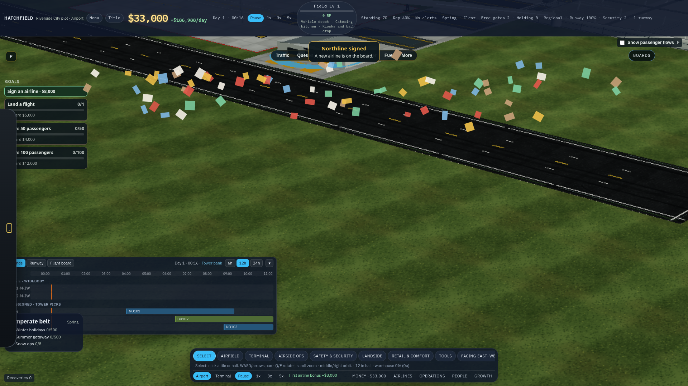

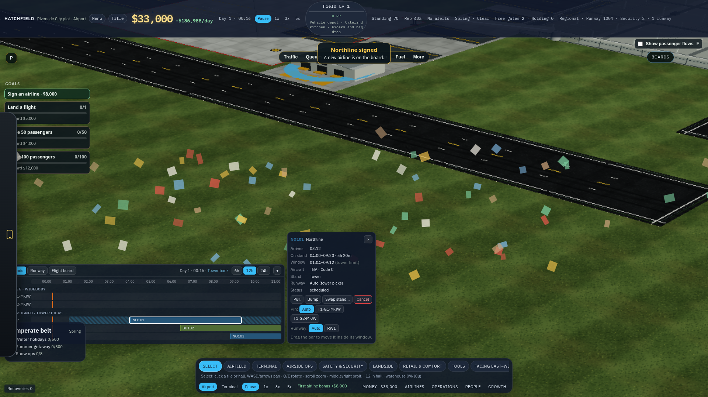

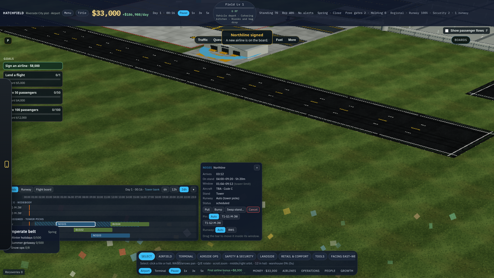

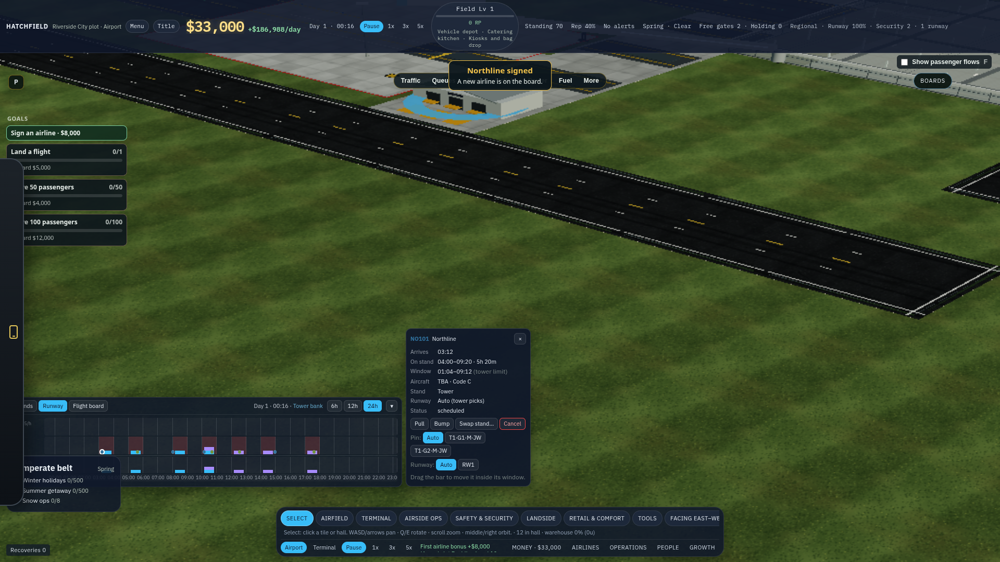


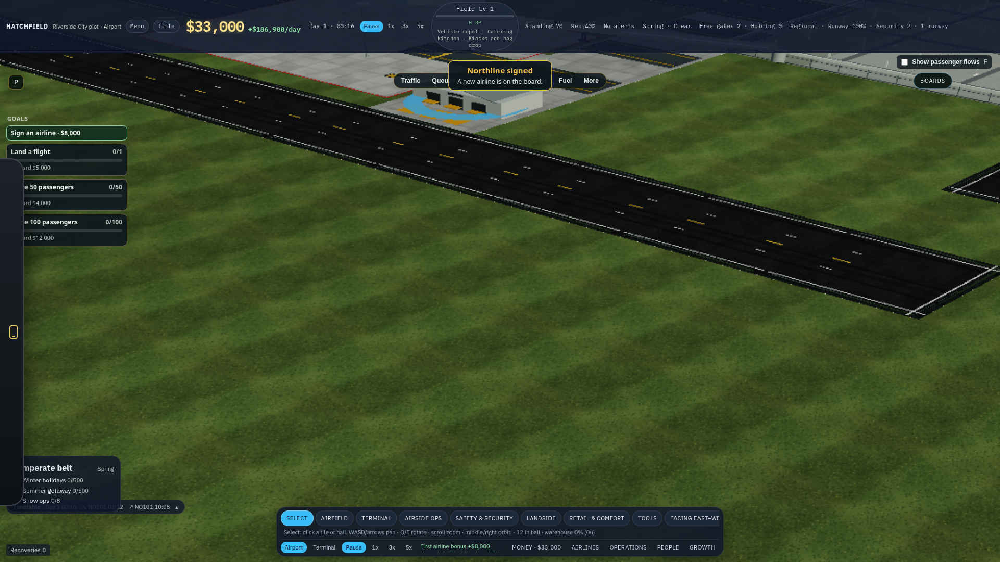

### The planner

Operations → Planner is the surface the taxonomy promises ("Timetable and the selected flight"). It is a right-hand manage panel. The top half repeats the flight card when a live flight is selected. The bottom half is a second editor:

- A strip labeled now to +2 m. The horizon is 120 sim seconds, which is 16 hours on the 24-hour face. The label is two real minutes.
- One chip per slot, airline colour, last three characters of the flight number. Delayed and stolen-by-emergency chips get a class.
- Runway filter buttons, Auto / Manual for the whole field, and a `+` button per signed carrier (first three only) that calls `addManualSlot`.
- A list of at most eight slots. Each row is flight, status, delay, runway, stand, aircraft, ETA in sim seconds, claim lane, and Pull / Bump / Stand / Runway / Cancel.
- Selecting a chip reveals ETA −10 / ETA +10 and a stand button per tile. Ten sim seconds is 80 game minutes.

Opening this panel unmounts the dock. The player cannot see the Gantt and the planner together, and the planner is the one they are sent to.

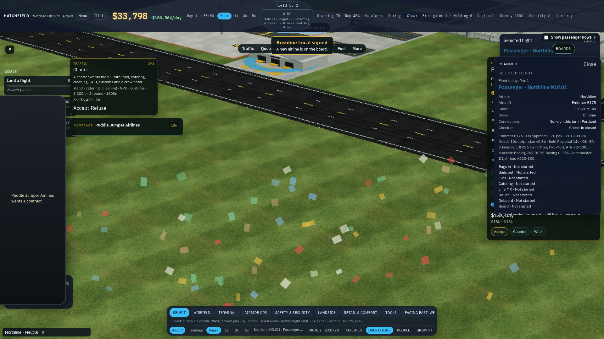

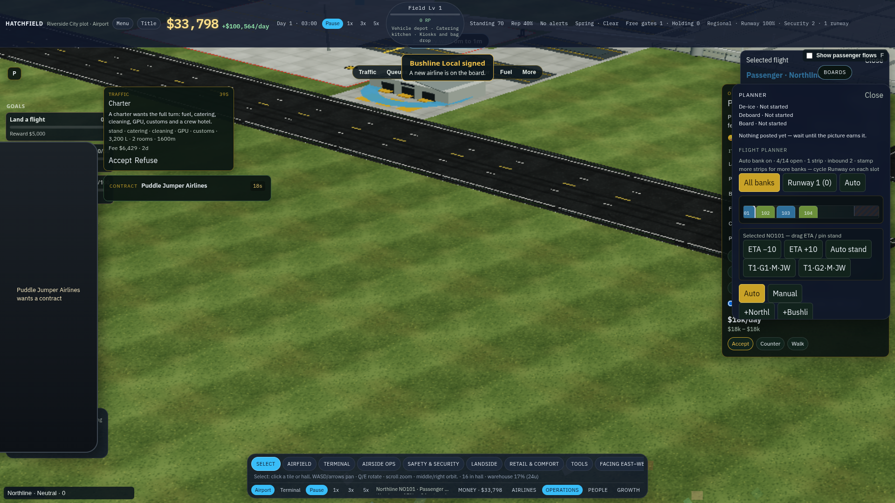

### The flight card

`src/ui/inspector/FlightCard.tsx` is the right edge, 320 px, above the alert dock. It opens when a flight on the apron is clicked. Planner shows the same body. The lines are airline, aircraft, stand (`T1·G2·M·JW` and the same shape), delay, connections, the turnaround grade, the phase, the service list, and the ledger. A GA turn can be released. This card is the live turn. It is a good card. It is not a schedule, and the schedule work should leave it where it is.

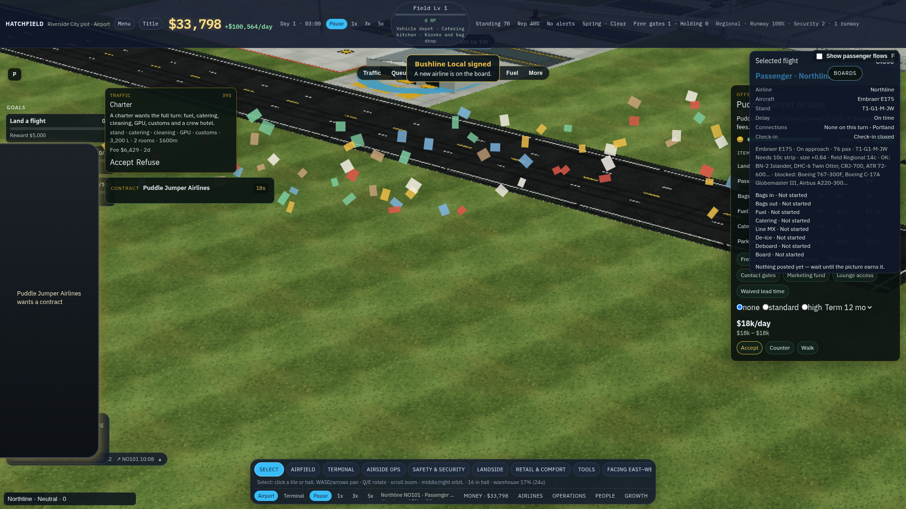

### Stands, airlines, hubs, phone

Operations → Stands is a count: how many stands, how many jetways, how many free. It does not show who is coming.

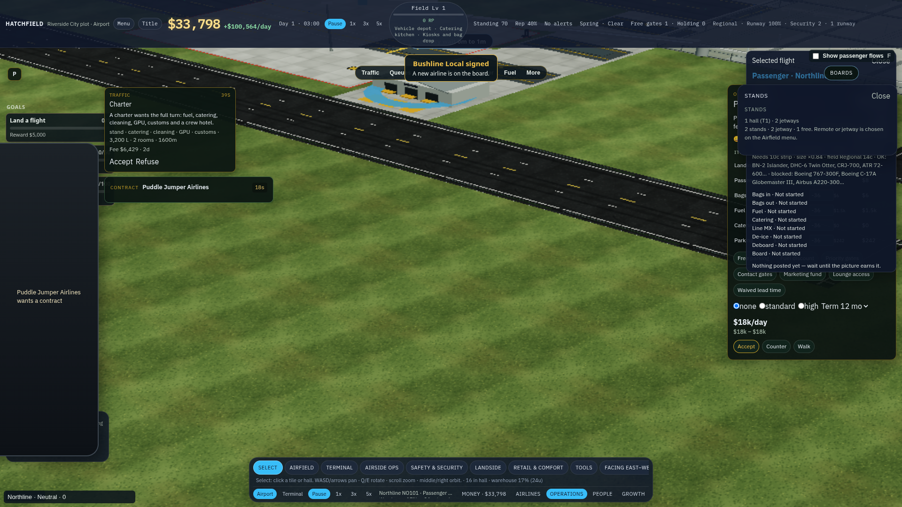

Airlines → Letters is the diplomacy roster, the relations submenu, and `HubSection`: tier, a checklist, dedicate buttons. Dedicate-a-desk stays disabled until the allocator exports a lease. A gate, a lounge, and a hangar bay can be dedicated now (`src/ui/hub/HubPanels.tsx`). None of that lease is drawn on a stand's day.

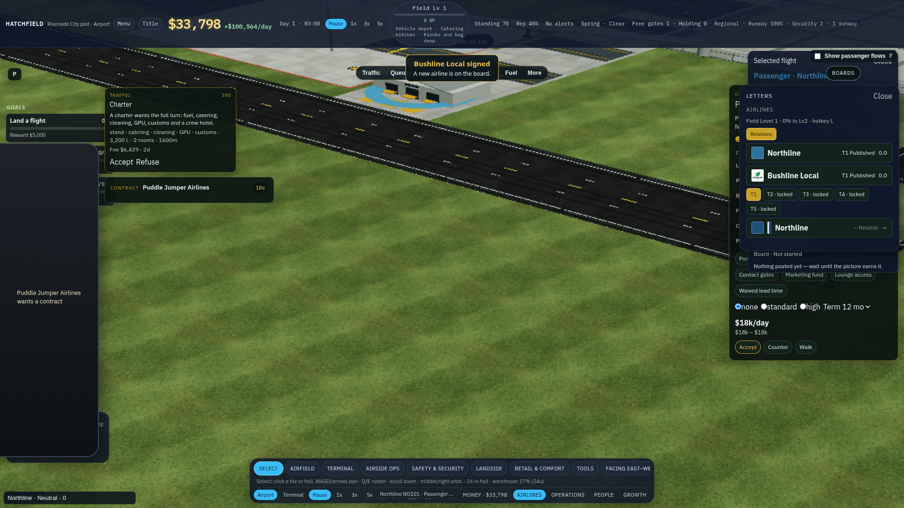

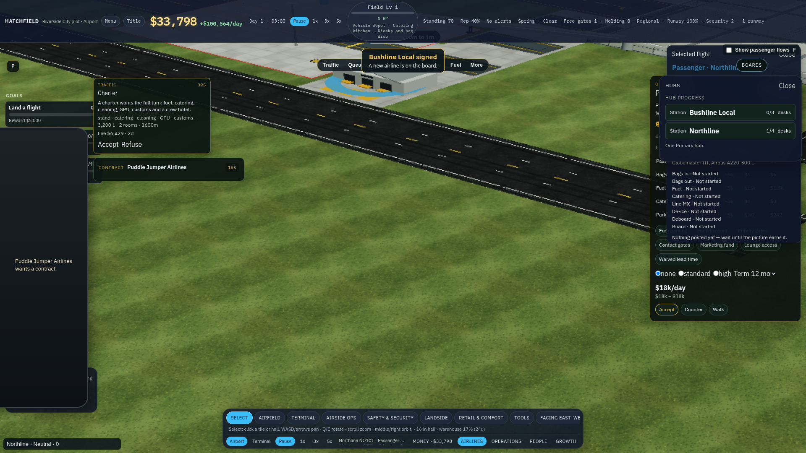

The phone's Contracts tab is the letter: sign or decline. A hub offer arrives as a message, not as a picture of the week it will add. Fuel contracts do not appear on the phone at all ([FUEL_CONTRACTS.md](./FUEL_CONTRACTS.md)). On this capture Harbor Air's letter was the open contract.

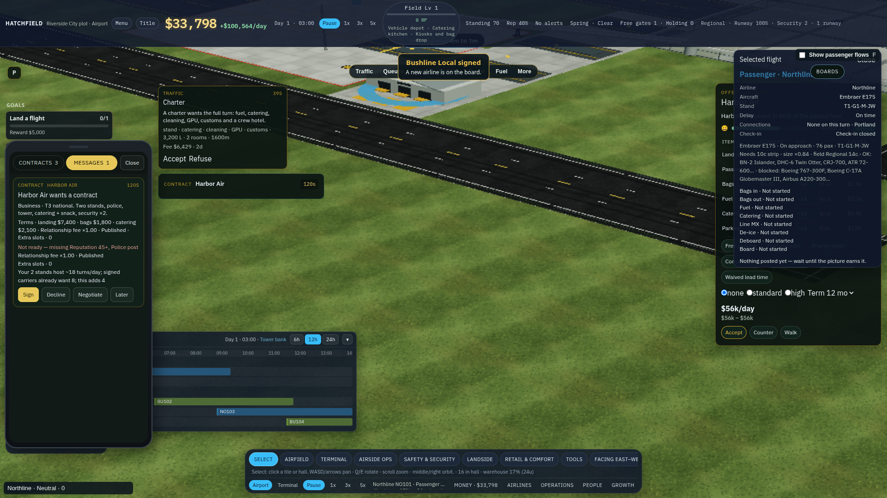

### The passenger board

The Boards button opens `src/fids/BoardPanel.tsx`, the same split-flap the terminal hangs. Columns are flight, airline, destination, time, gate, status (`src/fids/config.ts`). Eight rows. It is a display. Editing it would put the plan on the thing passengers read.

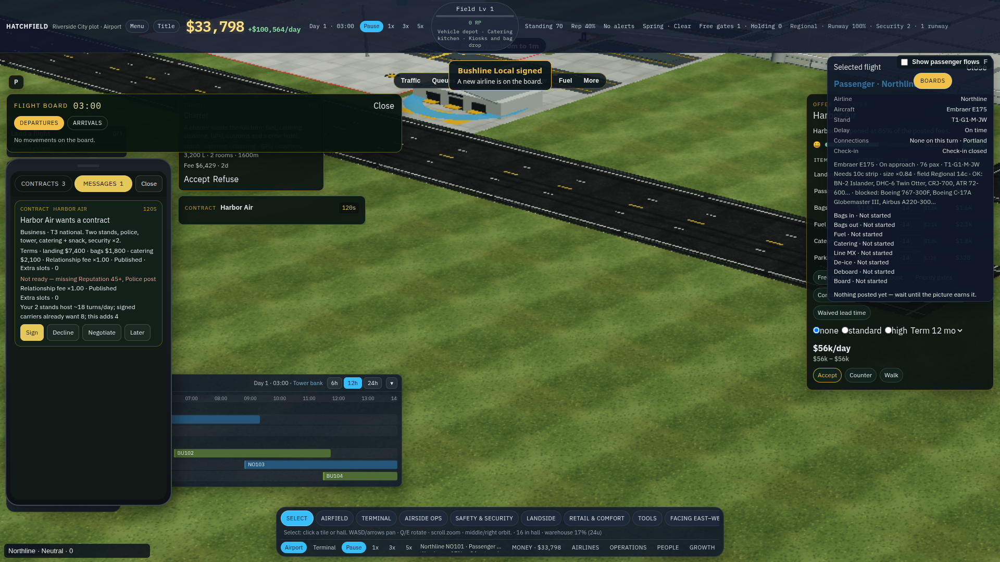

### The scheduler that is not on screen

`src/contracts/` already has the rules this UI wants, and [CONTRACTS.md](../CONTRACTS.md) says the HUD is later.

- A slot has a soft window and a hard window. The draft defaults are ±20 min and ±60 min.
- Drag inside the soft window is free. The hard band costs standing, once per line per week. Past the hard band the drag is refused.
- Stand pin refuses a stand that is too small. A clash is allowed and flagged red.
- Auto-schedule keeps pinned slots, then places hub, then historic series, then everyone else. The stand buffer defaults to 10 minutes (`standBufferMin`).
- Flags are `over_capacity` and `off_window`, with a sentence a card can show.
- `previewOffer` colours the offer's first week green / amber / red per hour.
- The 80/20 rule exists and defaults off.

`contractsAdapter.ts` can feed the dock from that module. The live dock uses `gameScheduleAdapter` and the tower window instead. The two editors in `Hud` call `pullSlot`, `bumpSlot`, `cancelSlot`, and `setSlotStandPref` on `game.schedule` directly.

### The clock lies to the manual buttons

A sim day is 180 s, drawn as a 24-hour face (`formatSimDate`). One sim second is eight game minutes. Night is the last third of the day, from 120 s.

`isBanned` is `airlineBanUntil[id] > clock`. A carrier with no ban stores 0. On this capture, a few hundred milliseconds after the starter kit, `clock` was −0.14. Every `addManualSlot` then posted "Northline is banned — no slots" and "Bushline Local is banned — no slots." Setting the clock to 2 s made the same calls land four slots. The auto bank is not affected: the starter still produced BU101 on its own. The `+` buttons and the dock's drag both depend on a clock that has crossed zero.

### What the player can and cannot do

| Job | Today |
| --- | --- |
| See the day by stand | Dock only, half the width, gone while Planner is open |
| Move a time | Dock drag inside a made-up window, or ETA ±10 s / Pull / Bump |
| Move a stand | Pin buttons, or cycle Stand. No vertical drag |
| See a clash | Red outline on the dock. The planner list does not say why |
| See the buffer | The dock's bar includes a multi-hour invented turn. No hatch for the gap after it |
| See check-in | The hall uses `planShowUp` from the departure. The chart does not draw it |
| See today's fuel | Services and the Fuel pill. The bank's litres are not on the schedule |
| See a hub lease | Checklist and dedicate buttons. The stand row is unlabeled |
| Sign the deal | Phone letter, with no picture of the week |
| Read the public board | Boards button. Correct, and separate |

## 3. Layout

1920×1080. The apron keeps the centre. Chrome stays on the edges. A second click on Planner, or on the pill, closes the sheet. Esc closes a sheet that was opened from the pill, after the flight card and before the pause sheet. A sheet opened as the Planner manage tab follows the manage-panel rule and stays until the tab is clicked again.

### Always on

The pill stays. It shows the 24-hour clock, the next arrival, and the next departure. It sits just right of the handset peek so the peek and the flash can use the left edge. It is one line, about 28 px, and it never covers a stand.

### The sheet

When the sheet is open it is a bottom band above the build bar.

| | Pixels at 1920×1080 |
| --- | --- |
| Left | 56, clear of the handset peek |
| Right | 16 margin. The alert dock stays in the bottom right and the sheet ends above it, or the dock shifts up for as long as the sheet is open |
| Height | 360, about a third of the frame |
| Label column | 168, the stand name `T1·G1·M·JW` on one line |
| Time axis | the rest, about 70 px per hour at 24 h |

Header, left to right: Stands, Runway, List. Then the clock and the source word (Tower, or Contracts once that adapter is the one on screen). Then the zoom, 6 h / 12 h / 24 h. Then a filter field. Then collapse.

The zoom scrolls a window across the selected day. It does not change what a time means. 24 h is the whole day and the default. 6 h is for dragging. Hour lines are solid on the hour. Half hours are faint. The now line is one colour and stays put while the day scrolls under it.

A bar that crosses midnight draws on both days. The next day's stub is visible when the window includes it. SimAirport's missing 00:00–01:00 slice is the bug this avoids.

Stand rows group by pier, then by gate number. A two-stand starter is two rows, not a taxonomy of ICAO letters. The ICAO code stays on the label (`M`, `L`) and in the filter. Unassigned turns sit in a top group, "Tower", packed into lanes, which the dock already does.

A dedicated gate lease puts the airline name on that row and tints the row with the livery. A preferred lease tints the row and still accepts other carriers. A spare row is marked Spare and the auto bank leaves it empty. The player sets spare from the row's menu.

### The bar

One bar per turn. Left edge is on-block. Right edge is off-block. Fill is the airline colour (`airline.color`). The flight number sits in the bar when the zoom gives it room. A pinned stand draws a small mark. A delay draws the planned end as a tick and the estimated end as the real right edge, in the same way the flight board already strikes the planned time.

Behind the bar, while it is selected or dragged, the soft window is a quiet band and the hard window is a wider, fainter band. That is the dock's hatched window, split in two so the free move and the costly move look different.

After the bar, a hatch of `standBufferMin` (10 game minutes until a tunable says otherwise). The hatch turns amber when the next turn on that stand starts inside it. The bar itself turns red when the next turn starts before off-block, or when the stand's code cannot take the aircraft. The sentence for the red and the amber lives in the popover, from the flag text the contracts module already builds.

Check-in is off until the header toggle "Check-in" is on. Then each passenger departure grows a ghost from show-up open to check-in close, using `src/pax/showup.ts` and that slot's STD. The ghost is a thin band under the bar, not a second bar the player can drag. International close is 45 game minutes before STD. Domestic is 30. Leisure show-up opens at 180. Business and premium open at 120. The outer lead is 240. Those constants stay the only copy.

### The popover

Clicking a bar opens a card anchored to the bar, inside the sheet. It is the dock's flight card, with the costs written on the buttons.

- On-block and off-block on the 24-hour face, plus the delay and its reason.
- Aircraft and code.
- Stand, and whether it is pinned, tower, spare, or a lease.
- Runway, when the field has more than one.
- Window, soft and hard, labeled contract slot or tower limit.
- Turn target, from the contract when the slot has one, otherwise the class turn.
- Services the turn bought.
- The flag sentence, if there is one.
- Pull, Bump, and Cancel, each with the standing cost on the button. Cancel already posts a standing line in the news. The button should say it before the click.
- A stand list that scrolls, so a pier with more than eight stands is not clipped.

The right-edge flight card does not move. A future slot uses the popover. A live aircraft uses the flight card. When the selected turn is the aircraft already on the stand, the flight card is the one that opens and the popover stays shut.

### Runway and list

The runway tab stays the histogram the dock has: one lane per strip, an Auto lane, a Total lane, arrivals and departures stacked, a capacity line, the hour turning red when the hour is over. Clicking an hour still opens that hour's counts. This tab is how a second runway earns its money.

The list tab replaces the planner's eight-row list. It is every open turn for the selected day, soonest first, with the filter applied. Columns: time (planned, and estimated when they differ), flight, airline, stand, runway, status. A late estimated time is red. Clicking a row selects the bar and scrolls the Stands tab to it. The list is the quick view. It is not a second editor with its own ±10 buttons.

### What happens to today's planner panel

Planner opens the sheet and keeps a short right-hand summary: the selected live flight (the existing card) and one line of bank health (open slots, strips, inbound, weather). The day strip, the ETA ±10 row, the eight-row action list, and the global Auto / Manual pair leave that panel once the sheet has them. Until that ticket lands, the sheet and the panel must not both be able to move the same slot.

### Offer preview

A contract letter on the phone gains one control, "Show on the schedule". It opens the sheet with that offer ghosted for the first week, using `previewOffer`: green, amber, and red hours, and the warning sentence ("this line exceeds declared stand capacity 07:00–09:00"). Accept and Decline stay on the letter. Signing is still never blocked by a red hour, which is the contracts rule.

## 4. Interactions

Times in the sheet are the 24-hour face. A control that moves a slot by a sim-second step says the face delta ("+16 min"), never "ETA +10".

| Action | Result |
| --- | --- |
| Drag a bar left or right | Moves on-block. Inside the soft window, free, and the time pins so the next auto run keeps it. Inside the hard window, the popover names the standing cost and the drop applies it. Past the hard window, the bar snaps back. |
| Drag a bar to another row | Pins that stand when the aircraft fits. A stand that is too small refuses and the bar returns. A clash is allowed, outlined red, and named. A dedicated lease refuses every other airline. |
| Drag a bar onto Spare | Allowed. The spare holds the turn. Auto will not fill a spare on its own. |
| Drop on the Tower group | Clears the pin. The tower may move it. |
| Pull / Bump | The same moves as drag, one step, for a player who does not want to drag. The step is a tunable in the schedule config, shown in face minutes. |
| Cancel | Removes the slot, abandons its show-up, and applies the standing hit the sim already applies. The button states the hit. |
| Swap | Stays available from the popover. Both stands must fit. |
| Pin runway | Stays, on the popover, when the field has more than one strip. |
| Filter | Airline, conflicts only, code, hub carrier, spare, unassigned. A flight-number field. Clearing the field is the first Esc inside the sheet, then Esc closes a pill-opened sheet. |
| Zoom | 6 h, 12 h, 24 h. The selected bar stays in view. |
| Day | Previous and next day. Commercial lead times already push a first flight out by days. The chart has to show that day. |
| Check-in toggle | Draws the ghost. Does not edit it. |
| Auto, per airline | The tower banks that airline's unpinned slots. Manual pins what the player dragged and leaves the rest. The global on/off becomes the default for a newly signed carrier. |
| Spare | Row menu. Auto skips the row. A late inbound and an emergency may use it. |
| Keyboard | The pill's open stays a click. No new global key that fights the build bar. |

Locked bars are the ones the dock already locks: inbound, on stand, departing, done, cancelled. The popover says "Locked: already in the air or on the ground."

A drag that the sim will cascade ("Bump slid three later slots") previews the cascade as ghost bars before the drop, and the drop applies the cascade the sim already runs. The player sees the slide before they commit to it.

## 5. Relations, hubs, fuel, and the hall

The sheet reads these. It does not grow a second diplomacy screen, a second fuel desk, or a second check-in sim.

### Relations

The relationship tier already grants extra timetable slots (`slotLine` on the relations card). Those owed turns appear on the Tower group as empty outlined blocks, "owed", in that airline's colour, until the tower or the player fills them. Cancelling a filled turn still costs standing. The sheet does not invent a new score.

A carrier's colour is the livery colour the aircraft and the airlines card already use. The stripe colour can be a 3 px edge on the bar so two blues still separate. The legend is the filter's airline list, not a permanent key.

### Hubs

A dedicated gate lease labels the row and blocks other carriers' drops. A preferred lease sorts that airline first when auto runs and still accepts overflow. Releasing the lease clears the label on the next draw. The checklist and the dedicate buttons stay on Airlines, where they are. The sheet is the picture of the lease, not the place you sign it.

A hub offer's ghost uses the same preview as any other letter. The denser bank the plaque promises should be visible before Accept. Focus, Base, Hub, and Primary stay phone offers.

The connection window in [HUB_PROGRESSION.md](./HUB_PROGRESSION.md) (on-block of the inbound to the last moment an onward seat is held) can be a later toggle on the same ghost channel as check-in. It is not in the first tickets. Cargo's night sort is the same kind of ghost, on freighter bars only, and waits with it.

### Fuel

The sheet's footer is one line: litres the visible day's turns will uplift, litres in the tank, the supplier name. The numbers come from the fuel demand the scale module already computes. Clicking the line opens Operations → Services, which remains the only place to sign a supplier. A fuel-hook lease, when hub progression adds one, paints a small mark on that airline's bars. It does not open a second contract.

A day the tank cannot cover turns the footer amber. The bars do not turn red for fuel. Fuel grounding stays a services fact, and the flight card already says when a turn is waiting on fuel.

### Check-in and the hall

Show-up is planned when a slot is banked, from STD. Moving a slot has to restamp that plan, which `ShowUpSeat.leadSimSec` is already there for. The ghost is that plan, drawn. Desk leases, when the allocator exports them, get a later Check-in tab: one row per desk, the airline's departures as bands from open to close. Until those leases exist, the toggle on the stand chart is enough, and it tells the player why the hall is busy an hour before the aircraft.

The passenger board reads the same times the sheet edits. A delay that moves off-block updates the estimated column. The scheduled time stays. Status words stay the ones the flap already has.

### Series

When `slotRule80` is off, the sheet says nothing about history. When a later ticket turns it on, a bar can carry a quiet "series" mark and the popover can say how much of the series was flown. A late turn does not burn the series by itself. That split is the IATA note above, and it is already how `slotRule.ts` is written.

## 6. Wireframes

1920×1080. The top bar, the info pills, and the build bar are the ones in the UI spec. Only the schedule band is new.

```
┌ top bar ─────────────────────────────────────────────────────────────────────────────┐
│ info pills                                                                            │
│                                                                                       │
│   apron                                                         ┌ Selected flight ──┐ │
│                                                                 │ NO101 · Northline │ │
│                                                                 │ On approach       │ │
│                                                                 │ services, ledger  │ │
│                                                                 └───────────────────┘ │
│ ┌ schedule ──────────────────────────────────────────────────────────────────────── ┐ │
│ │ Stands  Runway  List     Day 3 · 14:20 · Tower     6h 12h [24h]   [filter]   ▾  │ │
│ │        12:00      14:00      16:00      18:00      20:00      22:00      00:00  │ │
│ │ Tower  ┆ ░░░░░░░░░░░░░░░░░░░░░░░░░░░░░░░░░░░░░░░░░░░░░░░░░░░░░░░░░░░░░░░░░░░░ ┆ │ │
│ │        ┆              (owed) Harbor                                            ┆ │ │
│ │ T1·G1  ┆     ████ NO101 ████▒▒     ████ NO103 ████▒▒                            ┆ │ │
│ │  ·M·JW ┆                                                                       ┆ │ │
│ │ T1·G2  ┆            ████ BU102 ████▒▒        ████ BU104 ████▒▒                  ┆ │ │
│ │ Spare  ┆                                                                       ┆ │ │
│ │ Bank uplift 18,400 L · tank 80,000 L · Apex Local                                            │ │
│ └───────────────────────────────────────────────────────────────────────────────────┘ │
│ build bar                                                                          ▲  │
└ phone peek ──────────────────────────────────────────────────────────────────────────┘

████ turn, airline colour     ▒▒ buffer hatch     ░ soft window, while the bar is held
red outline = clash or too small     amber hatch = next turn starts inside the buffer
```

Popover, anchored to NO101:

```
┌ NO101 · Northline ──────────────── × ┐
│ On block     14:40                   │
│ Off block    16:05 · turn 1 h 25 min │
│ Window       14:20–15:00 soft        │
│              13:40–15:40 hard        │
│ Aircraft     ATR 72-600 · Code C     │
│ Stand        T1·G1·M·JW (pinned)     │
│ Runway       Auto                    │
│ Buffer       10 min · clear          │
│ Check-in     12:20–14:10 · domestic  │
│                                      │
│ [Pull · 16 min] [Bump · 16 min]      │
│ [Swap stand…] [Cancel · standing −2] │
│ Pin  Auto  T1·G1  T1·G2              │
└──────────────────────────────────────┘
```

List tab, same day, same filter:

```
Time     Flight   Airline          Stand        Status
14:40    NO101    Northline        T1·G1·M·JW   On time
15:10    BU102    Bushline Local   T1·G2·M·JW   On time
16:40    NO103    Northline        T1·G1·M·JW   On time
17:20    BU104    Bushline Local   T1·G2·M·JW   17:20  17:36 late
```

Check-in ghost, toggle on, under NO101 only:

```
T1·G1  ┆ ·············████ NO101 ████▒▒
       ┆  check-in 12:20 → 14:10
```

Offer ghost from the phone, before Accept:

```
┌ Harbor Air · T3 offer ───────────────┐
│ 4 turns on the week you are signing  │
│ Thu 07:00–09:00 stands over capacity │
│ [Show on the schedule]               │
│ [Accept]  [Decline]                  │
└──────────────────────────────────────┘
```

The ghost hours use the green / amber / red `previewOffer` already returns. The letter does not become a chart.

## 7. Tickets

Each ticket is one change. Tunables go in a config file, not in the component. `src/diplomacy` stays untouched. The flight card's markup stays. The FIDS columns stay. Tests are vitest. A layout ticket also gets a 1920×1080 shot.

The turn lengths and the buffer are the first config, so later tickets do not invent a third clock. Suggested file `src/ui/timetable/scheduleConfig.ts`, values in game minutes, read through `GAME_MINUTES_PER_SIM_SECOND`:

| Key | Starting value | Why |
| --- | --- | --- |
| `turnMin.narrow` | 45 | [TURNAROUND_REFERENCE.md](./TURNAROUND_REFERENCE.md), A320 / 737 full turn |
| `turnMin.wide` | 75 | 787 / A350 band |
| `turnMin.heavy` | 110 | 777 / A380 band |
| `turnMin.regional` | 30 | Below the narrowbody turn, for the ATR and the Twin Otter |
| `standBufferMin` | 10 | `DEFAULT_SCHEDULER_OPTIONS` |
| `softWindowMin` | 20 | Contracts draft |
| `hardWindowMin` | 60 | Contracts draft |
| `dragStepMin` | 16 | Replaces the ±10 sim-second nudge with a face step |

A slot that already carries `turnTarget` uses that instead of the class minute. These numbers are a proposal for the config. They are not a retune of the live economy by themselves. Wiring them is ticket 2.

### 1. One sheet

**Files:** `src/ui/Hud.tsx` (the mount, and the planner block only), `src/ui/timetable/GameTimetable.tsx`, `src/ui/timetable/Timetable.tsx`.

**Build:** Opening Operations → Planner opens the dock. The dock stays mounted while that panel is open. The pill opens the same dock. The handset flash must not cover the header tabs. Move the pill and the sheet's left edge to 56 px, past the peek. A click on Runway, List, or a zoom hits the sheet.

**Accept:** With a contract flash up, the three tabs still receive the click. Planner open and the pill open show one dock, not two. Closing Planner does not destroy a dock the pill still wants. A unit or e2e test covers the mount.

### 2. One turn length

**Files:** `src/ui/timetable/scheduleConfig.ts` (new), `src/ui/timetable/gameAdapter.ts`, `src/ui/timetable/timetable.test.ts`.

**Build:** The bar's on-stand interval comes from the config, converted with the show-up minute constant. Delete the 40 / 55 / 90 sim-second table in the adapter. STD for the ghost and for show-up is on-block plus that same turn.

**Accept:** A code C bar on the 180 s day is 45 game minutes wide, not 5 h 20 min. A test locks the minute values and the conversion. `PLANNED_TURN_SEC` is either pointed at this config or left with a comment that ticket 2's number replaces it. Do not leave both live.

### 3. Wide day

**Files:** `src/ui/timetable/timetable.css`, `src/ui/timetable/Timetable.tsx`.

**Build:** Open sheet is the band in [The sheet](#the-sheet): left 56, height 360, above the build bar, label column 168. Default zoom 24 h. Hour and half-hour lines. Rows group by pier and gate. A bar that crosses midnight draws the stub.

**Accept:** At 1920×1080 the 24 h axis is wider than 1400 px. A starter with two stands shows two rows plus Tower. A screenshot at 1920×1080 is attached to the PR.

### 4. Drag onto a stand

**Files:** `src/ui/timetable/Timetable.tsx`, `src/ui/timetable/types.ts`, `src/ui/timetable/gameAdapter.ts`.

**Build:** A vertical drag calls `pinStand`. Too small refuses. A dedicated lease refuses other airlines. A clash pins anyway and stays red. Drag past the hard window snaps back. Drag inside the hard window and outside the soft window applies the standing cost the contracts adjust path already defines, and the popover says the cost before release. The adapter may keep calling `pullSlot` / `bumpSlot` until the contracts state is the source, and the face delta is what the player sees.

**Accept:** A test drags a code C flight onto a code C stand and onto a stand it does not fit. A test refuses a drop past the hard window. The too-small stand does not change `standPref`.

### 5. Buffer and the words

**Files:** `src/ui/timetable/layout.ts`, `src/ui/timetable/Timetable.tsx`, `scheduleConfig.ts`.

**Build:** Draw the buffer hatch from `standBufferMin`. Amber when the next bar on the row starts inside the hatch. Red stays overlap or too small. The popover shows the flag sentence. Pull, Bump, and Cancel name their standing effect.

**Accept:** Two bars 5 minutes apart flag amber and not red. Two bars that overlap flag red. The popover text includes the minute gap.

### 6. Check-in ghost

**Files:** `src/ui/timetable/Timetable.tsx`, `src/ui/timetable/gameAdapter.ts`. The ghost reads `src/pax/showup.ts`. It does not copy the minute constants.

**Build:** A header toggle, off by default, draws the show-up band for passenger departures. Moving the bar restamps the show-up plan.

**Accept:** A domestic narrowbody STD at 14:40 draws 12:20–14:10. An international widebody uses the 45-minute close. The toggle hides the band. A test covers both closes.

### 7. List, filter, day

**Files:** `src/ui/timetable/Timetable.tsx`, `src/ui/timetable/layout.ts`.

**Build:** The flight board becomes the List tab and lists the selected day, not a clipped eight. Filter by airline, conflict, code, and flight number. Previous and next day. The planner panel drops its day strip, its ±10 buttons, and its eight-row action list in the same change, so one slot has one editor.

**Accept:** A filter of one airline hides the other airline's bars and rows. The list shows a late estimate in red with the planned time struck. The planner panel no longer calls `nudgeSlotEta`.

### 8. Auto per airline, spare, owed slots

**Files:** `src/ui/timetable/Timetable.tsx`, the schedule adapter, and the smallest sim hook that already implements `setScheduleAuto`. Per-airline auto should call the contracts `setAuto` if that state is wired, or a single map on the game if it is not. Do not add a second banking algorithm.

**Build:** Auto is per airline, with the old global switch as the default for a new signature. A row can be marked spare and auto skips it. Owed extra slots from the relationship tier render as empty blocks.

**Accept:** Manual on one carrier leaves the other's auto bank alone. A spare row has no auto bar. A carrier with `extraSlots` shows that many owed blocks.

### 9. Letter preview and the fuel line

**Files:** `src/ui/phone/Phone.tsx` (one button on the contract card), `src/ui/timetable/Timetable.tsx` footer, `src/contracts/preview.ts` as a reader.

**Build:** "Show on the schedule" ghosts `previewOffer` for the open letter. The footer reads the day's uplift, the tank, and the supplier, and opens Services on click.

**Accept:** A red hour on the ghost does not disable Accept. The footer figures match the fuel view's litres for the same field. The phone still does not list fuel contracts.

### 10. The clock guard

**Files:** `src/game/sim.ts` `isBanned` only, plus its test.

**Build:** A carrier with no ban is not banned while the clock is negative. The comparison should treat "never banned" as a missing time, not as time zero.

**Accept:** The capture in this note, repeated: a fresh field with `clock < 0` can `addManualSlot` for a signed carrier. An active ban still refuses.

Ticket 10 is a one-line fix found while shooting this note. It can land before the sheet, and it should, because the `+` buttons are wrong until it does.

## 8. Leave these

- A Gantt inside the handset. The letter stays a letter.
- Editing the split-flap board. Passengers read it. The sheet edits the plan it displays.
- A depart button per flight.
- OTP as the 80/20 test.
- A new turnaround length in the component. Ticket 2's config is the length.
- Replacing the flight card, the build bar, the manage taxonomy, or the airlines checklist.
- A modal over the apron.
- Staff assigned to a stand from this sheet. That is a different project, and [STAND_UPGRADES.md](./STAND_UPGRADES.md) already says so.
- Dragging check-in open and close. The ghost is a consequence of STD.
