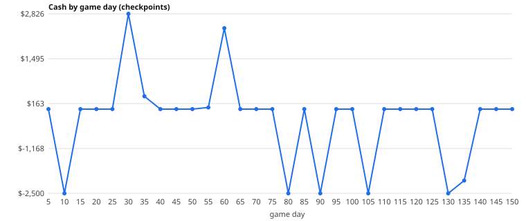

# Scripted playthrough report

Generated by `tests/scripted-playthrough/playthrough.mjs` (issue #153). Do not hand-edit the generated sections; the notes at the bottom are written after the run.

- Requested days: 150; **reached: day 150** (day 151 00:11)
- Wall time this session: 4.5 min; stuck-flight threshold: 2 game hours
- Money lines logged: 4378; flight phase events: 3274; console/page errors: 0

## Steps done

- open http://127.0.0.1:5406/
- New game (sandbox OFF) -> Passenger start
- Economy tab -> starter kit
- Place starter kit: done
- Sign Bushline and Zoomjet contracts
- Take a loan
- loan taken: +$45000 cash, balance 47800
- Buy a shop (Souvenirs room)
- Try a research purchase
- research not affordable at start (RP 0); retrying every 5 days
- Run 150 game days at speed 5 (render off)
- research bought on day 6: night_bank

## Money timeline

| Day | Cash | Income (bank) | Costs (bank) | Flights done | Pax lost | Bags lost | Stuck vehicles | Anomalies so far |
|---|---|---|---|---|---|---|---|---|
| 5 | $0 | $100,757 | $-70,807 | 19 | 0 | 0 | 0 | 3 |
| 10 | $-2,500 | $216,459 | $-110,432 | 37 | 0 | 0 | 0 | 5 |
| 15 | $0 | $301,987 | $-119,129 | 53 | 0 | 0 | 0 | 5 |
| 20 | $0 | $405,381 | $-141,553 | 69 | 0 | 0 | 0 | 5 |
| 25 | $0 | $506,068 | $-156,349 | 87 | 0 | 0 | 0 | 5 |
| 30 | $2,826 | $602,891 | $-172,378 | 103 | 0 | 0 | 0 | 5 |
| 35 | $380 | $697,036 | $-193,825 | 121 | 0 | 0 | 0 | 5 |
| 40 | $0 | $787,064 | $-208,710 | 138 | 0 | 0 | 0 | 5 |
| 45 | $0 | $894,369 | $-235,327 | 156 | 0 | 0 | 0 | 5 |
| 50 | $0 | $1,004,324 | $-285,371 | 172 | 0 | 0 | 0 | 5 |
| 55 | $48 | $1,099,745 | $-332,156 | 190 | 0 | 0 | 0 | 6 |
| 60 | $2,400 | $1,165,630 | $-370,546 | 199 | 0 | 0 | 0 | 8 |
| 65 | $0 | $1,207,338 | $-388,612 | 206 | 0 | 0 | 0 | 8 |
| 70 | $0 | $1,271,475 | $-409,283 | 212 | 0 | 0 | 0 | 8 |
| 75 | $0 | $1,304,345 | $-432,881 | 218 | 0 | 0 | 0 | 8 |
| 80 | $-2,500 | $1,355,069 | $-457,669 | 222 | 0 | 0 | 0 | 8 |
| 85 | $0 | $1,405,455 | $-481,925 | 230 | 0 | 0 | 0 | 9 |
| 90 | $-2,500 | $1,458,737 | $-502,977 | 236 | 0 | 0 | 0 | 9 |
| 95 | $0 | $1,507,047 | $-525,305 | 240 | 0 | 0 | 0 | 9 |
| 100 | $0 | $1,558,195 | $-556,651 | 248 | 0 | 0 | 0 | 9 |
| 105 | $-2,500 | $1,620,644 | $-577,125 | 255 | 0 | 0 | 0 | 9 |
| 110 | $0 | $1,690,573 | $-611,914 | 262 | 0 | 0 | 0 | 9 |
| 115 | $0 | $1,757,331 | $-643,756 | 270 | 0 | 0 | 0 | 10 |
| 120 | $0 | $1,839,317 | $-672,705 | 278 | 0 | 0 | 0 | 10 |
| 125 | $0 | $1,889,964 | $-690,690 | 286 | 0 | 0 | 0 | 10 |
| 130 | $-2,500 | $1,947,494 | $-711,280 | 293 | 0 | 0 | 0 | 10 |
| 135 | $-2,120 | $2,007,281 | $-742,511 | 300 | 0 | 0 | 0 | 10 |
| 140 | $0 | $2,063,815 | $-773,978 | 306 | 0 | 0 | 0 | 10 |
| 145 | $0 | $2,131,152 | $-806,856 | 315 | 0 | 0 | 0 | 10 |
| 150 | $0 | $2,173,223 | $-829,157 | 320 | 0 | 0 | 0 | 10 |

### Bank totals by category at day 150

| Category | Net |
|---|---|
| landing_fees | $734,574 |
| fuel_sales | $653,440 |
| building_upkeep | $-476,590 |
| parking_fees | $467,721 |
| payroll | $-295,567 |
| contract_fees | $167,760 |
| retail_sales | $72,066 |
| penalties | $-57,000 |
| passenger_fees | $34,647 |
| baggage_fees | $31,204 |
| catering_fees | $11,811 |

## Findings (10)

1. **high** `contract-mismatch` Flight from "harbor" with no active contract
   - game time: day 56 02:01
   - evidence: flight amb-dg9w1q first seen in "approach"; signed=never
2. **medium** `script-gap` could not sign zoomjet
   - game time: day 1 00:00
   - evidence: {"ok":false,"why":"airline not in game.allAirlines() (it only exists in negotiation/diplomacy data)"}
3. **medium** `low-fee` Income of $0: N231B bag handling (x30, first shown)
   - game time: day 6 23:41
   - evidence: earn "N231B bag handling" amount=0 cash 7181 -> 7181
4. **medium** `stuck-flight` 10x flight in "servicing" > 2 game h (bushline)
   - game time: day 10 12:21
   - evidence: worst: amb-oi8sv2 3.3 game h; key bushline@servicing
5. **medium** `stuck-flight` 71x flight in "taxi_out" > 2 game h (bushline)
   - game time: day 12 14:21
   - evidence: worst: amb-rf0d0q 2.5 game h; key bushline@taxi_out
6. **medium** `stuck-flight` 1x flight in "board" > 2 game h (bushline)
   - game time: day 51 12:21
   - evidence: worst: flt-uvolp6 2.2 game h; key bushline@board
7. **medium** `stuck-flight` 23x flight in "taxi_out" > 2 game h (harbor)
   - game time: day 57 09:11
   - evidence: worst: amb-tzy5yg 2.2 game h; key harbor@taxi_out
8. **medium** `stuck-flight` 6x flight in "servicing" > 2 game h (harbor)
   - game time: day 96 02:41
   - evidence: worst: amb-7ags9f 2.5 game h; key harbor@servicing
9. **medium** `stuck-flight` 1x flight in "taxi_out" > 2 game h (ga)
   - game time: day 113 00:51
   - evidence: worst: ga-vh93k6 2.2 game h; key ga@taxi_out
10. **low** `unledgered-cash` 1358 cash changes had no earn/spend/charge line (net 2089318)
   - game time: day 1 00:02
   - evidence: day 1 00:02 +45000 (action: loan); day 1 03:19 +162 (residual cash change (payroll/upkeep/loan/etc. outside earn/spend/charge)); day 1 04:21 +282 (residual cash change (payroll/upkeep/loan/etc. outside earn/spend/charge)); day 1 06:21 +18 (residual cash change (payroll/upkeep/loan/etc. outside earn/spend/charge)); day 1 08:21 -1250 (residual cash change (payroll/upkeep/loan/etc. outside earn/spend/charge))

## Could not do

- could not sign zoomjet: {"ok":false,"why":"airline not in game.allAirlines() (it only exists in negotiation/diplomacy data)"}

Screenshots: `media/scripted150/day010.png`, `media/scripted150/day020.png`, `media/scripted150/day030.png`, `media/scripted150/day040.png`, `media/scripted150/day050.png`, `media/scripted150/day060.png`, `media/scripted150/day070.png`, `media/scripted150/day080.png`, `media/scripted150/day090.png`, `media/scripted150/day100.png`, `media/scripted150/day110.png`, `media/scripted150/day120.png`, `media/scripted150/day130.png`, `media/scripted150/day140.png`, `media/scripted150/day150.png`.
Checkpoints: `docs/devlog/scripted150/`.

## Notes (written after the run)

The full 150 days fit in about 4.5 wall minutes with rendering stubbed, so the report is the 150-day run, not the 30-day cut. The game is not seeded, so a rerun gives different counts.

The player is passive: it signs one carrier, takes a loan and sits at max speed. Several points below are what happens to that player, not only bugs.

**Economy**
- Cash is pinned at about $0 (or the -$25,000 floor in `charge()`) from day 5 onward and ends at $0. 172 money lines landed on the floor.
- The loan is never repaid: balance $47,800 on day 5, $100,380 from day 30. It only grows.
- Reputation falls from 78 (day 5) to 0 on day 15 and stays between 0 and 14 for the rest of the run. The Bushline contract is gone by day 60 (`activeAirlines` is empty), so late flights are only GA and the `harbor` ambient carrier.
- Largest charges: `crashFlight` at $35,951 x81, `resolveEmergency` $2,500 x198, `closeOperatingDay` $2,330 x150 and $3,597 x106, `shockStock` $4,000 x73. ~80 crash charges with no `crash` phase event in the flight log is worth a look in `crashFlight`.
- Bank ledger vs cash: the bank shows $2.17M income and $0.83M costs by category, but cash moved by +$2.66M / -$0.57M with no `earn`/`spend`/`charge` line (grouped in the `unledgered-cash` finding). Payroll, upkeep and the loan principal bypass the three wrapped methods. That may be by design (they post to the bank directly), but a ledger built only from `earn/spend/charge` will not reconcile to cash.
- `spend()` never logged a price of $0 or $1, and a scan of 100 `cost/price/fee/sign` numbers exported from `src/game/catalog.ts` and of the fee card found no $0, $1, NaN or negative price.

**Findings, by type**
- NaN / Infinity cash or amounts: none.
- Double-spend: none in the final run. An earlier run flagged two identical $2,500 charges in the same tick, from the same code path; it did not recur.
- $0 fees: `<tail number> bag handling` earns $0 on 30 general-aviation flights (the wrapper sees `earn(0, ...)`, which `earn()` silently drops). Probably the GA bag fee rounds to 0.
- Stuck flights (> 2 game hours in one phase): `taxi_out`, `servicing`, `board` for `amb-*` flights of bushline and harbor, and a few `flt-`/`ga-` flights. These are 2.2-3.3 game hours, so they are mostly long normal turnarounds against a strict 2 h limit rather than hard stalls. `parked` is ignored on purpose.
- Fleet vs contract: `harbor` flights (`amb-*` ids) fly with no `harbor` contract. Zoomjet cannot be signed at all (see below).
- Console / page errors: none.
- Stuck vehicles: 0 at every checkpoint.
- Passengers / bags lost: 0 / 0 at every checkpoint.

**Script could not do**
- Zoomjet: `id: 'zoomjet'` exists only in `src/negotiation/data.ts` and `src/diplomacy/data.ts`; `game.allAirlines()` has no such carrier, so it cannot be signed through `acceptNegotiation()` / `acceptOffer()`. Reported as a script-gap finding.
- Research at the start: 0 RP, so the first purchase failed. `night_bank` was bought on day 6.
- A cold Vite cache makes the first page load slow (about 14 s). A file written under the repo during the run triggers a full page reload, which is why published files are copied after the browser closes.
