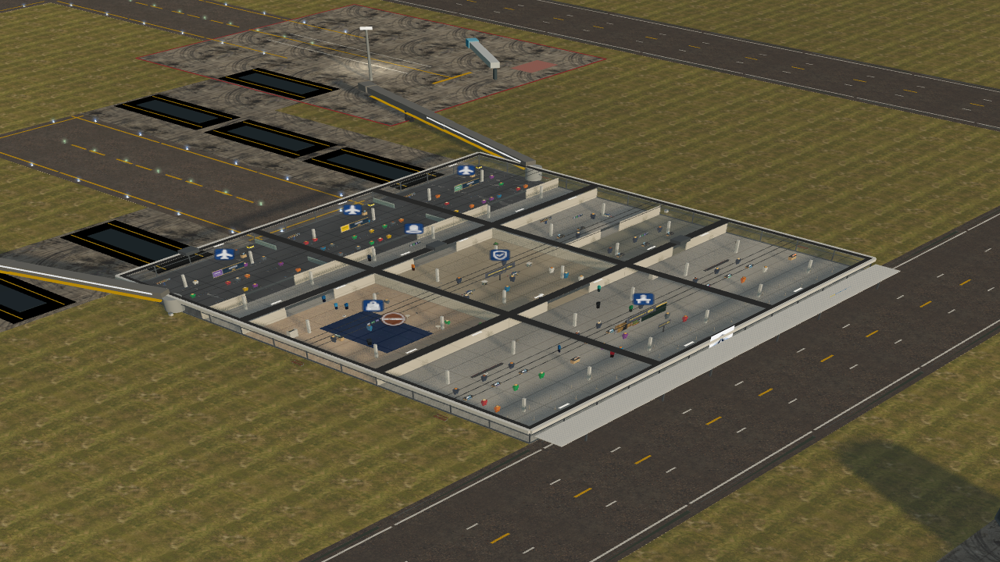
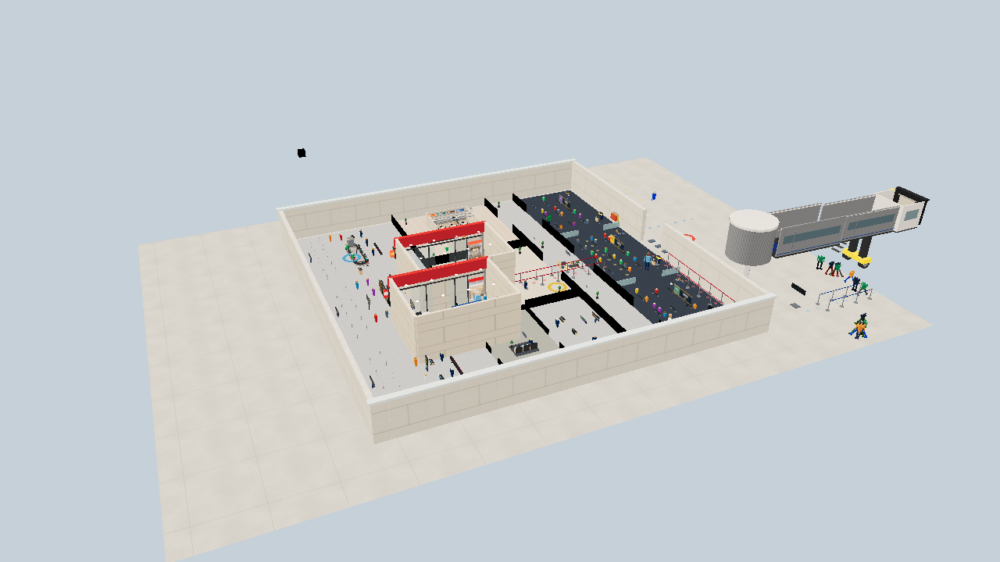
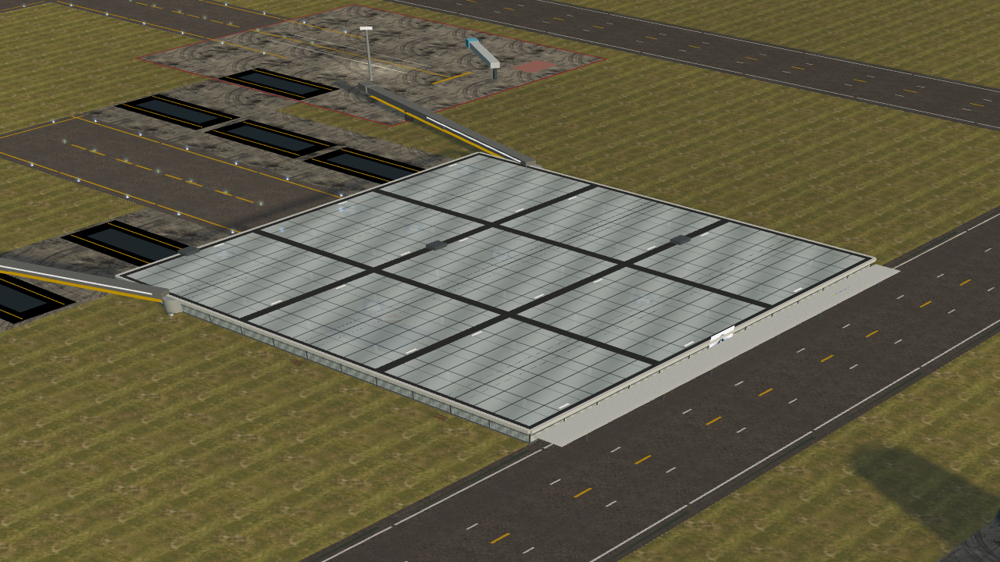
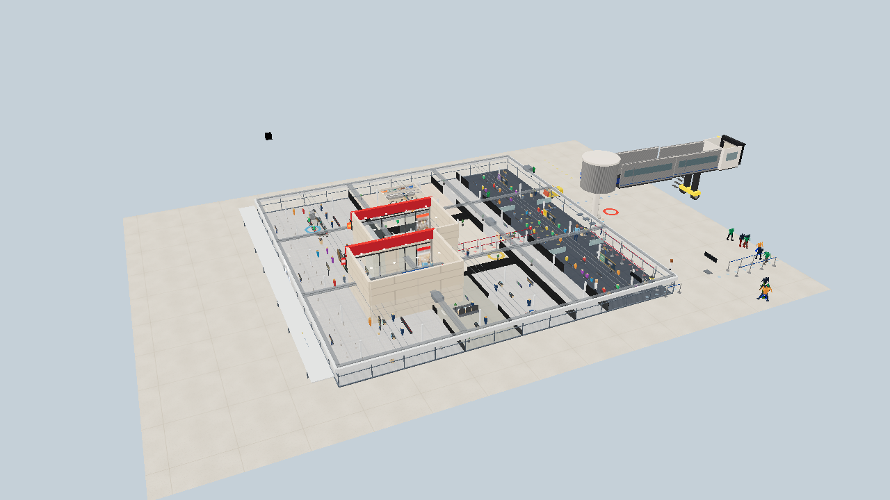

# Terminal view consistency

Airport view and Terminal view now draw the same terminal. The curtain-wall shell, roof, landside entrance, and airside gate doors come from one mesh. Terminal view lifts that roof off. Airport view leaves the interior out of the render list.

Sim pathing and saves are unchanged. Openings live in `src/render/world/facade.ts` and both views read them.

## Stills

Starter passenger kit, graphics high, SwiftShader. Same camera for each pair.

| | Airport | Terminal |
| --- | --- | --- |
| Before |  |  |
| After |  |  |

Close pair: [airport before](media/terminal-consistency/airport-close-before.png), [airport after](media/terminal-consistency/airport-close-after.png), [terminal before](media/terminal-consistency/terminal-close-before.png), [terminal after](media/terminal-consistency/terminal-close-after.png).

Before, Terminal view was a beige plaster box around a different footprint. Airport view was the glazed grid, and a close camera still drew the rooms through the glass.

After, Terminal view is that glazed shell with the roof cut away. The entrance is the landside bay. The jet bridge sits on the middle airside gate door. Airport view is the same shell with the roof on and the interior not submitted.

## Airport view GPU

One `renderer.render` after `info.reset()`, starter field, high graphics. Close is orbit distance 36 on the hall (LOD 0, the range that used to fade the interior in). Wide is distance 92.

| View | Draw calls | Triangles |
| --- | ---: | ---: |
| Close, before | 272 | 263,114 |
| Close, after | 88 | 129,925 |
| Wide, before | 265 | 227,210 |
| Wide, after | 124 | 124,578 |

Close airport view drops 184 draw calls and 133,189 triangles. `TerminalBuilding.counts().interior` is false in that frame, so the room floors, props, and agents are not in the render list. The shell and roof still draw.
