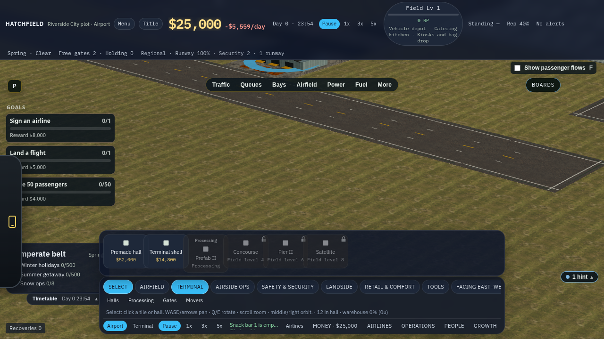
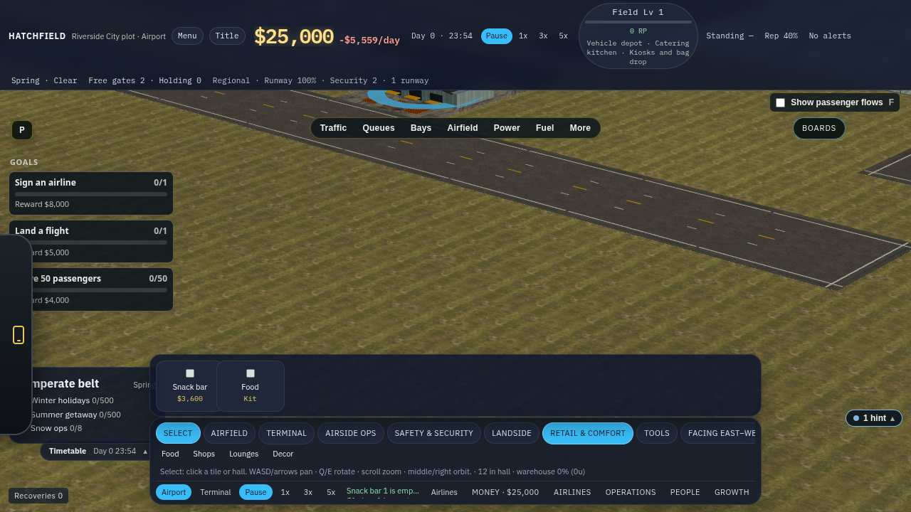
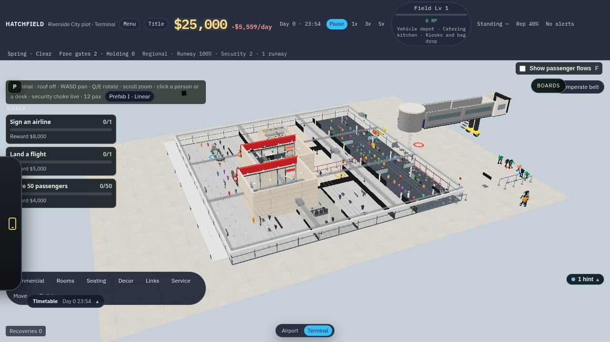
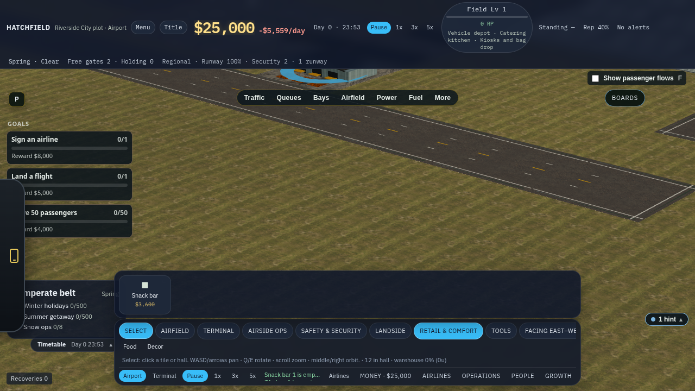
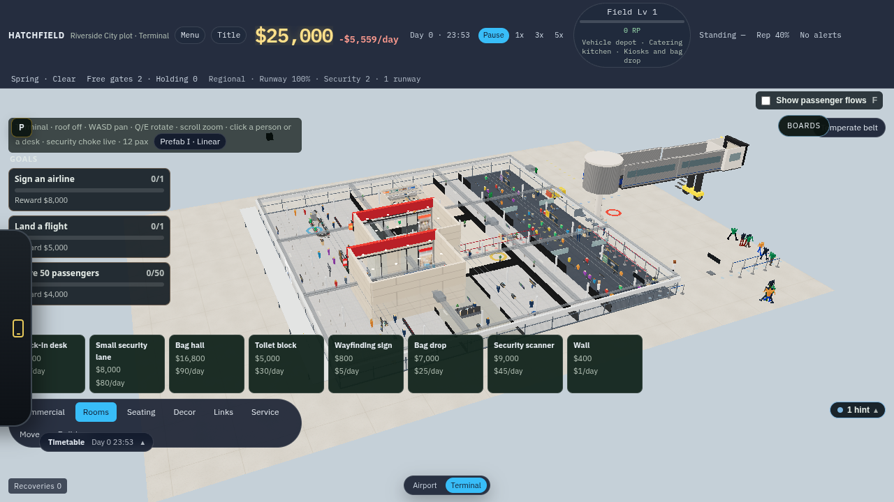
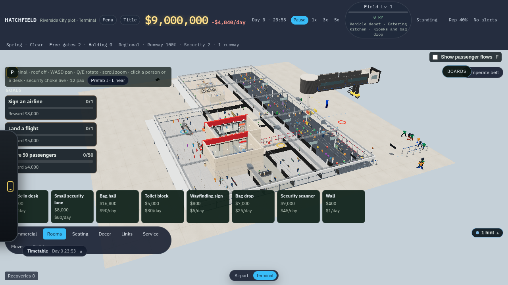

# Terminal shell and interior palette

Airport view builds the terminal shell. Terminal view furnishes the inside of that same shell. Expanding the shell on the apron adds interior floor.

## Quirks found

1. **Interior stamps sat on the airport build bar.** Terminal → Processing offered Check-in and Security, Gates was only a hall kit, and Retail offered Food, Shops, Lounges, and Decor. Each one opened the hall kit and walked the player inside. Rooms, desks, and shops were available while looking at the airfield.

2. **Terminal view had no switched palette.** The airport dock was removed entirely in Terminal view (`inHall ? null`), including a dead branch that still talked about apron tools. The interior kit bar was a separate control, easy to miss, and it was not the same menu with the exterior tools taken out.

3. **The playable hall was a fixed 48×32 m box.** Zone grids are 8×5 (or a prefab scheme). `hallFitFor` scaled whatever shell you had built so it fitted that box. A larger footprint got a smaller scale. Floor area in Terminal view did not grow.

4. **You could not expand a shell.** `placeTerminal` always required a clear 2×2 and `finishSite` always pushed a new hall. Adjacent terminal tiles merge into one exterior cluster, but each stamp was its own fit. Two halls could then show the same merged building. `hallFootprint` still assumed a 2×2 or 3×3 from the origin and ignored tiles beside it.

5. **A shell that would join two halls was not refused.** The next 2×2 that touched both clusters became a third hall and one exterior mesh.

6. **The legacy beige hall shell is still there when a hall has no room plan.** The room-plan path uses the curtain wall. Empty or unsynced halls still draw the old 48×32 plaster box.

## What changed

- Airport build groups drop interior kit stamps. Gates, Shops, and Lounges leave the apron bar because they had no exterior tool. Snack bars, shells, belts, and the rest of the airfield stay.
- Terminal view keeps the kit bar: Commercial, Rooms, Seating, Decor, Links, Service. Apron tools are not on it. Entering the hall clears the apron tool.
- Stamping a 2×2 against one existing shell extends that hall (`expand`) and charges the shell price. The original stamp keeps its scale and centre. New apron cells append zone columns or rows at the same cell size, so the interior floor gets larger and old cells stay put. A 2×2 that would join two halls is refused.
- Saves without `floorExtra` keep the 48×32 m floor.

Passenger walking on the new wing still uses the hall's existing nav box. The new cells are bare floor the player paints and furnishes.

## Stills

Starter passenger kit, graphics high, SwiftShader.

| | Airport terminal bar | Airport retail bar | Terminal kit |
| --- | --- | --- | --- |
| Before |  |  |  |
| After |  |  |  |

After an expansion on the apron, Terminal view is the same hall with a longer floor: .
