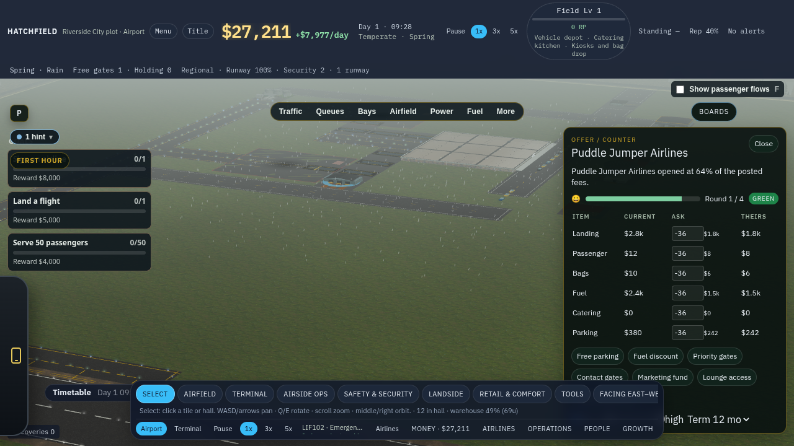
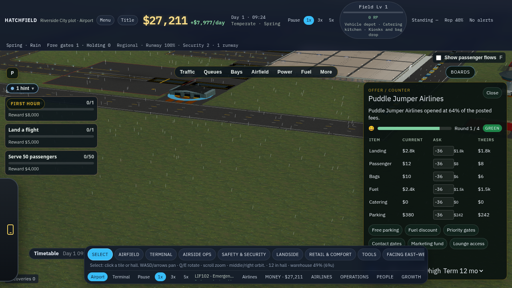
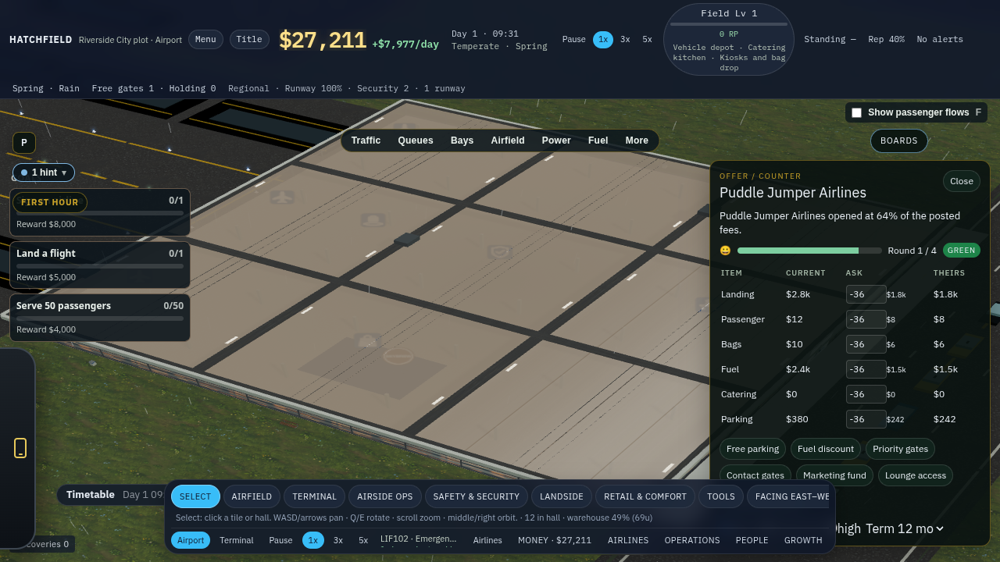
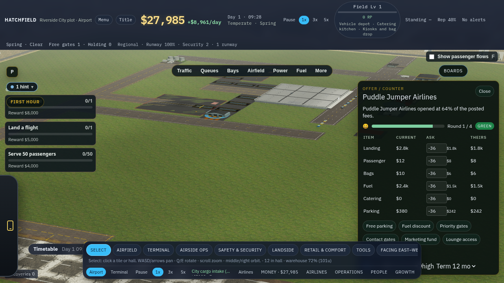
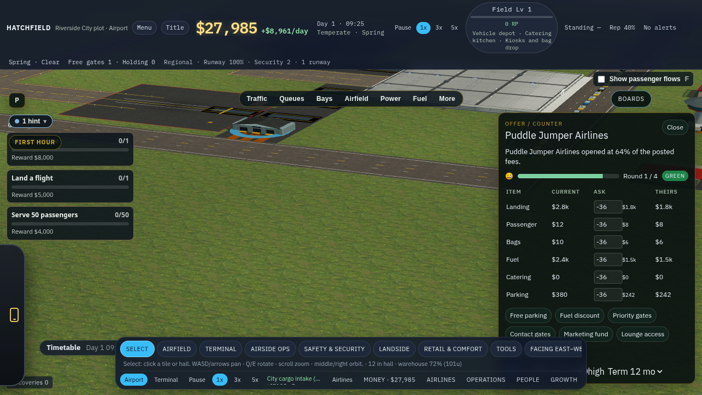
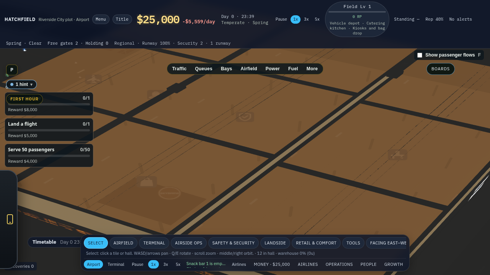
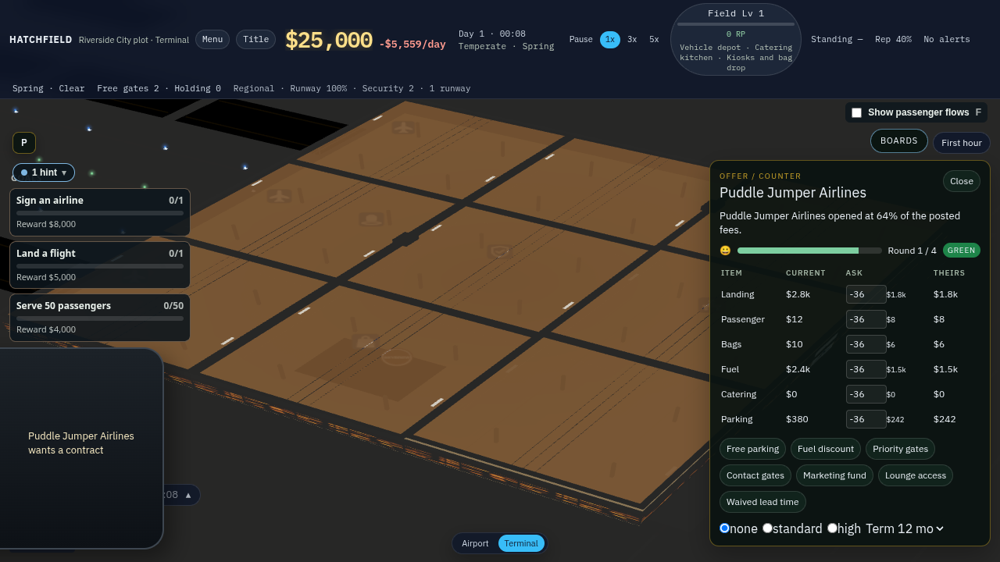
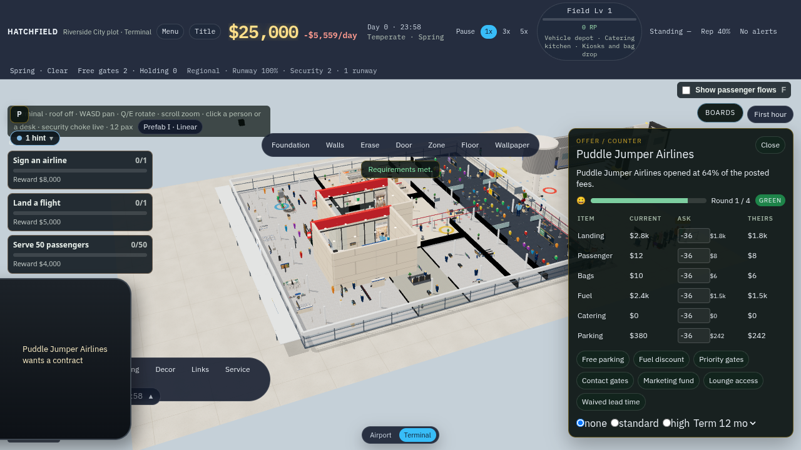

# View budget and the roof beat

Airport view keeps full aircraft and vehicle meshes at every zoom the player can reach. Terminal view does not draw that scene. The hall uses the same graphics preset as the apron, including its shadow map. Nothing reads frame time to drop LOD, textures, or shadows.

Max-zoom fps is a log only: `[view-budget] max-zoom N fps (reference only)`. Trever reports lag in playtest if the desktop frame rate is short.

## Frame rate

Reference desktop in `docs/PERF_BUDGET.md` is an i7-14700KF and RTX 4070 Super at 1920×1080, 60 fps. This machine is SwiftShader. The number below is not that desktop.

Starter passenger kit, graphics high, apron orbit at distance 280 (the far cap):

**about 3–4 fps** on SwiftShader (samples 3.9, 3.6, and 3.2). Logged only, and the preset stayed high. At that distance main draws the cheap aircraft shell. This change keeps the high and mid meshes.

## Stills

Retaken from the running game after the rebase onto main (terminal round 5 and the later landings). Same new game, graphics high. Before is current main without this change. After is this branch.

| | |
| --- | --- |
| Before, max zoom |  |
| Before, distance 140 |  |
| Before, roof seated |  |
| After, max zoom |  |
| After, distance 140 |  |

Distance 140 used to sit in the cheap aircraft band. The before still at that distance is the cheap shell. The after still keeps the fuselage, gear, and engines on the full mesh. The cheap silhouette only replaces the body past 8000 world units, which the orbit never reaches. Vehicles use that same distance.

| Entering | Leaving |
| --- | --- |
|  |  |

Entering lifts the roof in four sections while the camera dollies in. Walls stay up. Leaving drops those roof sections and snaps the walls up from the slab. The beat is 1.25s. A click or key after a short grace skips it. The sim view changes when the beat ends. `setView` is still immediate for tests, bots, and saves.

Terminal view after the beat, with the hall shadow map on: 

Clip: [transition.webm](media/view-budget/transition.webm)
