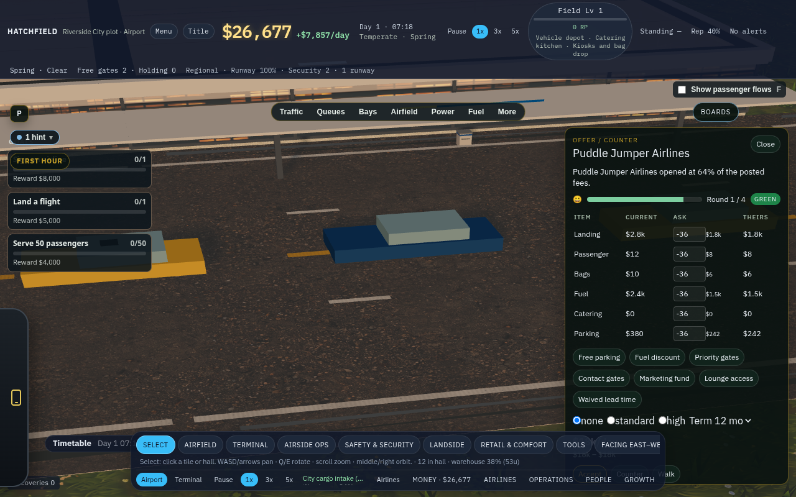
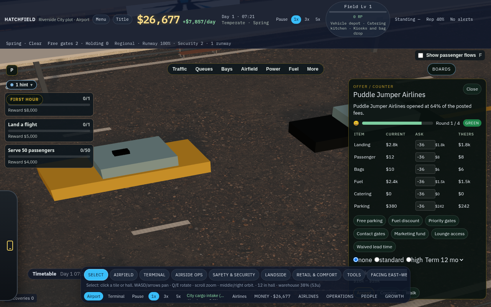
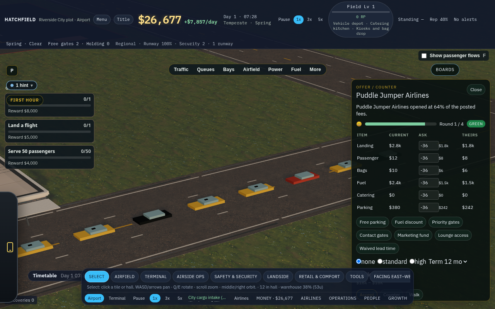
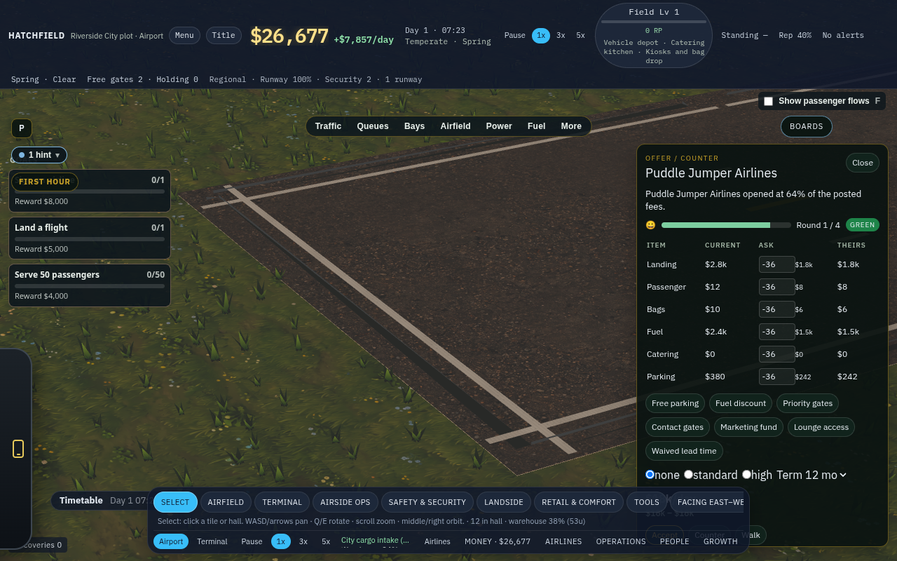
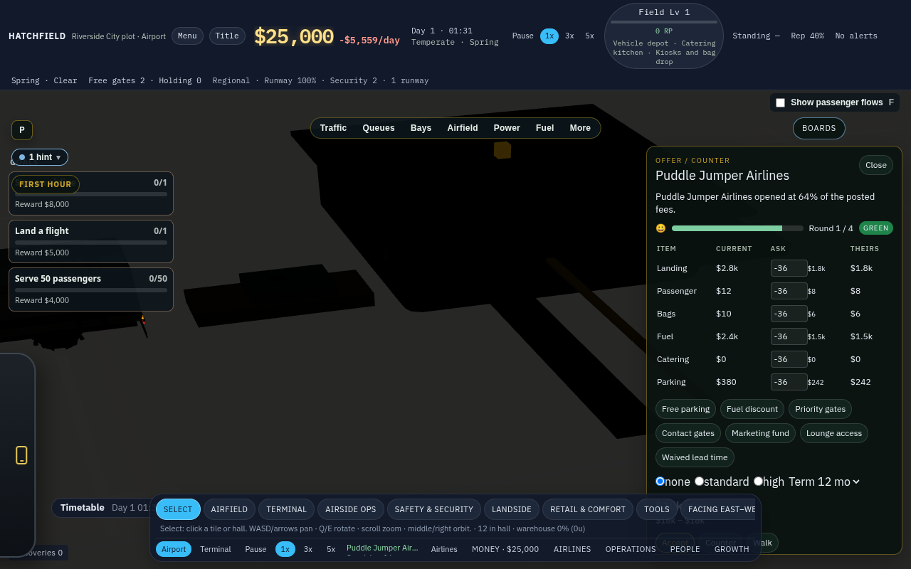
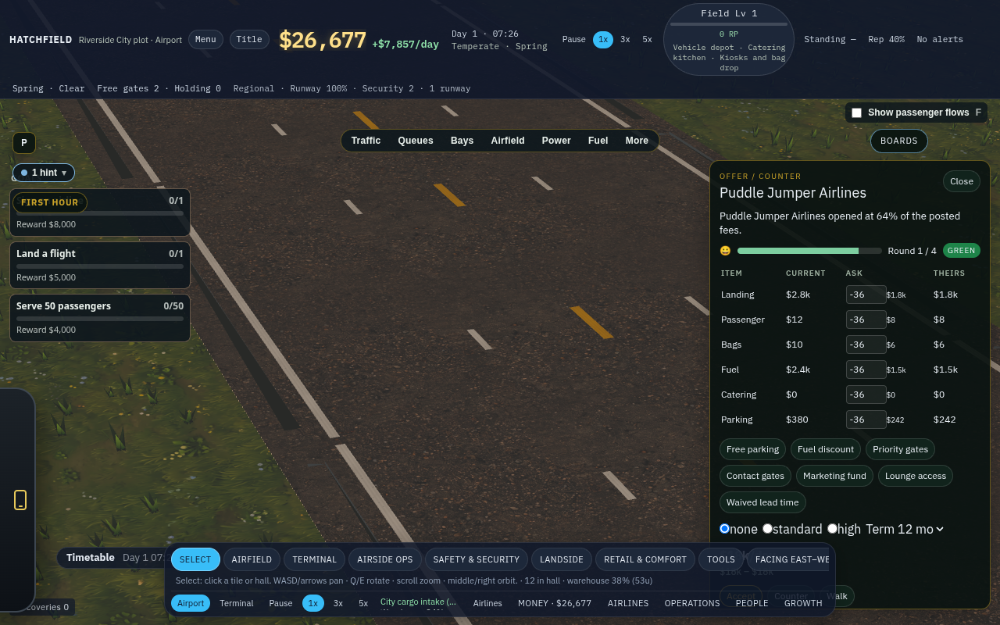
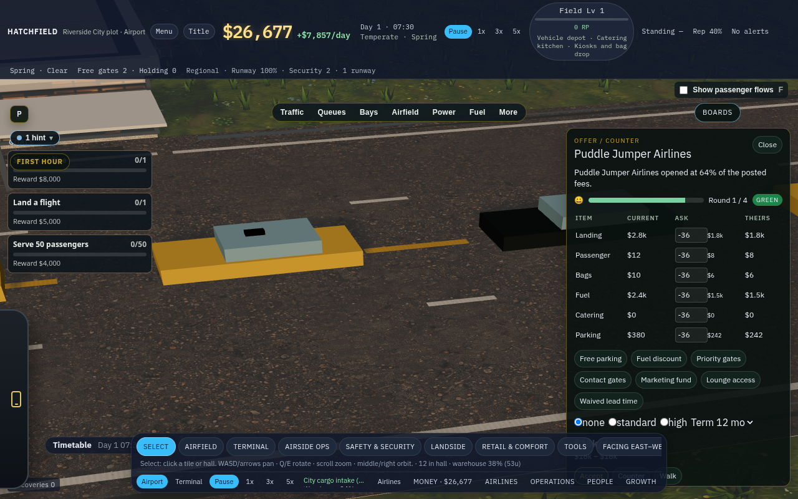

# Road traffic audit — 15 Oct 2026

Read-only look at `main` (`72436e06`) after the owner's playtest. No game code changed. Apron stand collisions are out of scope; agent `bc-3d53b71e` has that. This pass is the public road, the curb, and the service roads.

The starter field has one north–south public road on column 17, a guard post in that road at row 2, and two service roads (row 4 north of the hall, row 14 south of it). Cars, taxis and buses are not on that graph. They are a count, plus up to 14 meshes slid along one polyline through the cell centres. Service trucks are a second driver on the same cells, and they do not see the cars.

Recommendation up front: one directed road graph, shared by cars and road trucks. Keep the curb stall count and the guard as a stop. Throw out the centreline drawer and the "slow down when someone is nearby" truck step. **Driving side is a choice for the owner.** Thailand drives on the left. The only lane offset in the repo today is keep-right, and it does not run on this road. Do not paint arrows until that constant is set.

Stills are in `docs/devlog/media/traffic-audit/`. They are from a passenger starter on `?playtest=1`, driven through `window.__hatch` (`buildStarterKit`, `tick`, `landsideView`, `spawnTruck`).

## Verdicts

| # | Claim | Verdict |
|---|---|---|
| 24 | Traffic sits in front of the terminal and does nothing | **Partly right.** At 54 sim-seconds all 14 drawn vehicles are stopped on the hall face. They do dwell, then creep south and despawn. The curb never looks clear. |
| 25 | Cars drive down the middle, dead ends have no U-turn, the roads need a rework | **Right.** Every car is on column 17.000. The south end adds two cells of grass instead of turning. Lane paint is decoration. |
| 26 | The guard should sit between public traffic and airside, and service vehicles should come through it | **Partly right.** City cargo and contractors do stop at the post. Fuel bowsers, bag tugs, and the cars do not. The post is a tile in the public road, not a gate. |
| — | Vehicles drive into each other with no right of way | **Right**, on this road. Cars keep an 8 m file. Trucks do not stop, and they do not know the cars exist. A city truck was measured 0.74 m from a car. |

## 1. Two drivers, one carriageway

`LANDSIDE` says what it is (`src/landside/config.ts:1-9`): a capacity model, not a street sim. The cars that are drawn still have to enter, dwell, and leave. That second sentence is the whole visible behaviour.

| | Landside cars | Legacy road trucks | Depot fleet (`ApronTraffic`) |
|---|---|---|---|
| Who | Cars, taxis, buses | City cargo, contractors, fuel bowsers, bag tugs, catering | Fuel trucks and the rest, only after a vehicle depot |
| Path | One polyline, cell centres (`engine.ts:223-236`) | Undirected A* on walkable tiles (`path.ts:41-66`, `path.ts:207-218`) | Undirected graph of the same tiles (`logisticsBridge.ts:105-120`) |
| Lanes | None. `lanes` is a flow number (`network.ts:161-181`) | None. Position is the lerp of two cell centres (`sim.ts:24891-24894`) | Keep right, 3.2 m (`traffic.ts:8-9`, `traffic.ts:33`, `traffic.ts:257-260`) |
| Yield | Follow gap only, and only while not leaving (`engine.ts:446-451`, `engine.ts:421-425`) | Speed drops when something is within 1.15 cells (`sim.ts:24533-24572`, `sim.ts:24869-24871`) | Earlier dispatch goes first (`traffic.ts:9-12`) |
| On the starter | Always | Always | Off. The graph is null until a depot and a farm both exist (`logisticsBridge.ts:79-92`). The starter has a farm and no depot |

The depot fleet is the apron audit's driver. It is named here only so it is not mistaken for the road. A depot does not fix the curb: those vehicles still ignore the cars, and their graph is bidirectional.

## 2. What the starter road actually is

Passenger kit, `src/game/starterLayout.ts:122-130`:

- Public road: column 17, rows 0–12, except row 2, which is the guard.
- North service road: row 4, columns 7–16, meeting the public road at (17, 4).
- South service road: row 14, columns 8–17. Row 13 is grass, so this road does not touch the public road.
- Hall: columns 14–16, rows 8–10. The curb is the three road cells touching it, (17, 8–10).

`pickEntry` takes the border cell with the smallest row (`network.ts:36-40`), which is (17, 0). `approachPath` walks to the first frontage cell (`network.ts:72-100`). With the guard passed in as a connector (`sim.ts:6988-6989`), that walk is (17, 0) … (17, 8), **through the guard**. `exitPath` refuses to go back up the inbound cells (`network.ts:115-124`) and, if it finds no border, extends two cells past the pavement (`network.ts:147-158`). On this kit that extension is (17, 13) grass and (17, 14), the disconnected south spur.

Measured on that field, before any rendering:

- `lanes` 1, `curbStalls` 3, pressure 0.23, arrivals 2.0 passengers a minute, about 1.5 vehicles a minute on the road.
- After 80 sim-seconds: 14 vehicles, every `c` exactly 17, closest pair 8.00 m, states over the run mixed between drive, queue, stop and leave. Cars were on the guard cell in 56 of those samples.

The same 14-vehicle, all-stopped picture showed up in the running game at clock 54.2 s: 3 `stop` and 11 `queue`, rows 5.27–10, column 17.000, separation 8.00 m, `lanes` 1, `curbStalls` 3, pressure 0.227. That is the whole east face of the hall, plus the road north of it.

## 3. #24 — sitting in front of the terminal

**Partly right.** They are not a frozen bug. They are a queue that is much bigger than the curb, drawn on the only cells the player is watching.

The drawer ignores the arrival rate. `stepAgents` spawns another vehicle whenever fewer than `visualCap` (14) exist and the one nearest the city is at least `queueGapM` (8 m) ahead (`engine.ts:399-416`, `config.ts:52-53`, `config.ts:74-75`). Two passengers a minute would be about one car a minute. The drawer fills 14 vehicles in well under a minute, because each one only has to pull 8 m forward.

Three stalls (`stallsPerCurbCell` is 1, and three cells touch the hall: `config.ts:21`, `network.ts:203-207`) sit on rows 8–10. Everyone else waits behind them in `queue`. Dwell is 28 s for a car or taxi and 40 s for a bus (`config.ts:28-31`). At the 54 s mark the first wave is still inside that dwell, so the snapshot is 14 stopped vehicles and zero driving. Leave does happen: the headless probe recorded `leave`, and a later frame in the same session had already split into leave, drive and queue. They leave by driving south, off the end of the road, and despawn (`engine.ts:421-425`, `engine.ts:480`).

What makes it look like nothing:

- Parking, a bus bay and a taxi rank change the stall **count** only (`network.ts:203-207`). `stepAgents` never reads `parkSpaces`. No drawn car enters a lot or a rank.
- Passengers step toward the door for 4.5 s and then vanish (`engine.ts:484-510`, `config.ts:79`). They are not the hall crowd.
- The outbound path is the same three frontage cells, so a car that has "left" is still in front of the building until it passes row 10.

The capacity math and the picture disagree on purpose. Pressure 0.23 would not jam a real curb. `visualCap` jams this one.

## 4. #25 — middle of the road, no U-turn

**Right.**

`poseAt` interpolates the cell coordinates and sets the heading from the next cell (`engine.ts:223-236`). There is no lateral offset. In both the probe and the live session the column was exactly 17. `approachLanes` can report more than one lane when a parallel road runs beside the approach (`network.ts:161-181`), and a `curb_lane` stamp adds one to that number (`network.ts:202`). The mesh path is still the one polyline.

The paint already pretends otherwise. `roadPaint` draws a yellow centre dash and a white dash either side (`src/render/world/layout.ts:822-850`). The white dashes sit `CELL * 0.16` off the centre. `CELL` is 22 m × 0.45 (`specs.ts:13`, `specs.ts:31-33`), so the dashes are about 3.5 m from the yellow line, not at the edge of the 22 m cell. Cars on the cell centre are on the yellow dash, between the white dashes.

Dead ends do not turn around. The comment on `exitPath` says a dead-end curb gets two cells of departure so cars do not turn around (`network.ts:115-118`). The starter road ends at row 12. Cars continue onto grass at row 13. Trucks that do go back reverse the point list in place (`sim.ts:27499-27507` and the same pattern for fuel at `sim.ts:27484-27492`). That is a spin on the cell, not a bulb.

There is no intersection object. A junction is two cells that share a side. Both drivers may use either direction. Nothing stores "this lane goes south".

## 5. #26 — the guard is not a gate

**Partly right.** The owner wants the post between public arrivals and the airside roads, with fuel trucks and contractors coming from the city through it. Today the post is a waypoint for two missions, and a normal tile for everyone else.

Where it sits. (17, 2) is on the public approach, north of the hall, not between the curb and the stands. The north service road joins at (17, 4), two cells **south** of the post. A vehicle that is already on the curb can reach that junction without passing the post again. The south service road has no post at all, and it is not connected to column 17 (grass at row 13). It reaches the apron through the bag building and the belts.

Who actually goes there:

| Vehicle | Route today | Through the guard? |
|---|---|---|
| Drawn car, taxi, bus | (17, 0) through (17, 2) to the curb, no stop (`engine.ts` has no guard state) | Drives through. Does not stop |
| City cargo | City edge → guard, dwell, then shed (`sim.ts:9530-9558`, dwell at `sim.ts:27518-27521`) | Yes, and it waits |
| Contractor and delivery | City edge → guard → site, when a guard exists (`sim.ts:21370-21408`, dwell `sim.ts:21454`) | Yes |
| Fuel bowser | Farm (7, 5) → taxi (7, 6) → stand (11, 6). `nearestPath` on the starter. The guard is not on it (`sim.ts:12778-12783`) | No |
| Bag tug | Bags (13, 13) → belts → stand. Guard not on it | No |
| Catering | Snack (19, 13) has no truck-walkable neighbour. `nearestPath` returns null. No truck | No |
| Road tanker | A vehicles-per-minute number, `fuelRoadLoad`, added to curb pressure (`sim.ts:6977`, `sim.ts:6999`). Not a mesh | No |

`walkableFor('truck')` treats `guard` like `road` (`path.ts:41-66`). Shortest path uses it when it is shorter, and skips it when it is not. Nothing is one-way, and nothing is forbidden to the public.

## 6. Right of way — road and landside only

**Right.** The cars do not pile through each other. Everything else on this road does.

Cars in `drive`, `queue` or `stop` keep `queueGapM` (8 m) behind the vehicle ahead (`engine.ts:446-457`). A 4.6 m car (`landsideTraffic.ts:17-18`) then has about 3.4 m of air. A 12 m bus does not: the gap is shorter than the bus, so a bus and the car behind it occupy the same space. Buses almost never spawn, because `kindFor` only picks one from the leftover of the car and taxi shares (`engine.ts:240-248`) and one bus is 30 passengers (`config.ts:32-33`), so the leftover is tiny. The hole is real. It is not what the starter shows.

`leave` skips the gap (`engine.ts:421-425`). With one dwell for every car and taxi, the lead vehicle finishes first and drives away, so this does not bite on the starter. A longer dwell ahead of a shorter one (a bus, or any future slow vehicle) gets driven through.

Trucks never yield. `followPath` moves every truck every tick. `congestionAt` counts jets, trucks and some walkers inside 1.15 cells and divides speed by `1 + 0.65 * n` (`sim.ts:24869-24871`). It does not stop the truck, and it does not look at `landsideView()`. Cars do not look at trucks. The two lists share column 17.

In the running game a city truck on `city_guard` was 0.74 m from a car, both at column 17, the car at row 1.56 and the truck at row 1.53. Later the same truck dwelled on the guard cell while a car was 2.5 m away, still on the same centreline. A second truck spawned at (17, 6) sits in the stopped file in the still below. The truck mesh is the game's own `spawnTruck` on the public-road cells.

`ApronTraffic` does reserve space and yield (`traffic.ts:1-18`). It is not this road. It starts only with a depot (`logisticsBridge.ts:178-179`), and even then its bodies are not the curb cars.

## 7. Fix plan

**Flag for the owner, before any of this is built:** left-hand or right-hand. Thailand drives on the left, which matches the rest of this airport. `ApronTraffic` already says keep right (`traffic.ts:8-9`, `traffic.ts:257-258`). One constant, `drivingSide: 'left' | 'right'`, default **left** unless the owner says otherwise. Lane arrows, the curb (the near lane is the drop-off) and the yield rule all read it. Do not fork the packages.

Four packages. Each one leaves `npm run gate` green and includes an in-game MP4 of the behaviour below, shot on the passenger starter. No package starts until the previous MP4 is in `docs/devlog/media/`.

| Package | What it touches | Done when | MP4 |
|---|---|---|---|
| 1. Directed lanes and a way out | Starter road and the landside polyline. A lane graph with a side, a centreline the cars are not on, and a loop or bulb at the south end of column 17 so the road is not a dead end. Service roads stay separate carriageways. Tunables stay in `config.ts` | A drawn car is about half a lane off the yellow dash. It reaches the south end and turns, instead of entering the grass at (17, 13) | One car from the city edge, along the curb, through the turn, and away |
| 2. Dwell, then leave | `LandsideTraffic` spawn and stalls. Spawn from `arrivalsPerMin`, not from `visualCap`. A stall is a stop: passengers out, then the outbound lane. A park, a bus bay and a taxi rank are places a vehicle goes, not numbers added to `curbStalls` | A quiet starter does not hold 14 stopped vehicles while pressure is under 1. One car stops at the hall, a passenger steps out, the stall empties, the car leaves | That one car, from arrival to out of frame |
| 3. Guard as the airside gate | Truck graph and the guard mission. Public lanes do not enter the post. City cargo, contractors, and the road tanker (today only `fuelRoadLoad`) go city edge → stop at the guard → service road → apron. Bowsers and bag tugs that already live at the farm and the bag hall stay airside. The south road cannot reach a stand without the post | `nearestPath` from (17, 0) to a stand includes the guard and a dwell. A car's path does not include the apron. The snack at (19, 13) is either on that road or not a truck goal | A contractor or a tanker through the post, and a car that stays on the public road |
| 4. One body list for this road | `followPath` and the landside file, on road and service-road cells only. Gap at least the vehicle's length. At the row-4 junction the later vehicle waits. Cars and trucks are in the same test. Apron stand traffic stays in `ApronTraffic` | A city truck and a queued car never close inside the sum of their half-lengths. The second arrival at the service-road junction waits | The truck meeting the car file, then the junction |

Package 1 without 2 still shows a queue, but the queue is in a lane and it can turn around. Package 2 without 1 still piles the curb onto one line. Package 3 without 4 lets the tanker drive through the cars it is now legally sharing the road with. Package 4 without 3 yields on a road that still has no gate. The footage is the gate between them: a green `npm run gate` with no MP4 does not close the package.
