# Morning playtest — 15 Oct

Measured on `d6aa69e5bb92deb70611c4e4f4a89fe3c54f2702` (`Hold stand, lounge and gate credit until a carrier has actually flown.`). No rules, prices, or relations weights were changed for this note.

Headless Careful, Greedy, and Chaotic each ran **90 sim days**. One day is 180 sim seconds. The driver uses the player command API at **5×**, tick dt **0.25s**, and looks at the board every **12 sim seconds**. Difficulty is standard, focus is passengers, sandbox is off. Persona decision seeds are Careful `0x5eed`, Greedy `0x6eed`, Chaotic `0xc0a0`. The field’s own `Math.random` was left unseeded, so a rerun will not match these dollars. Nothing was still stuck, nothing NaN’d, and there were no console errors or softlocks.

The browser pass is a production build (`vite build`, then `vite preview`) at **1×**. The timed session is the first **600 sim seconds** (10 minutes, about 3.3 game days) after the starter kit. Title, opening, research, Airlines Relations, and the fuel farm are from that session. The landing, apron, curb, building card, and livery frames were aimed on a second production opening of the same build, because the first pass could not point the camera. Those beats did happen inside the 600 seconds; the second opening is only there so the frame shows them. Livery close-ups are **posed** after that opening, one parked airframe per silhouette class, wearing a roster livery. They are not arrivals from the first 10 minutes.

## Headless, 90 days

| | Careful | Greedy | Chaotic |
| --- | ---: | ---: | ---: |
| Wall | 84s | 108s | 101s |
| Cash start | $168,000 | $168,000 | $168,000 |
| Cash end | $285,909 | $4,202 | $971 |
| Cash low | $5,855 day 3 | −$17,256 day 57 | $799 day 9 |
| Field rating, day 90 | 76 | 56 | 45 |
| Satisfaction avg | 71 | 67 | 67 |
| Flights turned | 493 | 374 | 421 |
| First landing | 43.8s PDJ101 | 42.5s PDJ101 | 80s LIF101 |
| Stands / terminal rooms | 4 / 9 | 6 / 9 | 17 / 36 |
| Shops leased | 5 / 5 | 8 / 8 | 6 / 58 |
| Carriers signed | 10 | 27 | 17 |
| Tree nodes bought | 62 | 62 | 62 |
| Tree points left | 395 | 82 | 12,779 |
| Could-not acts | 2 | 91 | 97 |
| Recoveries (still stuck) | 6 (0) | 9 (0) | 6 (0) |

Cash and rating through the run:

| Day | Careful cash | Careful rating | Greedy cash | Greedy rating | Chaotic cash | Chaotic rating |
| --- | ---: | ---: | ---: | ---: | ---: | ---: |
| 1 | $9,242 | 80 | $48,163 | 81 | $50,881 | 64 |
| 3 | $5,855 | 87 | $29,218 | 86 | $2,589 | 75 |
| 7 | $32,139 | 87 | $20,332 | 84 | $8,151 | 87 |
| 14 | $62,127 | 84 | $7,030 | 78 | $6,368 | 82 |
| 30 | $115,803 | 82 | $12,119 | 72 | $288,224 | 73 |
| 60 | $179,840 | 78 | $5,060 | 49 | $20,931 | 55 |
| 90 | $285,909 | 76 | $4,202 | 56 | $971 | 45 |

Day-1 cash is after the kit. Chaotic’s day-30 spike is loan and contract money; it does not stick. Greedy borrowed $365,000 and paid $279,353 back plus $69,897 interest. Chaotic borrowed the same $365,000. Careful did not take a loan.

### Relations

Tiers are counted on signed carriers at the end of day 90. “Preferred+” and “Trusted+” on the day rows below are cumulative (tier 2 or better, tier 3 or better).

| Day | Careful best | Pref+ | Trust+ | Greedy best | Pref+ | Trust+ | Chaotic best | Pref+ | Trust+ |
| --- | ---: | ---: | ---: | ---: | ---: | ---: | ---: | ---: | ---: |
| 1 | 2.9 | 0 | 0 | 2.9 | 0 | 0 | 0 | 0 | 0 |
| 30 | 22.8 | 1 | 0 | 24.3 | 1 | 0 | 10.6 | 0 | 0 |
| 60 | 46.3 | 3 | 2 | 70.1 | 4 | 3 | 49.5 | 2 | 1 |
| 90 | 73.1 | 5 | 3 | 97.7 | 10 | 4 | 96.1 | 6 | 3 |

**Careful** ends with two Priority, one Trusted, two Preferred, five Published. Nobody reached Flagship.

| Carrier | Tier | Score | On time | Delayed | Kept | Fines |
| --- | --- | ---: | ---: | ---: | ---: | ---: |
| Zoomjet | 4 Priority | 73.1 | 0 | 26 | 89 | 36 |
| SkyCheap | 4 Priority | 71.3 | 0 | 14 | 75 | 22 |
| Puddle Jumper Airlines | 3 Trusted | 63.7 | 3 | 37 | 90 | 47 |
| Cityhopper | 2 Preferred | 42.2 | 0 | 17 | 70 | 26 |
| Alpine Swift | 2 Preferred | 31.3 | 0 | 30 | 73 | 39 |
| Harbor Heli | 1 Published | 19.2 | 0 | 0 | 88 | 11 |
| Island Heli | 1 Published | 18.9 | 0 | 0 | 86 | 10 |
| Medevac One | 1 Published | 18.5 | 0 | 0 | 83 | 9 |
| Rotorlink | 1 Published | 18.0 | 0 | 0 | 81 | 9 |
| Skyline Rescue | 1 Published | 17.4 | 0 | 0 | 78 | 9 |

**Greedy** ends Flagship / two Priority / one Trusted / six Preferred, and 18 still Published. The Published list includes five helicopters with no turns, plus Pacific Isles −3.0, Coral Coast −4.2, and Prestige Air −7.2.

| Carrier | Tier | Score | On time | Delayed |
| --- | --- | ---: | ---: | ---: |
| Puddle Jumper Airlines | 5 Flagship | 97.7 | 2 | 14 |
| Zoomjet | 4 Priority | 88.7 | 0 | 10 |
| Alpine Swift | 4 Priority | 76.2 | 0 | 10 |
| SkyCheap | 3 Trusted | 50.4 | 1 | 6 |
| Savanna Air | 2 Preferred | 33.9 | 0 | 5 |
| Brisa | 2 Preferred | 25.7 | 1 | 3 |
| Kauri Air | 2 Preferred | 25.4 | 0 | 4 |
| Cityhopper | 2 Preferred | 24.2 | 0 | 3 |
| Outback Link | 2 Preferred | 23.6 | 0 | 2 |
| Borneo Wings | 2 Preferred | 22.6 | 0 | 4 |

**Chaotic** ends Flagship / Priority / Trusted / three Preferred, and 12 Published. Prestige Air is Published at −12 with no turns. Brisa is Published at −6.1 with four kept days and no turns.

| Carrier | Tier | Score | On time | Delayed |
| --- | --- | ---: | ---: | ---: |
| Puddle Jumper Airlines | 5 Flagship | 96.1 | 0 | 22 |
| Zoomjet | 4 Priority | 88.5 | 2 | 37 |
| Alpine Swift | 3 Trusted | 55.1 | 0 | 11 |
| Cityhopper | 2 Preferred | 37.6 | 1 | 5 |
| SkyCheap | 2 Preferred | 28.8 | 0 | 5 |
| Savanna Air | 2 Preferred | 20.0 | 0 | 3 |

On-time turns are rare for everyone. Zoomjet’s Careful book is 0 on time and 26 delayed at Priority. Puddle Jumper’s Greedy book is 2 on time and 14 delayed at Flagship.

### Research

All three bought the whole 62-node Growth tree, plus the desk nodes that were affordable (Careful 20, Greedy 22, Chaotic 20). Wave 3 research points stayed at 0. Careful’s lab is one desk, one board, one machine, and 395 tree points are left over. Greedy has 82 left. Chaotic furnished 8 desks, 18 boards, and 15 machines, finished the tree around day 38, and is holding **12,779** unspent tree points at day 90.

### Penalties

Penalty categories only. Field-ask fines posted at the full ask amount were **$0** for every persona. Amounts are cash out.

| Category | Careful | Greedy | Chaotic |
| --- | ---: | ---: | ---: |
| Missed connection | $608,220 | $572,164 | $414,780 |
| Penalties | $40,377 | $92,170 | $47,681 |
| Emergency refuse | $36,800 | $46,800 | $45,200 |
| Crash fine | $0 | $69,933 | $84,000 |
| Security shock | $9,600 | $29,300 | $12,700 |
| Task miss | $0 | $0 | $0 |
| Inbound fine | $0 | $0 | $0 |
| Cargo miss | $0 | $0 | $0 |
| **Penalty total** | **$694,997** | **$810,367** | **$604,361** |

Missed connections are 88% of Careful’s penalty bill, 71% of Greedy’s, and 69% of Chaotic’s. Careful’s landing fees over the same 90 days were $829,846, so the connection bill is in the same league as the landing revenue.

## Browser, first 10 minutes at 1×

Production preview, sandbox off, passenger start, starter kit, opening contract accepted. Clock at the end of the timed session: **600.7s**. Cash **$68,106**. Field rating **76 Solid**. Flights turned: **7**. One carrier signed: Puddle Jumper Airlines, score **+0.36**, tier **1 Published**. Desk research points: **32**. Growth-tree points: **0**. No page errors.

In that timed session the first landing was PDJ101 (CRJ-700) at **20.7s**, cash $34,157, rating 72. A serviced turn was on the apron at **52.7s** (one aircraft in deboard/service/board, two turnaround pieces, two trucks on a flight). The curb had **14** cars and taxis, all stopped or queued, by **40.7s**.

### Opening

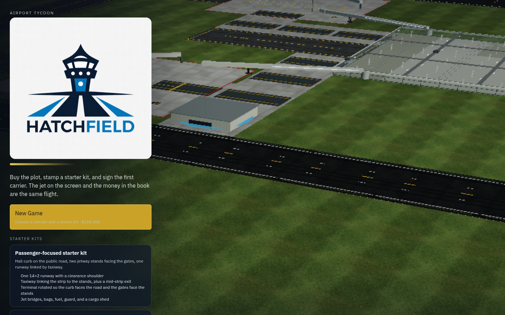

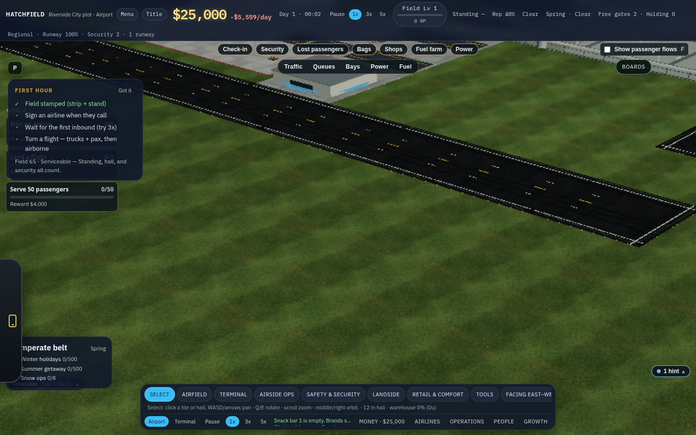

### First landing

The framed shot is a second opening: PDJ101, an ATR 72, on short final at 18.6s with the gear down. The timed session’s first landing was the same flight number on a CRJ-700 at 20.7s.

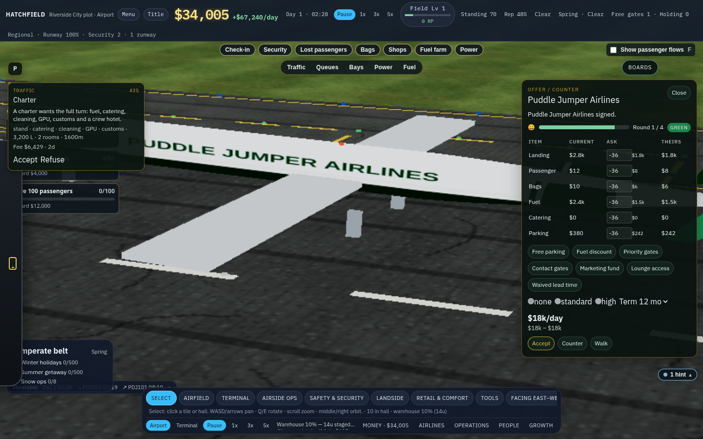

### Busy apron

Second opening, 43.6s: a turn on stand with a fuel tanker and a bag tug assigned (two trucks on the flight). The timed session’s first serviced turn was at 52.7s.

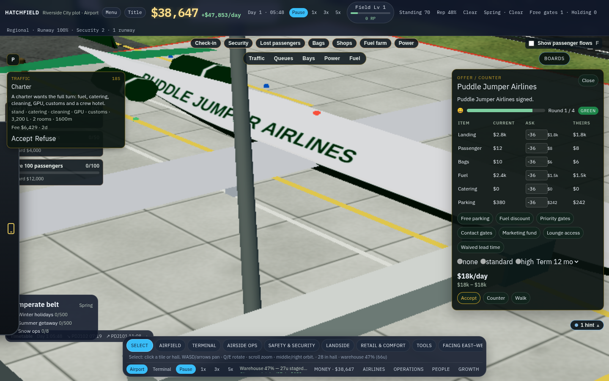

### Curb

Second opening, 37.6s: cars and taxis queued on the terminal road. The timed session peaked at 14 vehicles by 40.7s.

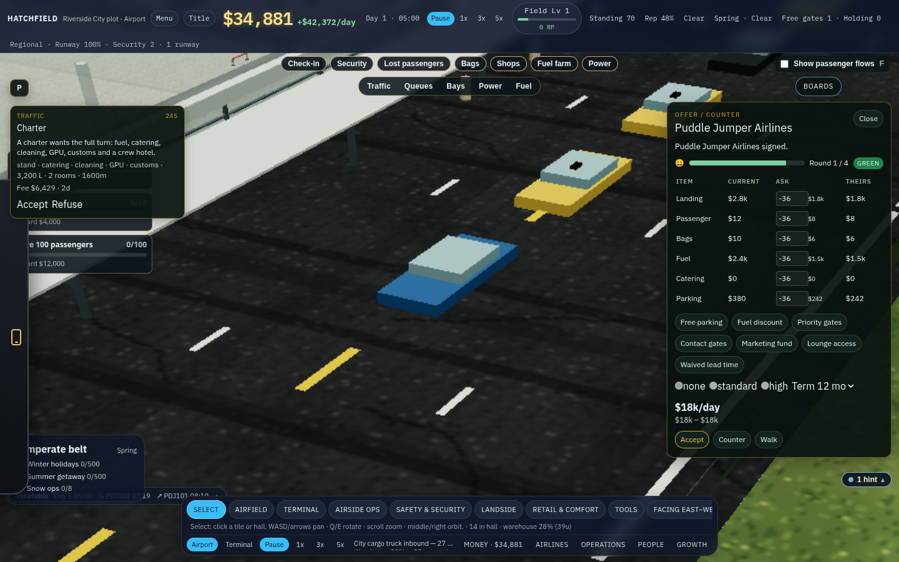

### Research tree

Growth → Research tree, at the end of the 600 seconds. The tree shows 0 points. The airfield nodes are still locked. Desk points (32) do not appear as tree points.

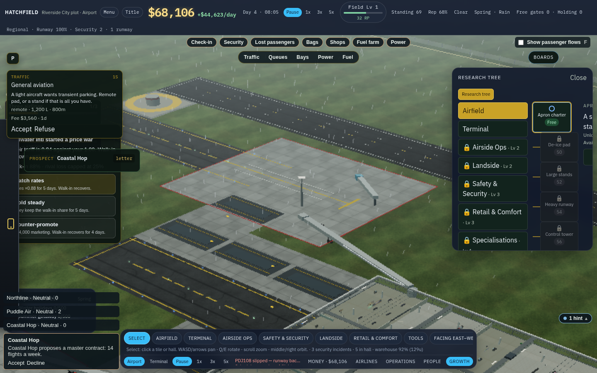

### Airlines Relations

Airlines → Letters → Relations, same session. One signed carrier. Puddle Jumper is Published at about +0.4, with the day’s parts listed (on-time, kept days, spare stands, delays, fines).

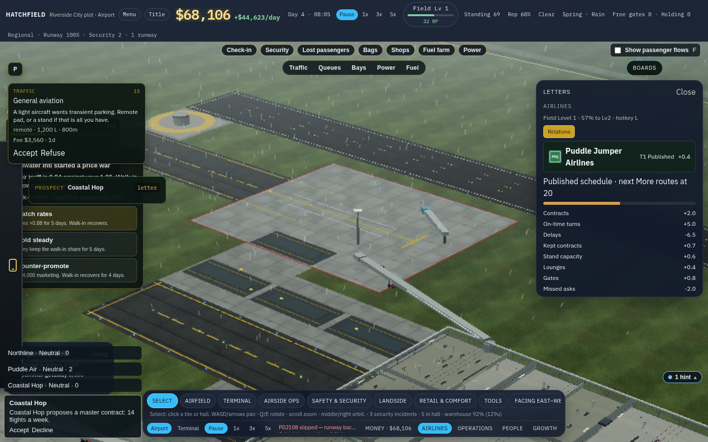

### Fuel farm

The fuel panel open on the starter farm during the timed session. The delivery line was waiting on cash while the cash bar showed about $68,000 and the tank read empty.

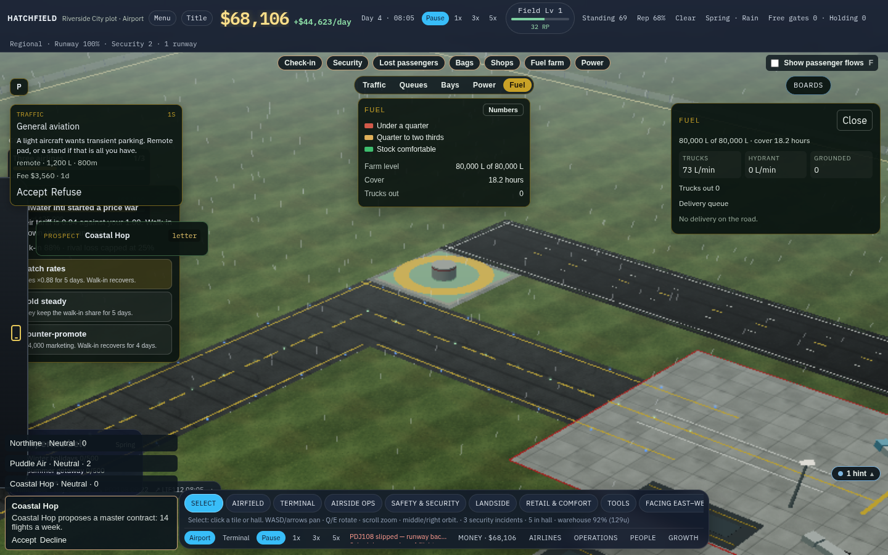

### Building info card

Medium stand, status Working. Throughput, bays, upkeep, and staff stay behind the row until opened. Captured on the second opening, on a stand that was turning an aircraft.

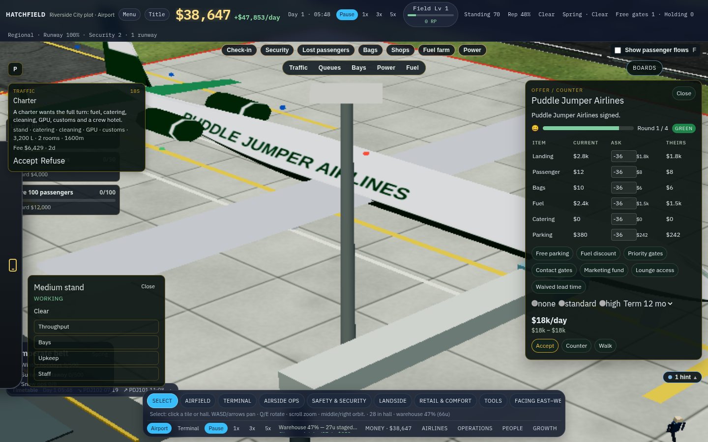

### Livery close-ups

Posed parked airframes after the opening, not traffic from the first 10 minutes. One per silhouette class, in a roster livery.

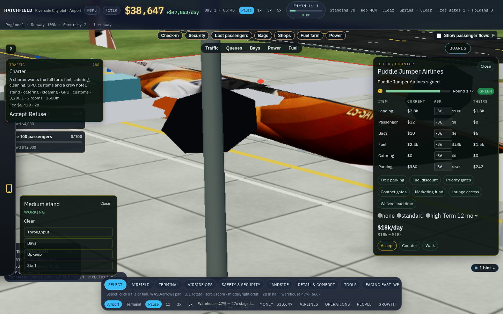

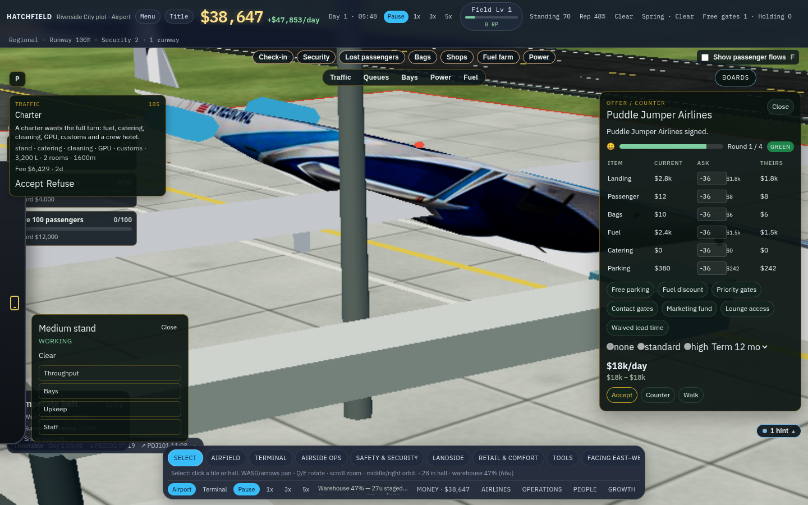

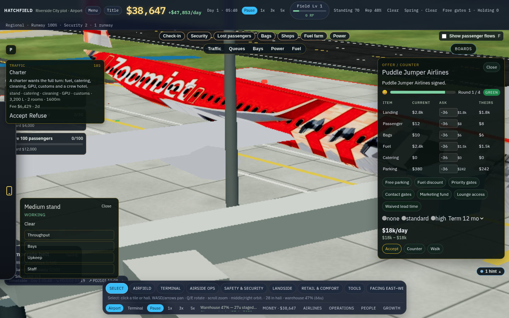

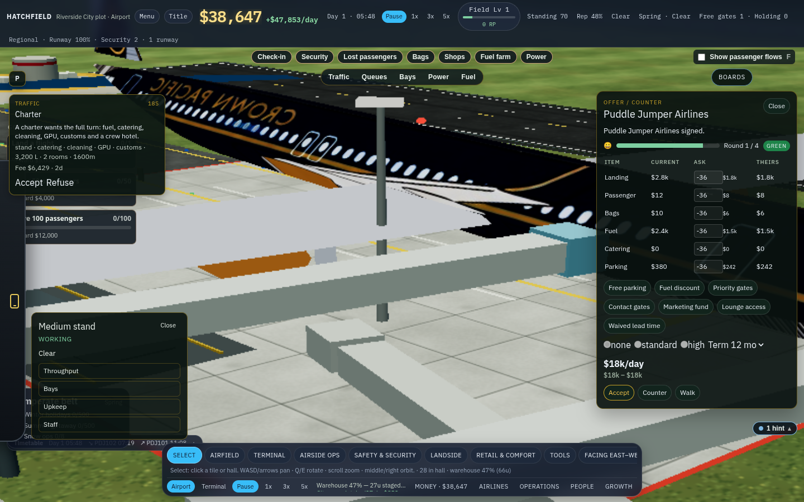

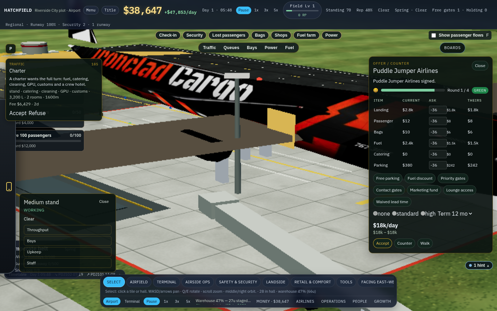

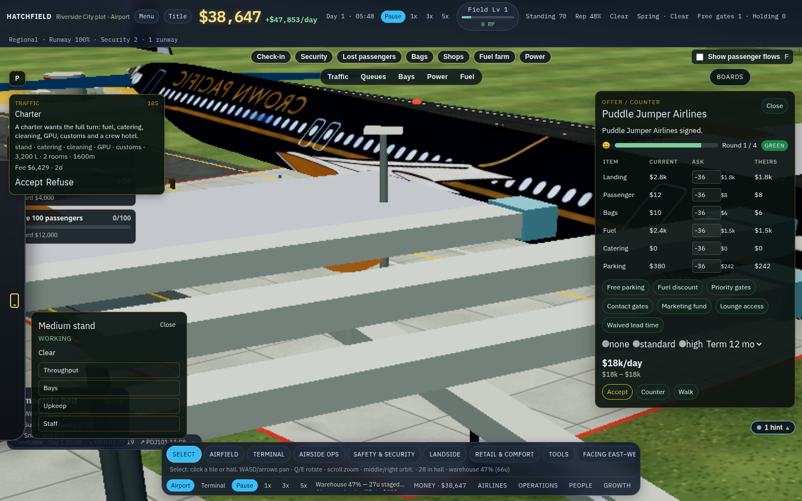

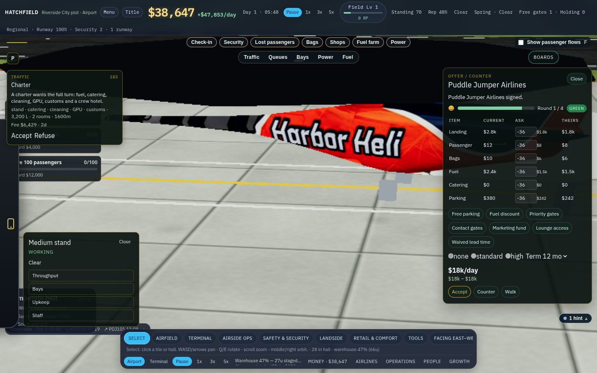

## Top 5 fun / feel

1. **The schedule is late, and the relationship still climbs.** Across 90 days the flying carriers are almost all delays. Careful’s Zoomjet is 0 on time and 26 delayed and ends Priority. Greedy’s Puddle Jumper is 2 on time and 14 delayed and ends Flagship. Kept days and the building do the climbing. A flagship carrier does not feel like an airline you run well.

2. **The penalty you pay is not the penalty you can see.** Missed connections are $414k–$608k and most of the fine bill. Crash fines show up only for Greedy and Chaotic. Field-ask fines are $0. The apron, the stand card, and the curb never point at the connection bill, which is large enough to rival landing fees.

3. **Careful gets rich. Building does not.** Everyone is under $10k within a few days of a $168k start. Careful then climbs to $286k and holds a 76 rating by doing less. Greedy finishes at $4,202 after loans, with the rating down at 56. Chaotic stamps 36 terminal rooms and 58 shopfronts, leases 6 of them, and finishes at $971 with a 45 rating. The fun loop of “place more airport” is how the other two go broke.

4. **Research is empty, then finished.** At 10 minutes the Growth tree has 0 points and every node locked, while 32 desk points sit somewhere else. By day 38–80 all three personas have bought all 62 tree nodes. Chaotic then stockpiles 12,779 points on a lab of 8 desks, 18 boards, and 15 machines. There is no middle stretch where research is the thing you are working on.

5. **The picture and the books describe different airports.** At one minute the curb is a line of cars, and at 10 minutes it still is, but the 90-day curb pressure never goes above 0.8 and the scored curb queue stays 0. Five helicopter carriers sit on Careful’s relations list for 78–88 days with zero flights. The stand card says Working and hides throughput, bays, upkeep, and staff until you open each row. What you watch in the first hour is not what the day-90 numbers say was wrong.
